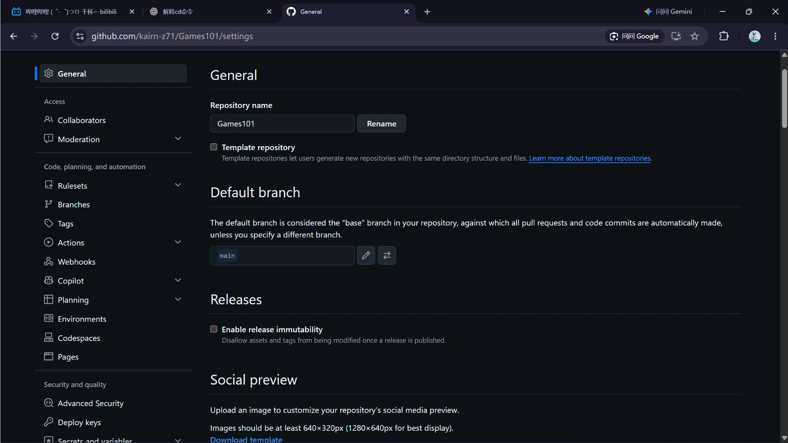
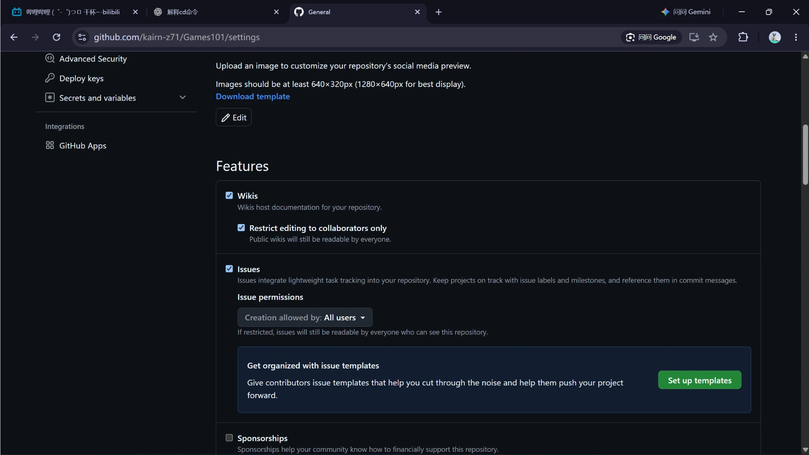
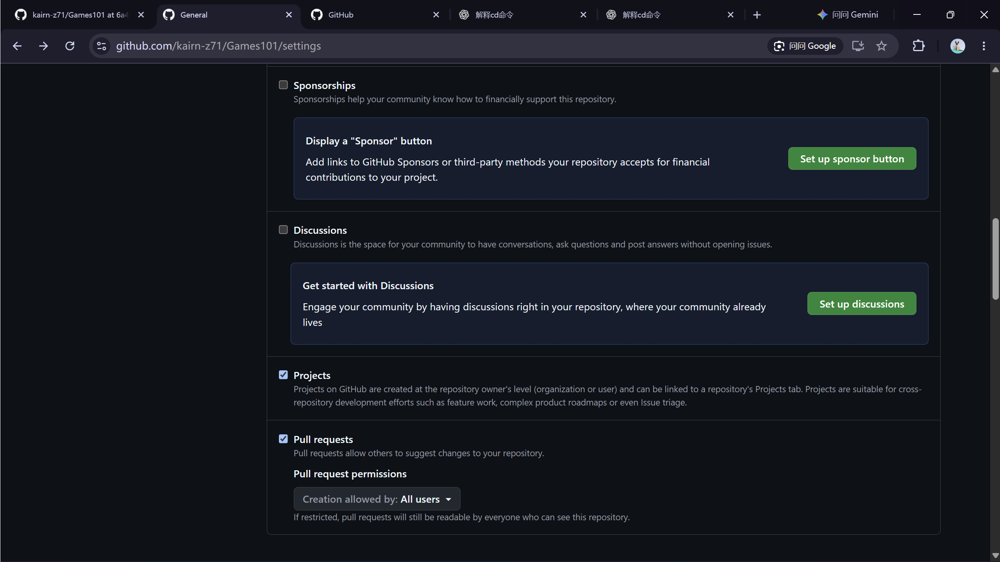
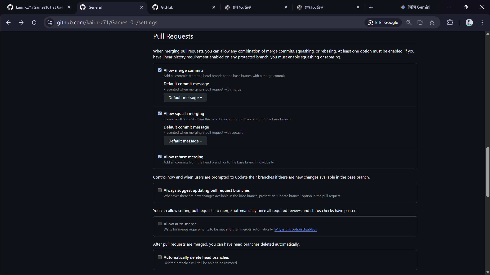
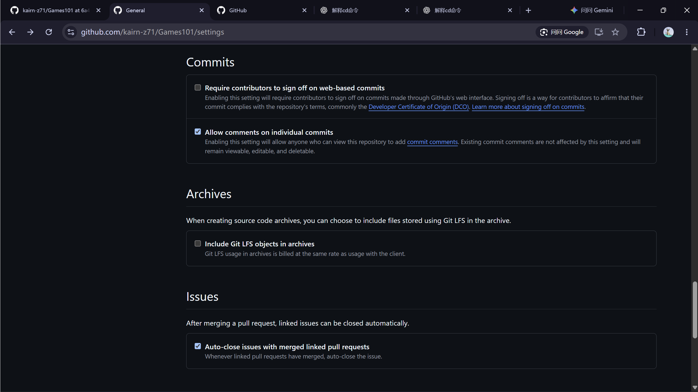
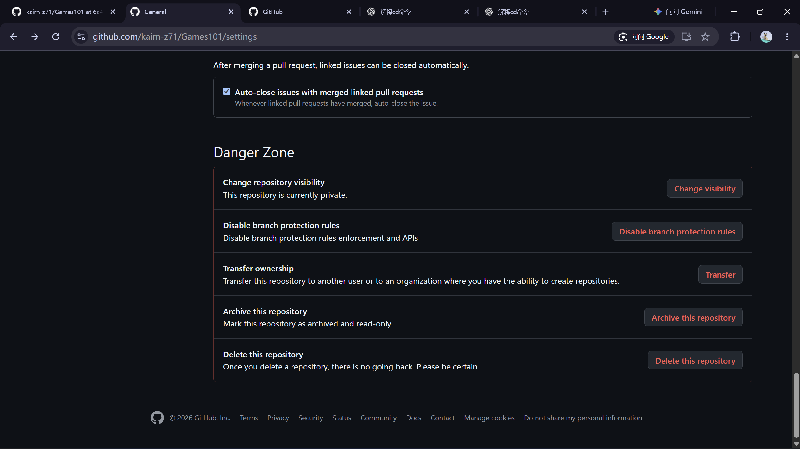

# Git + GitHub + VS Code 管理代码


> [!NOTE]
> **阅读约定**
>
> 说明性表格主要采用“图标 / 名词｜含义｜大白话”；教程资源表与对比表按用途命名列。“含义”列用于技术说明，“大白话”列保留原有个人表述，不因排版整理而改写。
>
> 标题按“部分 → 主题（2.3）→ 场景（2.3.2）→ 独立操作（2.3.2.1）”组织；同一操作下先看**方法 A（VS Code 界面 / 命令面板）**，再看**方法 B（对应终端命令或配置内容）**。两种方法通常二选一；提醒保留为正文，配置内容不当成终端命令执行。
>
> **链接约定：**本文内部跳转使用 Obsidian 的 `[[#完整标题|显示文字]]`；没有独立标题的段落用 `[[#^块ID|显示文字]]`。标题链接的目标须与实际标题对应，修改标题后同步核对链接；官网、教程与仓库地址才使用 `[显示文字](https://…)` 外部链接。
>
> **GitHub 阅读兼容：**图片保留 Pictures/ 相对路径；callout 标记独占第一行，中文标题或正文从第二行开始，折叠内容使用 HTML details。内部导航以 Obsidian 为准，GitHub 不原生解析这些双链，可使用页面自动目录查找章节。
>
> 格式依据：[GitHub Markdown 格式与 Alerts](https://docs.github.com/en/get-started/writing-on-github/getting-started-with-writing-and-formatting-on-github/basic-writing-and-formatting-syntax)、[GitHub 折叠区块](https://docs.github.com/en/get-started/writing-on-github/working-with-advanced-formatting/organizing-information-with-collapsed-sections)。
>
> **发布检查：**本文引用的 Pictures/ 图片也必须已纳入提交并推送；只上传 Markdown，不能保证图片显示。路径存在不等于图片已被 Git 跟踪。

> [!TIP]
> **学习阶梯与阅读顺序：先图形，后命令**
>
> L1～L4 表示由浅入深的学习阶梯，不是章节编号；综合章节看子节标记。GitLens 是可选扩展，放在全文最后。这是本文的阅读建议，不是行业认证标准。
>
> - **L1 · 新手先学**：先查[[#1.2 核心名词，不懂的概念看这里|第 1.2 节]]基础名词 → [[#1.3 VS Code 图标与菜单速查|第 1.3 节]]认 VS Code 图标 → [[#1.4 GitHub 网页图标与菜单速查|第 1.4 节]]认 GitHub 页面 → 第 [[#2.1 首次配置与创建仓库：先用 VS Code|2.1]]～[[#2.2 VS Code 日常操作流程|2.2]] 节完成首次建仓与日常图形流程。不要先把所有进阶名词背完。
> - **L2 · 日常熟练**：会用按钮以后，用[[#1.3.3 VS Code 图标 / 菜单与命令行对照|第 1.3.3 节]]图标 / 命令对照表建立联系，再看[[#2.3 日常命令行与 PowerShell 实录|第 2.3 节]]终端准备、日常命令与模拟实录；[[#第四部分：GitLens 插件（可选）|第四部分]] GitLens 是可选工具。
> - **L3 · 团队协作**：[[#2.4 团队协作：先界面，后命令|第 2.4 节]]按场景先看“方法 A：VS Code / GitHub”，再学“方法 B：命令行”，重点是分支、PR、同步、冲突与团队规则。
> - **L4 · 进阶按需**：日常与协作熟练后，再练提交整理、已发布历史改写、移植修复、Reflog 与 Bisect。没有完整 GUI 的部分会明确说明，不虚构按钮。
>
> **安全底线不分等级：**所有人先看 [[#2.5.1 忽略规则配置与敏感信息|敏感信息]] 与 [[#2.5.3 高风险操作的底线|高风险操作底线]]；每次提交前对照 [[#2.6.1 提交前检查|检查清单]]。两种方法通常二选一，练习双方法时重新准备初始状态。

> [!TIP]
> **阅读导航**
>
> **[[#第一部分：概念、名词与界面介绍|第一部分：概念、名词与界面介绍]]**
> [[#1.1 官方教程|1.1 教程]] · [[#1.2 核心名词，不懂的概念看这里|1.2 核心名词]] · [[#1.3 VS Code 图标与菜单速查|1.3 VS Code 界面]] · [[#1.4 GitHub 网页图标与菜单速查|1.4 GitHub 界面]]
>
> **[[#第二部分：操作流程|第二部分：操作流程]]**
> [[#2.1 首次配置与创建仓库：先用 VS Code|2.1 首次配置]] · [[#2.2 VS Code 日常操作流程|2.2 图形日常流程]] · [[#2.3 日常命令行与 PowerShell 实录|2.3 命令行流程]] · [[#2.4 团队协作：先界面，后命令|2.4 团队协作]] · [[#2.5 忽略规则与安全边界|2.5 忽略与安全]] · [[#2.6 检查清单与双方法验收|2.6 检查与验收]]
>
> **[[#第三部分：实操记录|第三部分：实操记录]]**
> [[#3.1 只把「代码管理」目录发布到 GitHub|3.1 代码管理独立发布]] · [[#3.2 Games101 清理、私有化与分支统一|3.2 Games101 清理与分支统一]]
>
> **[[#第四部分：GitLens 插件（可选）|第四部分：GitLens 插件（可选）]]**
>

## 第一部分：概念、名词与界面介绍

### 1.1 官方教程

学习阶梯：**L1 · 新手先学**

| 教程 / 资源                                                                                          | 内容                               | 学习建议                                                                                     |
| ------------------------------------------------------------------------------------------------ | -------------------------------- | ---------------------------------------------------------------------------------------- |
| [GitHub Skills：Introduction to GitHub](https://github.com/skills/introduction-to-github)         | GitHub 官方动手练习：创建分支、提交文件、打开并合并 PR | 最先做一遍，练习仓库与真实项目分开；官方预计不到一小时                                                              |
| [Pro Git 第二版·简体中文](https://github.com/progit/progit2-zh)                                         | 系统讲解 Git 原理和使用方法                 | 作为长期参考书；可从 [Git 官网中文版](https://git-scm.com/book/zh/v2) 阅读                                |
| [Learn Git Branching](https://github.com/pcottle/learnGitBranching)                              | 用交互式提交图学习分支和 Git 命令              | 在 [在线练习站](https://learngitbranching.js.org/?locale=zh_CN) 观察 commit、merge、rebase 怎样改变提交图 |
| [Git Flight Rules·中文](https://github.com/k88hudson/git-flight-rules/blob/master/README_zh-CN.md) | 按“遇到什么问题”查找解决方法                  | 出错时查阅；涉及重置、清理、改写历史的命令不要直接照抄                                                              |
| [GitLens 源码与 README](https://github.com/gitkraken/vscode-gitlens)                                | 扩展功能、使用入口、Community 与 Pro 的说明    | 配合本文[[#第四部分：GitLens 插件（可选）\|第四部分]]学习，不必先开通付费功能                                                                    |

**建议学习路线：** 先做 GitHub Skills → 按第 [[#2.1 首次配置与创建仓库：先用 VS Code|2.1]]～[[#2.2 VS Code 日常操作流程|2.2]] 节完成一次 VS Code 提交和推送 → 用 Learn Git Branching 理解分支 → 需要时查 Pro Git 和 Flight Rules。这是本文的学习安排，不是教程官方要求。

VS Code 操作细节以微软的 [源代码管理总览](https://code.visualstudio.com/docs/sourcecontrol/overview) 和 [首次提交教程](https://code.visualstudio.com/docs/sourcecontrol/quickstart) 为准，避免用老教程猜测新界面。

### 1.2 核心名词，不懂的概念看这里

学习阶梯：**L1–L4 · 分层查阅，以子节标记为准**

> [!NOTE]
> 本节集中解释整篇笔记出现的关键名词。后面的配置、日常流程和团队实操通过内部链接回到这里，不再在流程中插入长篇概念说明。
>
> Fork 为什么存在、PR 在什么场景下使用，见 [[#1.2.11 Fork 与 PR|Fork 与 PR]]。
>
> Merge 与 Rebase 的方向、提交数量和历史形状，见 [[#1.2.12 Merge 与 Rebase|Merge 与 Rebase]]。
>
> 删除 .git、Commit 和分支的区别见 [[#1.2.13 删除 .git、删除 Commit、删除分支：不是同一件事|1.2.13 删除对象对照]]，具体 UI 入口见 [[#1.3.4 删除与撤销的 UI 速查：.git、Commit、分支|1.3.4 删除与撤销]]。


#### 1.2.1 基础动作：Save、Stage、Commit、Push、Pull 与 Diff

学习阶梯：**L1 · 新手先学**

- **Save（保存）**：把编辑器内容写入磁盘，不会生成提交。
- **Stage（暂存）**：选出这次**即将**Commit的内容；暂存后继续编辑的部分，要再次暂存才会进入本次Commit。
- **Commit（提交）**：把暂存 记入 本地历史，不等于上传到Github，只是作为一个历史版本。
- **Push（推送）**：把本地提交发送到远程（Github等）。
- **Pull（拉取）**：把 远程仓库（Github） 的 新提交（别人的） 下载到本地，并合并到当前分支。
- **Change / Diff （改动）**：相比于以前的版本，做出的代码改动。

- 个人理解：（王者荣耀版本）
	1. Commit一次，就是一次王者服务器的本地更新；Stage是属于Commit下的，Stage相当于这次更新的每一处小改动，可以微调。
	2. Push一次，就是一次正式的大规模赛季更新。推送到每个玩家的手机上（Github等远程分支上）

**Publish Branch 和 Push 的区别** ^git-publish-branch

学习阶梯：**L1 · 新手先学**

**Publish Branch = 第一次把“这个本地分支”发布到远程**
**Push = 这个分支已经发布到Github一次了，后续继续上传新的 commit**

依据：[Git Add](https://git-scm.com/docs/git-add)、[Git Commit](https://git-scm.com/docs/git-commit)、[Pro Git：记录更新](https://git-scm.com/book/zh/v2/Git-基础-记录每次更新到仓库)。

#### 1.2.2 工作区、暂存区与本地仓库

学习阶梯：**L1 · 新手先学**

```
工作树 Working Tree
↓ git add
暂存区 Staging Area / Index
↓ git commit
本地仓库 Local Repository
↓ git push
GitHub 远程仓库
```

`working tree` 你可以直接理解成：**工作区**

> [!NOTE]
> 当你正常在Vscode里面打开文件时，没有标记。
> 
> 当你点击左侧边栏的Git，然后点击 Changes 里面的文件时，就会带上（Working Tree）标记。

`Staging Area / Index` 就是存changes的地方。

`Local Repository` 可以粗略理解为：项目里的 `.git` 目录。


#### 1.2.3 仓库、分支与远程名词

学习阶梯：**L1 · 新手先学**

| 名词                  | 含义                                                        | 大白话                                   |
| ------------------- | --------------------------------------------------------- | ------------------------------------- |
| `Repository / Repo` | 仓库：保存 项目内容 及 版本历史                                         | 整个 Git 项目                             |
| `Branch`            | 分支：指向某个提交的可移动引用                                           | 项目的一条版本路线                             |
| `main`              | 常见的主分支名称                                                  | 默认的名称，**可以改名**                        |
| `origin`            | 远程仓库的常用别名                                                 | 远程仓库的默认名称，就是GitHub仓库，**也可以改名**        |
| `origin/main`       | 本地的**远程跟踪引用**（很常见的描述）<br>**记录最新，最后一次commit获取的远程 main 位置** | Github的main分支<br>也可以指这个main分支的最尾部（最新） |
| `HEAD`              | 你当前的位置                                                    | 你现在站在哪条分支的哪个版本上                       |
| `upstream`          | 默认对接对象<br>比如本地的 main分支 默认 Push 的时候，会上传到 origin/main分支 里   | 说白了就是Github上对应的分支                     |
| `Pull Request / PR` | 请求把一个分支合并进另一个分支                                           | 两个分支要合二为一了                            |

例图👇


**Pull Request：分支合并的请求** ^git-pull-request

学习阶梯：**L3 · 团队协作**

- 假如说ai-polished 要 merge 合并到 main 一个分支了：
	`Pull Request = ai-polished 新增的改动 + main 新增的改动` 得到合并后的 `main`

**如果说，两个分支对同一个地方做出了改动呢？**

- VS Code 会让你手动选：
	1. Accept Current Change 保留当前分支 （HEAD的位置）
	2. Accept Incoming Change 保留要合进来的那个分支
	3. Accept Both Changes 两个都保留

**怎么看哪个是当前分支，哪个是要合进来的呢？**

- 两个方法：
	1. 点分支UI（左下角和Graph里的都可以），看**HEAD**的hash和哪一个分支的一样
	2. Graph 里 看这个球 `◎` ，球在哪个分支，就是当前分支


概念参考：[分支与工作树](https://code.visualstudio.com/docs/sourcecontrol/branches-worktrees)、[仓库与远程](https://code.visualstudio.com/docs/sourcecontrol/repos-remotes)、[GitHub 官方入门练习](https://github.com/skills/introduction-to-github)。


#### 1.2.4 .git：本地仓库的管理数据

学习阶梯：**L2 · 日常熟练**

**原有个人理解（比喻；技术边界见下文）：**

`git init`只是创建了一个 `.git` **隐藏**文件夹，我们在目录里看不到。
	`.git` 相当于一个保险库，暗中保存着一套 最新完整的文件。
	而我们在Vscode里面的工作区看到的呢，是我们可以在目录里看到的，是明着的一套 最新完整的文件。

- 所以说，Git其实分为**明一套暗一套**的。
	我们平时常见的是，明暗两套的文件是一模一样，同步的。
	但是，我们在Vscode的Graph里面看到的，就是`.git`里的整个历史版本。历史版本路线不分明暗

- 但是我们Fetch了之后，就不一样了：
	1. 它会把Github里的那一套 最新完整的文件 和 整个历史版本放到我们本地的`.git`隐藏文件夹里面。
	2. 但是我们在Vscode里面还是能看到我们原来的那些东西。

参考：[Git Init](https://git-scm.com/docs/git-init)。

**.git 与项目文件的关系**

学习阶梯：**L1 · 新手先学**

下面是一个已经准备了 README、源码和忽略规则的项目示意，不是说这些文件都由 `git init` 自动创建：

```text
my-project/
├─ .git/          ← Git 的管理数据，通常隐藏
├─ .gitignore     ← 忽略规则文件，不是 .git 文件夹
├─ README.md      ← 项目文件
└─ src/           ← 项目源码
```

**.git 内部保存什么？**

学习阶梯：**L4 · 进阶按需**

```
.git/
├── index        ← 暂存区
├── HEAD         ← 当前在哪个分支
├── refs/        ← 分支、标签引用
├── objects/     ← commit、文件快照等真正的数据
└── ...
```

| 文件                 | 含义                           | 大白话                             |
| ------------------ | ---------------------------- | ------------------------------- |
| `.git/`            | 保存 Git 仓库的管理数据与对象            | Git 的“保险库”和账本，不是拿来日常写代码的地方      |
| `.gitignore`       | 指定应忽略的未跟踪文件模式；不会让已跟踪文件自动退出历史 | 哪些新文件先别纳入版本管理，由这份规则说清楚          |
| `.git/index`       | 记录暂存区的路径、内容引用等信息             | 下一次 Commit 准备交哪些内容的清单（index工作区） |
| `.git/HEAD`        | 通常指向当前分支，也可能直接指向某个提交         | 记住“我现在站在哪个位置”                   |
| `.git/refs/` 等引用记录 | 记录分支、标签等引用的位置；部分引用可能以其他形式存储  | 记住各条版本路线走到了哪里                   |
| `.git/objects/`    | 存储已写入 Git 的内容、目录树、提交等对象      | Git 记录过的内容和历史，主要靠这些数据保存         |
| `.git/config`      | 当前仓库配置；关联远程后可包含远程地址等设置       | 这个仓库自己的设置本                      |

初始化时不会立即拥有全部历史记录；某些数据文件会在后续 Add、Commit 等操作后才出现。`.git/` 也不是给每个版本直接复制一个完整项目文件夹，而是用 Git 对象及引用组织历史。参考：[仓库目录结构](https://git-scm.com/docs/gitrepository-layout)、[Git Ignore](https://git-scm.com/docs/gitignore)。

**为什么经常看不到 .git？**

学习阶梯：**L1 · 新手先学**

- Windows：Git 默认通常会给新建的 `.git/` 设置隐藏属性；文件管理器未开启显示隐藏项目时，就可能看不到它。Windows 上不是所有点开头的文件都会自动隐藏。
- VS Code：资源管理器还可能按 `files.exclude` 等规则不显示某些文件；“不显示”不代表它不存在，也不等于被 `.gitignore` 忽略。
- macOS / Linux：点开头的文件或目录通常按隐藏项处理。

参考：[Git 的 Windows 隐藏属性配置](https://git-scm.com/docs/git-config#Documentation/git-config.txt-corehideDotFiles)、[VS Code 排除设置](https://code.visualstudio.com/docs/editing/codebasics)。


> [!WARNING]
> 只查看，不要随便删除或手工修改 `.git`
> 
> 删除它可能丢失本地历史、分支、暂存信息和仓库配置，即使项目文件还在，也不等于版本记录还在。少数场景（例如关联 Worktree）中，`.git` 可能是指向实际管理目录的文件，而非目录，不能一概理解成“必定有一个同名文件夹”。参考：[Git 仓库布局](https://git-scm.com/docs/gitrepository-layout)。

#### 1.2.5 .gitignore：忽略规则文件

学习阶梯：**L1 · 新手先学**

> [!NOTE]
> 比如你新建了一个文件夹，里面的文件长这样：
> 
> ```text
> my-project/
> ├─ .git/ （已被隐藏）
> ├─ src/
> ├─ node_modules/
> ├─ .env
> ├─ debug.log
> └─ README.md
> ```

但你不想让 Git 管：

```
node_modules/
.env
debug.log
```

那就在项目根目录创建一个纯文本文件，文件名必须是 `.gitignore`，不要带 `.txt` 后缀：

```
.gitignore
```

里面写：

```
node_modules/
.env
debug.log
```

这样Git就不会管这些垃圾文件啦

> [!TIP]
> 已经被跟踪的文件不会仅因补写 `.gitignore` 就停止跟踪；补救步骤见 [[#2.5.2 已跟踪文件的补救：保留本机文件并停止跟踪|停止跟踪流程]]。

#### 1.2.6 Fetch、Pull、Push 与 Sync Changes

学习阶梯：**L1 · 新手先学**

| 图标               | 含义                  | 大白话                                    | 是否改变本地代码（硬盘） | 是否上传到Github |
| ---------------- | ------------------- | -------------------------------------- | ------------ | ----------- |
| **Fetch**        | 获取远程提交并更新远程跟踪引用<br> | 去 GitHub 看一眼，把远程最新情况记下来，但先别动我现在的本地文件。  | ❌️           | ❌️          |
| **Pull**         | 获取并整合远程提交到当前分支<br>  | 把远程的新东西拿下来并合进当前分支                      | ✅️           | ❌️          |
| **Push**         | 推送本地提交到目标远程分支<br>   | 把你本地的提交传到远程                            | ❌️           | ✅️          |
| **Sync Changes** | 先 Pull，再 Push<br>   | 先 Pull，再 Push<br>（说白了就是把别人改的变成自己的正式版本） | ✅️           | ✅️          |
> [!NOTE]
> 注意：pull 和 push 都是一次性推到最新进度，而不是一次一次地推。


**Fetch 更新什么，不更新什么？**

学习阶梯：**L1 · 新手先学**

| Fetch后的改变     | 大白话                     |
| ------------- | ----------------------- |
| VS Code Graph | 地图上多出了远程的新路线信息，不代表你搬过去了 |
| 当前本地分支与 HEAD  | 你本人还站在原来的位置             |
| 工作区与暂存区       | 桌面上正在写的文件和待提交清单不被顶掉     |


> [!NOTE]
> **核心结论**
>
> **Graph 变了，不等于工作区文件变了。单纯 Fetch 不会把你正在编辑的项目文件顶掉。**
> **fetch = 更新地图，不搬家。**

> [!NOTE]
> - 工作区 = 你桌面上摊开的那份文件
> - .git 数据库 = 柜子里保存的各个历史版本


- fetch已经得到了Github上的所有文件和整个git历史，并把它放进了 .git 数据库里面，但没有修改本地硬盘里的文件。

这里讨论普通工作仓库中的正常 `git fetch`，不是手动指定特殊引用更新方式或同时执行其他命令。参考：[Git Fetch](https://git-scm.com/docs/git-fetch)、[VS Code 历史图](https://code.visualstudio.com/docs/sourcecontrol/history)。

**Graph 已经知道 E，工作区却仍在 C**

学习阶梯：**L2 · 日常熟练**

假设当前检出 `main`，工作区没有未提交改动。开始时，本地只知道提交 C；同事已经在 GitHub 的同一条主线上提交了 D、E。

```text
Fetch 前：
  本地 main           A---B---C
  本地 origin/main    A---B---C      ← 旧的远程位置记录
  GitHub 实际 main    A---B---C---D---E

执行 git fetch 后：
  本地 main           A---B---C      ← 没有移动，HEAD 仍指向 main
  本地 origin/main    A---B---C---D---E

  工作区：仍然是 C 对应的项目文件，不会自动变成 E
```

图中的 A、B、C 是同一批提交；本地 main 只是落后了，**并不是 Fetch 制造了一个新分叉**。Graph 可以显示 D、E，因为这些提交现在已经获取到本地，且远程跟踪引用指向了 E；你当前的 main 仍停在 C。

如果 Fetch 前还有自己没提交的change，工作区仍保留这些change，不能简单说成“纯粹的 C 版本”。Graph 也不会因为 Fetch 就丢掉原来只存在于本地的提交。参考：[Git Fetch](https://git-scm.com/docs/git-fetch)、[VS Code Graph](https://code.visualstudio.com/docs/sourcecontrol/history)。

**什么时候工作区才会更新？**

学习阶梯：**L2 · 日常熟练**

- 执行 `git pull`，或在当前分支执行 `git merge origin/main` / `git rebase origin/main`，整合远程提交后，工作区才可能随结果更新。
- 执行 `git switch` 切换分支，或用 `git checkout` 检出某个版本，也可能改变工作文件；这是另一个操作，不是 Fetch 自动做的。
- `git reset --hard` 也能改变工作文件，但有丢失未提交内容的风险，**不要把它当成 Fetch 后的常规下一步**。

在上面的可快进示例中，如果随后成功 Pull，main 才会从 C 前进到 E，工作区也随之更新；如果双方分叉或发生冲突，先按实际状态处理，不能假定直接覆盖成功。参考：[Git Pull](https://git-scm.com/docs/git-pull)。


参考：[Git Fetch 的获取范围与对象机制](https://git-scm.com/docs/git-fetch)。

**Fetch 会覆盖原来的 .git 吗？**

学习阶梯：**L2 · 日常熟练**

不会。普通 Fetch 是在现有仓库里获取缺少的对象、更新相应的远程跟踪记录，不是把 GitHub 的 `.git` 整个复制过来，替换你本地的 `.git`。

```text
不是：本地 .git → 被远程的 .git 整体替换

而是：现有本地仓库
      + 远程新增且本地缺少的对象
      + 更新后的远程位置记录
      = 获取完成后的本地仓库
```

- 也就是说，把本地的`.git`给缝缝补补，补成Github的历史记录了。

本地分支、由它们引用的本地提交、HEAD、仓库配置和暂存区，不会因为普通 Fetch 就被远程的同名内容整体顶掉。**会变化的是远程跟踪记录及相关获取数据，不是“本地所有数据都原封不动”，也不是“本地原来的版本没了”。**

> [!NOTE]
> **柜子的比喻**
>
> Fetch 不是“把整个柜子换成别人家的柜子”，而是“把别人家新出现、我这里没有的档案复制进我的柜子，并更新一张‘远程现在到哪了’的标签”。

这里说的“放在一起保存”只是在描述对象共存，不等于已经执行了 Git Merge、把两边代码整合成一个版本。参考：[Git Fetch](https://git-scm.com/docs/git-fetch)。

**Fetch 后不想 Pull，需要恢复 .git 吗？**

学习阶梯：**L2 · 日常熟练**

不用。假设本地停在 B，而远程已经有了 C1：

```text
Fetch 后，不执行 Pull：
  main         → B
  origin/main  → C1
  HEAD         → main

  工作区：仍是 B 的文件，加上你可能已有的未提交changes
```

`origin/main → C1` 只是说明“我现在知道远程到 C1 了”，不会强迫 `main` 也前进到 C1。**Fetch 后不想 Pull，就别 Pull；可以继续保留自己的版本、继续开发。**

通常没必要撤销远程位置记录或恢复 `.git`。远程跟踪引用的旧位置与恢复方法是另一类问题，不要为此删除 `.git`、Hard Reset 或强推。只是继续开发之后，仍要面对将来如何整合远程改动的问题。


**本地新提交 C2 会覆盖远程 C1 吗？** ^git-local-remote-divergence

学习阶梯：**L3 · 团队协作**

不会。用 **C1 表示同事的远程提交，C2 表示你的本地提交**，就容易分清了。假设二者内容不同，确实形成了两个不同提交：

```text
最初双方：
  A---B

同事先提交 C1；你 Fetch 后：
  A---B---C1  ← origin/main
      ↑
     main    ← HEAD 仍指向 main

你不 Pull，从 B 继续修改并 Commit 得到 C2：
      C1  ← origin/main
     /
A---B
     \
      C2  ← main、HEAD
```

- 开始分叉了。

- **C1、C2 同时保存在本地仓库的对象数据中，不互相覆盖。**
- C1、C2 只是教学名字；Git 根据对象 ID（哈希）区分提交，例如 C1 是 `8f32a1b`，C2 是 `d91c47e`，并不是按照“第几个版本叫 C”保存。
- 你的新 Commit 推进当前本地 `main` 到 C2，不会顺便把 `origin/main` 从 C1 改到 C2；后者是本地对远程位置的记录。
- 此时叫**分支分叉（diverged）**：双方都从 B 出发，各自有了对方没有的提交。共存在 `.git` 里，不代表已经合并。
- 工作区对应你这一侧的 C2，以及后续可能继续产生的编辑；不会因为 C1 也在 `.git` 中，就自动混入 C1 的修改。

这种分叉来自双方各自创建了提交，不是 Fetch 凭空制造了新提交。若上游upstream是 `origin/main`，`git status` 通常会提示双方已分叉、各自有独有提交。参考：[Git Status](https://git-scm.com/docs/git-status)。

**怎样整合 C1 和 C2？**

学习阶梯：**L3 · 团队协作**

这时才需要按团队规则选择 Merge 或 Rebase，而不是指望 Commit 自动整合远程：

```text
选择 Merge：保留 C1、C2，并产生同时连接两边的合并提交 M

      C1
     /  \
A---B    M  ← main、HEAD
     \  /
      C2

选择 Rebase：将你的改动重放到 C1 后面

A---B---C1---C2'  ← main、HEAD
        ↑
   origin/main
```

Merge 示例中，`origin/main` 仍记录 C1；M 是本地整合结果。Rebase 示例中，C2′ 通常是新的提交、哈希不同，不是把旧 C2 对象就地改掉。**两种方式都可能遇到冲突，需要解决并测试**

具体操作见第 [[#2.4.6 把主线更新接入功能分支：Merge / Rebase 二选一|2.4.6]]～[[#2.4.9 改写已发布历史后：为什么不是直接 Force Push？|2.4.9]] 节。参考：[Git Merge](https://git-scm.com/docs/git-merge)、[Git Rebase](https://git-scm.com/docs/git-rebase)。

> [!NOTE]
> **Fetch 的最短记忆版**
>
> **Fetch 不换掉本地柜子；不想 Pull 就先不 Pull；远程 C1 和本地 C2 可以同时存在。两边独立前进叫分叉，只有后续整合才叫合并或变基。**

#### 1.2.7 Changes、文件状态与 Graph

学习阶梯：**L1 · 新手先学**

- **Changes**：尚未进入提交的文件变化。
- **Staged Changes**：已经选入暂存区、准备由下一次 Commit 记录的变化。
- **Outgoing Changes**：相对于上游upstream（Github），已经commit提交到本地、但尚未push到Github的commit；**不是changes**。

**U、M、D、A、R、C：文件状态**

学习阶梯：**L1 · 新手先学**


| 图标  | 含义                          | 大白话                                                   |
| --- | --------------------------- | ----------------------------------------------------- |
| U   | Untracked：未跟踪               | Untracked，没上传过git<br>例：新增的图片、新创建的文件                   |
| M   | Modified：已跟踪文件有修改           | Modified，上传过git<br>例：`6.Ray Tracing.md`               |
| D   | Deleted：已跟踪文件被删除            | Deleted，上传过git，但已经被删除<br>例：原位置的 `unity集大成.md`，文件名带删除线 |
| A   | Added：新增文件已暂存               | Added，添加到暂存stage区                                     |
| R   | Renamed：重命名                 | Renamed，文件被重命名                                        |

**Graph：提交历史与分支位置** ^git-graph-concept

学习阶梯：**L2 · 日常熟练**

VS Code 把 `.git` 里那些平时看不见的 Git 历史，用可视化方式画出来了。

Graph 可以显示提交、分支与远程跟踪位置；图上的远程状态取决于最近获取的信息。
**读图示例见 [[#^vscode-graph-screenshot|Graph 截图]]，Fetch 的分叉图见 [[#^git-local-remote-divergence|C1 与 C2]]。**

#### 1.2.8 协作、撤销与排错名词

学习阶梯：**L2–L4 · 协作与进阶名词，按需查阅**

这里先认名词，具体操作与适用前提见 [[#2.4 团队协作：先界面，后命令|团队协作双方法流程]]。

**整合与提交整理** ^git-integration-terms

学习阶梯：**L3 · 团队协作**

两条分支“7＋2 个提交”的整合示例，见 [[#1.2.12 Merge 与 Rebase|Merge 与 Rebase]]；这里先查名词。

例图：
```
      C1
     /  \
A---B    M
     \  /
      C2
```

| 名词            | 含义                            | 大白话                    | 例图解释          |
| ------------- | ----------------------------- | ---------------------- | ------------- |
| Diverged / 分叉 | 双方都有对方没有的提交                   | 两边从共同起点各走了一段           | 从B            |
| Merge         | 合并分支；分叉时通常产生合并提交              | 把两条路线求个并集              | 求个并集M         |
| Rebase        | 在新的基点上重放提交，通常改变提交 ID          | 把自己的改动接到新主线后面          | C2接到C1后面，成一条线 |
| Conflict      | Merge / Rebase 时需要人工决定最终内容的情况 | 你要选择两条路线怎么Merge和Rebase |               |
| Merge Base    | 合并之前，两条历史最后共同经过的那个 commit。    | 从哪里分叉的，那个点就是。          | B点            |


| 名词          | 含义                              | 大白话                                         |
| ----------- | ------------------------------- | ------------------------------------------- |
| Cherry-pick | 把指定提交的改动移植到当前分支，通常创建新提交，放在分支最末尾 | 不拿整条分支，只像**挑樱桃**一样，挑其中某一个 commit 过来，放在分支最末尾 |
| Amend       | 用新提交替代最近一次提交，可调整说明或纳入暂存内容       | 修正最近一次 commit，比如改提交说明、补进漏掉的文件               |
| Reword      |                                 | 把 commit message 重新写一遍                      |
| Squash      | 挤压                              | 把几个Commit 挤成一个Commit                        |

操作见 [[#2.4.6 把主线更新接入功能分支：Merge / Rebase 二选一|整合主线]]、[[#2.4.7 冲突处理：会解决，也会安全退出|冲突处理]]、[[#2.4.8 提交整理：Amend、Reword、Squash / Fixup|整理提交]]、[[#2.4.9 改写已发布历史后：为什么不是直接 Force Push？|强推边界]]、[[#2.4.10 Cherry-pick：只移植一个修复，不合并整个分支|移植修复]]。

**Stash 与 Worktree** ^git-stash-worktree-terms

学习阶梯：**L2 · 日常熟练**

| 名词       | 含义                             | 大白话                    |
| -------- | ------------------------------ | ---------------------- |
| Stash    | 临时保存未提交改动                      | 把 change 存进去，就叫做 Stash |
| Worktree | 同一仓库另开工作目录；共享部分仓库数据，工作文件和暂存区独立 | 另开一张桌子处理急事，不是完全独立的新仓库  |
|          |                                |                        |
注意：working tree 不等于 worktree
	working tree是单个工作区
	worktree可以多开

操作见 [[#2.4.11 临时任务：Stash 与 Worktree|临时任务流程]]。

**Restore、Reset、Revert 与 Reflog** ^git-undo-recovery-terms

学习阶梯：**L3 · 团队协作**

| 图标 | 含义 | 大白话 |
| --- | --- | --- |
| Restore | 恢复工作文件 / 暂存区中的指定路径 | 恢复工作文件可能覆盖尚未提交的编辑 |
| Reset | 移动当前分支位置；不同模式还会重置暂存区 / 工作区 | 必须看模式，Hard 风险很高 |
| Revert | 新增反向提交，抵消已提交变化 | 不改写旧历史；也可能冲突，需要测试 |
| Reflog | 查本机引用位置的移动记录，寻找旧提交 | 不是所有文件的回收站，也不是永久远程备份 |

操作见 [[#2.4.12 撤销与救援：Restore / Reset / Revert / Reflog|撤销与救援流程]]。

**Log、Blame 与 Bisect** ^git-history-terms

学习阶梯：**L4 · 进阶按需**

| 名词 | 含义 | 大白话 |
| --- | --- | --- |
| Log / History | 查看提交历史；可按路径、说明或补丁变化检索 | 找以前哪一笔记录改过这里 |
| Blame | 追踪每行最后一次修改涉及的提交 | 找上下文，不是直接判定谁负责 |
| Bisect | 在已知好、坏版本之间二分定位问题提交 | 一次排除一半，缩小 Bug 范围 |

操作见 [[#2.4.13 排查“谁改的、哪次引入了 Bug”|历史检索与 Bug 定位]]。

#### 1.2.9 团队与命令行辅助名词

学习阶梯：**L1–L3 · 混合词表，遇到不懂的词再查**

| 名词                               | 含义                                   | 大白话                   |
| -------------------------------- | ------------------------------------ | --------------------- |
| Clone                            | 获取仓库的项目文件及 Git 历史，不是普通 ZIP 下载        | 从Github把项目连版本记录一起拿到本地 |
| Initialize Repository / git init | 初始化本地仓库，不会直接在 GitHub 创建仓库            | 先在本机建立版本管理            |
| Publish to GitHub                | 在 GitHub 建立远程仓库并发布本地项目               | 给本地项目建立远程存放位置         |
| Public / Private                 | 发布时选择的仓库可见性                          | 看清项目准备公开还是私有          |
| Remote                           | 远程仓库地址与相关配置；`origin` 是常用别名           | 本地项目准备与哪里收发提交         |
| Commit Hash / ID                 | 用于识别提交的哈希；界面也会显示短哈希                  | 一次提交的“身份证号”           |
| Commit Message                   | 提交说明                                 | 这次提交做了什么，起个能看懂的名字     |
| Fork                             | 在没有原仓库写权限等场景下，先从自己的仓库发起 PR           | 先在自己的仓库改，再请对方合入       |
| Issue                            | GitHub 集成中可管理的问题条目                   | 团队记录和讨论待处理事项的入口       |
| Tag / Release                    | Tag 标记特定提交，Tag 不等于完整的 GitHub Release | 给版本留标记，与完整发布流程区分开     |
| Submodule                        | 主仓库记录子模块的特定提交，不自动跟踪其最新代码             | 主项目记住子项目的某一版          |
| Git LFS                          | 用指针记录大文件的工作方式，需单独安装相关工具              | 大文件按项目规则走专门通道         |
| Hook                             | 可在提交等操作时执行检查；失败时需看具体输出               | 不要把绕过检查当作日常操作         |
| CI                               | PR 等流程中的持续集成检查                       | 本地测试通过，不代表平台检查也通过     |
| .gitattributes                   | 仓库用于文件属性、换行等约定的配置                    | 按项目规范处理，不随手改全局配置      |


创建与发布见 [[#2.1.2 两种起点：克隆或发布|首次建仓流程]]；团队约定见 [[#2.4.15 入职后的团队约定与按需能力|团队与发布规范]]；命令参数写法见 [[#2.4.2 先看懂命令的写法|命令行阅读约定]]。

#### 1.2.10 GitHub 平台名词：界面背后的对象

学习阶梯：**L1–L3 · 先认识名称，配置细节以后再学**

| 名词 | 含义 | 大白话 |
| --- | --- | --- |
| Dashboard | 登录后的个人工作首页 | 从这里进入常用仓库与待办 |
| Issue / PR / Project | 事项、合并请求与组织工作计划的不同对象 | 记问题、审改动、排计划，不是同一个按钮 |
| Actions / Workflow / Run | 自动化平台 / 流程配置 / 某一次执行 | 脚本在哪跑、按什么流程跑、这次跑得怎样 |
| Runner | 执行自动化任务的环境或机器 | 干活的机器，不是 Git 分支 |
| Agents / Session | AI 代理任务入口与会话记录 | 看 AI 在做什么，结果仍需要审核 |
| Wiki / README | 独立的项目文档区 / 仓库中的说明文件 | 长篇说明书与项目首页简介是不同位置 |
| Watch / Star / Fork | 通知订阅 / 收藏关注 / 派生仓库 | 看动态、收藏、另开自己的仓库副本；都不等于 Clone |
| Codespaces | GitHub 提供的云端开发环境 | 在远端环境写代码，不是普通 ZIP 下载 |
| Security policy / Advisory | 安全报告约定 / 安全公告 | 规定怎么报告问题，并管理披露信息 |
| Dependabot / Code scanning / Secret scanning | 依赖风险 / 源码问题 / 凭据泄露等不同检查 | 第三方库、程序本身、钥匙泄露，分别处理 |
| Ruleset / Default branch | 仓库规则集 / 默认分支 | 什么能做、默认看哪条路线，不会切换本机分支 |
| Release / Package / Immutable release | 发行版 / 发布的软件包 / 带不可变保护的发行版 | 代码提交之外的发布对象与保护机制 |
| Secret / Variable / Deploy key | 机密值 / 配置变量 / 机器访问仓库的密钥 | 配自动化与访问权限，不是把密码写进笔记 |
| Webhook / GitHub App | 事件通知到外部系统 / 集成应用 | 让其他系统参与，先看清权限 |

上表只作查词入口。按钮位置、截图状态与英文名称见 [[#1.4 GitHub 网页图标与菜单速查|GitHub 界面速查]]。

#### 1.2.11 Fork     PR    Clone

学习阶梯：**L1 · 先理解作用；L3 · 协作时使用**


> [!NOTE]
> Fork 提供一个你能独立开发的派生仓库
> PR 提供一个提议、讨论和审查修改的入口。
> 
> 原项目不必给每个贡献者开放写入权限，也能接收他们提出的修改。

---

**场景一：没有原仓库写入权限，想给开源项目修 Bug**

假设张三的游戏有 Bug，你能阅读代码，但不能直接 Push 到他的仓库。通常这样做：


**Push 到自己的 Fork，不会直接改动张三的原仓库；提交 PR 也不等于对方已经接受修改。**

是否合并由有权限的维护者决定。

---

**场景二：团队成员有同一仓库的写入权限，不必 Fork 也能用 PR**

大家可以直接在共享仓库创建功能分支：`feature/login 开发 → Commit / Push → 向 main 发起 PR → 审查、检查 → 合并`。

这里 PR 的作用不是获得仓库写入权限，而是**让修改进入主线前，先经过讨论、代码审查和项目要求的检查**。有写入权限，不代表可以绕过主线保护规则。

- **Fork、Branch、Clone、PR 与 Merge 的区别：**

| 对比                | Fork          | Clone             |
| ----------------- | ------------- | ----------------- |
| 复制到哪里？            | GitHub 账号     | 本地电脑              |
| 会产生新的 GitHub 仓库吗？ | ✅ 会           | ❌ 不会              |
| 会产生本地项目文件夹吗？      | ❌ 不会          | ✅ 会               |
| 可以继续修改代码吗？        | 可以，通过网页或克隆后修改 | 可以，直接在电脑修改        |
| 和原仓库有关系吗？         | 保留派生关系        | 通常保留远程地址 `origin` |


**几个容易混淆的地方**

- 只 Clone 也能在本地修改、Commit，但不能凭空获得原仓库的 Push 权限。没有权限时，Fork 给你提供一个可Push的远程仓库，再从其分支向原项目发起 PR。
- Fork 不一定要配合 PR。你也可以只做自己的版本；原项目不会自动接受你的改动。私有仓库能否 Fork 还受权限与组织策略限制。
- 跨仓库贡献和同仓库分支协作都能使用 PR；两种场景都要看清来源分支与目标分支。

网页入口见 [[#1.4.4 Pull requests：审查与合并请求|Pull requests 页面]]；同仓库的完整操作流程见 [[#2.4.4 一次正常任务：从分支到 PR|从分支到 PR]]。

参考：[GitHub：Fork 的概念与权限](https://docs.github.com/en/pull-requests/reference/forks)、[GitHub：PR 与两种协作模式](https://docs.github.com/en/pull-requests/reference/pull-requests)。

#### 1.2.12 Merge 与 Rebase

学习阶梯：**L2 · 看懂历史与方向；L3 · 协作时选择整合方式**

> [!NOTE]
> **Merge 把两条历史汇合；Rebase 把当前分支要重放的提交，重新建立在另一个基点后面。**先看自己站在哪条分支，再看命令中指定的是谁，不能只看哪边提交多。

**初始状态：从 B 分叉，main 有 7 个提交，feature 有 2 个提交**

```text
B---C1---C2---C3---C4---C5---C6---C7  ← main
 \
  D1---D2  ← feature
```

目标是把 **feature 的改动整合进 main**。以下两种方案分别从上面的初始状态开始。


##### 1.2.12.1 Merge：在 main 上合入 feature，保留分叉历史

先切到接收改动的 `main`，再合入 `feature`：

**方法 A｜VS Code 图标步骤**

1. 点击**左下角分支名**，在分支列表选择本地 `main`；切换后再次确认左下角显示 main。
2. 按 `Ctrl+Shift+P` 打开命令面板，运行 `Git: Merge...`；也可以从 Source Control 的 `… → Branch → Merge...` 进入。
3. 在接下来的列表里选择 `feature`。这里选的是“要合进来的来源分支”，当前接收方已经是 main，**不是再次选 main，也不是切换到 feature**。
4. 若没有冲突，等待合并完成；若出现提交说明编辑器，按提示填写、保存并完成提交。成功后一般已生成 M，**不要为了“补一个 M”再随意点击一次 Commit**。
5. 若停在冲突：打开 **Merge Changes** 中的文件 → **Resolve in Merge Editor** → 逐处检查并编辑 Result → 保存 → 给已解决文件点 `+` 暂存 → 检查 Staged Changes → 填写合并说明并 **Commit** 完成普通 Merge。取消本次合并可用命令面板的 `Git: Abort Merge`；取消前先另存需要保留的冲突处理成果。细节见 [[#2.4.7 冲突处理：会解决，也会安全退出|冲突处理流程]]。
6. 回到 **Source Control Graph** 检查：main 在 M，M 连接 C7 与 D2，feature 仍在 D2；再检查文件结果并运行项目测试。这是本地合并，**不等于已经 Push 到 GitHub**。

**方法 B｜对应命令行**

```powershell
git switch main
git merge feature
```

本例已经真正分叉，普通合并成功后会新增合并提交 M：

```text
B---C1---C2---C3---C4---C5---C6---C7---M  ← main
 \                                                           /
  D1-------------------------------------D2  ← feature
```

- C1～C7、D1、D2 都保留，原提交的 Hash 不变。
- **M 有两个父提交：C7 和 D2**，所以两条历史在这里汇合。
- `main` 移到 M，`feature` 仍指向 D2；合并不会自动删除 feature。
- 从 main 沿父提交追溯，B 之后共可达 **7＋2＋1＝10 个提交**，其中只有 M 是这次合并新增的提交。

##### 1.2.12.2 Rebase：将 feature 的提交重放到 main 后面

先切到要整理的 `feature`，把它的两次改动重放到 `main` 当前的 C7 后面：

**方法 A｜VS Code 图标步骤**

1. 点击**左下角分支名** → 选择本地 `feature`。确认现在站在 feature，而不是 main；只对团队允许整理、无人依赖的提交操作。
2. 按 `Ctrl+Shift+P`，运行 `Git: Rebase Branch...`；也可在 Source Control 的 `… → Branch` 中寻找对应 Rebase 入口。
3. 在列表中选择 `main` 作为新基点。意思是“把当前 feature 的提交重放到 main 后面”，**不是修改 main**。不要误选成 `Pull (Rebase)`，本例不是从远程拉取的操作。
4. 没有冲突时等待结束；若遇到冲突，打开 Merge Editor，逐处检查 Result → 保存 → 给已解决文件点 `+` 暂存。当前官方流程支持通过 Source Control 的 **Commit** 继续正在进行的 Rebase；这里不是随意新增一个普通提交。若不确定当前状态或界面提示，打开 `Terminal → New Terminal`，先用 `git status` 判断，再用 `git rebase --continue` 精确继续。后续提交仍可能冲突，需要重复处理，直到 Rebase 完成。
5. 如果要放弃本次 Rebase，在命令面板运行 `Git: Abort Rebase`；它会放弃本次变基中的处理成果，先另存需要保留的编辑。继续与取消的区别见 [[#2.4.7.2 核对当前状态，完成、继续或取消操作|命令行检查与继续／取消]]。
6. 回到 Graph，确认 **feature 已在 D2′，main 仍在 C7**，再检查最终文件并测试。不要因为 feature 的提交已经排在 main 后面，就以为 main 也已经更新。

**方法 B｜对应命令行**

```powershell
git switch feature
git rebase main
```

```text
B---C1---C2---C3---C4---C5---C6---C7---D1'---D2'  ← feature
```

此时 **main 仍指向 C7**，并没有自动获得 feature 的两次改动：

- C1～C7 没变；D1、D2 的改动按顺序重新应用，生成 D1′、D2′。
- 本例中，重放后提交的父提交发生变化，**D1′、D2′ 的 Hash 与原来不同**；不是把旧提交对象直接搬走或就地修改。
- 普通 Rebase 在这个例子中不额外生成合并提交；feature 的新历史在 B 之后有 **7＋2＝9 个提交**。

##### 1.2.12.3 Rebase 后：让 main 快进到 feature

如果随后 main 没有再前进，且已按项目要求检查、测试，就可以切回 main 做快进整合：

**方法 A｜VS Code 图标步骤（严格快进的终端例外）**

1. 点击左下角分支名 → 切回本地 `main`。
2. 在 Graph 确认 main 的 C7 是 feature 的 D2′ 的祖先，中间是一条连续路线，main 没有另外长出新提交；不要仅凭图上上下位置判断。
3. 若只做普通界面合并，可运行 `Git: Merge...` → 选择 `feature`。在本例可快进且合并配置允许时，main 会前进到 D2′；完成后去 Graph 核对 main、feature 是否指向同一提交。
4. **普通 Merge 入口不等于“只能快进”的硬性保证。** 如果要严格复现下方 `--ff-only` 的“不能快进就拒绝”，不要先点 Merge；直接在 VS Code 打开 `Terminal → New Terminal`，执行方法 B。不要先完成界面合并，再重复执行一遍来“补保护”。

**方法 B｜对应命令行（明确只允许快进）**

```powershell
git switch main
git merge --ff-only feature
```

```text
B---C1---C2---C3---C4---C5---C6---C7---D1'---D2'  ← main、feature
```

**快进只是把 main 的指针从 C7 推进到 D2′，不会再创建一个 M。**`--ff-only` 明确要求只能快进：如果期间 main 又前进并形成分叉，命令会拒绝，而不是悄悄新增合并提交。团队要求通过 PR 整合或保护主线时，仍须走团队流程，不能直接照抄本地命令代替审批。


##### 1.2.12.4 两种方案对比与方向提醒

| 对比                | Merge              | Rebase → main 快进                  |
| ----------------- | ------------------ | --------------------------------- |
| 本例操作方向            | 在 main 上合入 feature | 先在 feature 上重放到 main 后，再让 main 快进 |
| main 原来的 7 个提交    | 保留，Hash 不变         | 保留，Hash 不变                        |
| feature 原来的 2 个提交 | 保留原提交              | 重放成 D1′、D2′，Hash 改变               |
| 本例是否新增合并提交        | 新增 M               | 不新增                               |
| 本例历史形状            | 保留分叉与汇合            | 整理成一条线                            |
| 冲突处理              | 整合两边结果时可能冲突        | 重放到不同提交时可能多次停下来处理                 |
| 常见选择              | 保留开发过程，避免改写已有共享提交  | 按团队规则整理尚未共享、无人依赖的个人分支提交           |

**特别注意：Rebase 的方向由当前分支决定，不由提交数量决定**

如果回到同一个初始状态，反而站在 `main` 执行 `git rebase feature`，被重放的就是 main 的 7 个提交，而不是 feature 的 2 个：

```text
B---D1---D2---C1'---C2'---C3'---C4'---C5'---C6'---C7'  ← main
```

这时 feature 仍指向 D2。这个反例只用于理解方向，**不要擅自 Rebase 团队共享的 main**。可以把 re-base 记成“重新设定提交的基础”。

> [!NOTE]
> **10 和 9 是本例的计数，不是固定公式。**这里不计 B 及其更早历史，也不是在统计整个仓库的对象数量；旧 D1、D2 可能仍被其他引用或本机记录保留。若两边本来可以快进，Merge 不一定产生 M；若 Rebase 跳过已有等价改动、丢弃变空的提交，或另做 Squash，最终数量也可能不同。

图形界面与命令行入口见 [[#2.4.6 把主线更新接入功能分支：Merge / Rebase 二选一|2.4.6 节]]（该节演示把主线更新接入功能分支，方向与本例不同）；冲突处理见 [[#2.4.7 冲突处理：会解决，也会安全退出|冲突处理流程]]；已发布历史的限制见 [[#2.4.9 改写已发布历史后：为什么不是直接 Force Push？|强推边界]]。

本文跳转：[[#1.2.12.1 Merge：在 main 上合入 feature，保留分叉历史|Merge：普通合并与快进]]、[[#1.2.12.2 Rebase：将 feature 的提交重放到 main 后面|Rebase：重放提交]]；提交筛选与整理见 [[#2.4.8.2 交互式 Rebase：整理最近三次普通本地提交|交互式 Rebase]]。

外部官方资料：[Git Merge 文档](https://git-scm.com/docs/git-merge)、[Git Rebase 文档](https://git-scm.com/docs/git-rebase)。VS Code 界面入口核对：[分支与合并](https://code.visualstudio.com/docs/sourcecontrol/branches-worktrees#_merge-and-publish-branches)、[冲突的完成与取消](https://code.visualstudio.com/docs/sourcecontrol/merge-conflicts#_complete-the-merge-operation)、[内置 Git 命令名称](https://github.com/microsoft/vscode/blob/main/extensions/git/package.nls.json)。

#### 1.2.13 删除 .git、删除 Commit、删除分支：不是同一件事

学习阶梯：**L1 · 先认清删除对象；涉及改写已发布历史时为 L4。**

| 想做的事              | 真正改变什么                                       | 不会自动发生什么                   |
| ----------------- | -------------------------------------------- | -------------------------- |
| 删除或移走某个仓库的 `.git` | 该工作目录不再使用这套本地 Git 数据；历史、分支、暂存信息和仓库配置随之失去正常入口 | 不会删除 GitHub 仓库，也不会删除项目正文文件 |
| 删除 GitHub 仓库      | 移除服务器上这个仓库的托管内容与相关资源                         | 不会删除电脑里的项目或 `.git`         |
| 移除 `origin`       | 删除当前本地仓库的一项远程连接配置                            | 不删除本地提交，不删除 GitHub 仓库      |
| 删除分支              | 删除一个本地或远程的分支引用                               | 不等于删除整个仓库，也不保证清除了分支曾经包含的数据 |
| 撤回 / 抵消某个 Commit  | 根据 Reset、Revert 或历史整理方式改变提交关系或效果             | 不等于永久擦除该提交在所有地方的副本         |

##### 1.2.13.1 删除 .git：让指定目录停止使用这套本地 Git 管理

- `.git` 管的是**这个仓库自己的**版本数据。删 TA 根目录的 `.git`，不会顺便删除 Games101、代码管理目录各自的独立 `.git`。
- 正文、图片等工作文件通常仍在，但本地独有提交、分支、Stash、暂存选择及局部配置可能丢失；**“文件还在”不代表“历史和暂存信息还在”**。
- 安全思路是：**保存编辑 → 完整备份 → 退出占用程序 → 核对完整路径 → 先改名或移到外部备份 → 验证 → 最后才考虑删除备份**。仅改名不是额外复制了一份备份。
- 如果只是不想联网，用“移除 Remote”即可，不必删除 `.git`。少数 Worktree / Submodule 场景中 `.git` 是指针文件，不能套用普通目录删除法。

UI 见 [[#1.3.4.1 移除本地 Git 管理：只处理指定目录的 .git|1.3.4.1 移除本地 Git 管理]]；TA / Games101 的具体边界见 [[#3.2.4 后续目标：删除远程 Games101，移除 TA 父仓库|3.2.4 删除远程与移除父仓库]]。

##### 1.2.13.2 删除 Commit：先问“不要效果，还是不要这段历史？”


```text
原历史：             A ── B ── C
撤回末次普通提交后： A ── B      修改仍保留，C 可能还在备份或本机记录里
Revert 后：          A ── B ── C ── R   C 仍在，R 抵消它的修改效果
重新建仓后：         X          与 A、B、C 没有父子连接
```

| 合适的方式                         | 实际需求                     | 关键区别                        |
| ----------------------------- | ------------------------ | --------------------------- |
| Undo Last Commit / Soft Reset | 撤回最近一次尚未分享的普通提交，但保留编辑    | 当前分支退回父提交，修改保留；不是清空文件       |
| Revert                        | 已经推送、别人可能依赖，只想撤销修改效果     | 新增反向提交；原 Commit 仍保留         |
| 交互式 Rebase 的 Drop / Squash 等  | 删除或整理中间的未共享提交            | 后续提交通常重建、哈希改变；可能冲突，不是点“删文件” |
| 备份旧仓库后重新建仓                    | 旧历史全部不要，只留当前项目文件         | 新历史从一个新根提交开始，不再继承旧提交        |
| 路径过滤 / 历史重写                   | 保留课程历史，但从每个旧快照剔除 TA 其他文件 | 需要覆盖历史路径、分支和标签，不能靠普通清理提交完成  |


**Commit 不是一份可以单独从资源管理器删掉的项目文件。** 删除分支、Revert 或补写 `.gitignore`，都不能保证旧 Commit 中的 TA 内容消失。

UI 见 [[#1.3.4.2 处理 Commit：撤回、抵消与重建分开选|1.3.4.2 按场景处理 Commit]]；精确命令见 [[#2.4.12 撤销与救援：Restore / Reset / Revert / Reflog|2.4.12 撤销与救援]]；课程重建见 [[#3.2.7 方案 A：用 UI 重建只含当前课程文件的新历史|3.2.7 方案 A]]。

##### 1.2.13.3 删除分支：本地、远程、远程跟踪记录分开看

| 名称示例                       | 在哪里         | 怎么理解删除                                                |
| -------------------------- | ----------- | ----------------------------------------------------- |
| 本地 `ai-polished`           | 当前本地仓库的分支   | 用 Delete Branch；先切换离开，其他 Worktree 也不能正在检出它            |
| GitHub 的 `ai-polished`     | 服务器上的分支     | 用 Delete Remote Branch 或 GitHub 的 Branches 删除入口；影响协作者 |
| 本地显示的 `origin/ai-polished` | 本地记住的远程分支位置 | 远程删除后可 Fetch (Prune) 清掉过期记录；不等于再删一次本地分支               |

删除前要确认改动已整合或明确不再需要；仅看分支名相同或没有 Outgoing，不足以证明内容已合入 main。Git 的安全删除可能拒绝尚未按祖先关系合并的分支；**不要因为被拒绝，就直接改用强制删除**。若某些提交只被该分支引用，删除它可能丢掉最容易找到这些提交的入口。

UI 见 [[#1.3.4.3 删除分支：本地与 GitHub 分开操作|1.3.4.3 删除分支]]；分支名与提交关系见 [[#1.2.3 仓库、分支与远程名词|1.2.3 仓库与分支]]。

参考：[Git 仓库布局](https://git-scm.com/docs/gitrepository-layout)、[Git Remote](https://git-scm.com/docs/git-remote)、[Git Reset](https://git-scm.com/docs/git-reset)、[Git Revert](https://git-scm.com/docs/git-revert)、[Git Branch](https://git-scm.com/docs/git-branch)。

> [!CAUTION]
> **删除入口不等于安全擦除入口**
>
> 备份分支、标签、Reflog、其他克隆或服务器缓存仍可能保留旧内容。真实密码 / Token 泄露时先撤销或轮换，再评估历史清理；不要为了“看不到旧提交”就清空回收站、强推或批量删 Git 对象。


### 1.3 VS Code 图标与菜单速查

学习阶梯：**L1–L2 · 界面速查，不必一次记住所有菜单**

> [!NOTE]
> - 我先解释：整个大面板的各个图标含义
> - 然后再详细解释：每个菜单下面的选项含义
> - 删除 .git、撤回 Commit 和删除分支，集中看 [[#1.3.4 删除与撤销的 UI 速查：.git、Commit、分支|1.3.4 删除与撤销的 UI 速查]]。

#### 1.3.1 主面板图标

学习阶梯：**L1 · 新手先学**


**编号图标含义**

学习阶梯：**L1 · 新手先学**

[[#1.2.6 Fetch、Pull、Push 与 Sync Changes|Fetch]] / [[#1.2.6 Fetch、Pull、Push 与 Sync Changes|Pull]] / [[#1.2.6 Fetch、Pull、Push 与 Sync Changes|Push]] / [[#1.2.6 Fetch、Pull、Push 与 Sync Changes|Sync Changes]] 的区别见 [[#1.2.6 Fetch、Pull、Push 与 Sync Changes|远程同步名词]]。

| 图标                                                                             | 含义                                                   | 大白话                                                                |
| ------------------------------------------------------------------------------ | ---------------------------------------------------- | ------------------------------------------------------------------ |
| ① [[#^git-stash-worktree-terms\|Stash]] All [[#1.2.7 Changes、文件状态与 Graph\|Changes]] | 临时保存未提交改动；不是 Stage，也不会自动形成普通 Commit                  | 把changes存着，等着commit                                                |
| ② [[#1.2.1 基础动作：Save、Stage、Commit、Push、Pull 与 Diff\|Commit]]                     | 把暂存内容记录为本地提交；不会自动上传                                  | 提交当前已经 [[#1.2.1 基础动作：Save、Stage、Commit、Push、Pull 与 Diff\|Stage]] 的修改 |
| ③ Create Pull Request                                                          | 在 GitHub 上创建分支间的 PR；通常由 GitHub PR 扩展提供，不是直接合并本地与云端文件 | 请求把 Github上的 和 本地的 合并                                              |
| ④ Refresh                                                                      | 重新读取源代码管理状态，不等于 Fetch                                | 刷新一下 Changes 工作区                                                   |
| ⑤ Open Changes                                                                 | 打开未提交文件差异；比较对象取决于所在列表                                | 查看 Changes                                                         |
| ⑥ Discard All Changes                                                          | 丢弃未提交编辑；涉及未跟踪文件时可能删除文件，先确认范围                         | 把所有changes撤销了                                                      |
| ⑦ Stash All Changes                                                            | 与 ① 同类；是否包含未跟踪文件取决于所选 Stash 操作                       | 同 ①                                                                |
| ⑧ 筛选分支                                                                         | 可以筛选多个                                               | 筛选你想看的分支                                                           |
| ⑨ Go to Current History Item                                                   | 让历史视图定位到当前提交，不会切换工作版本                                | 去到 HEAD / 你现在所在的位置                                                 |
| ⑩ Fetch From All Remotes                                                       | 从全部已配置远程获取更新；不自动整合到当前分支                              | 因为本地仓库可能连接着多个Github仓库。<br>但是这个笔记里默认一个本地对应一个Github仓库                |
| ⑪ Pull                                                                         | 把远程的新提交拉下来并整合                                        | “GitHub → 我的电脑”                                                    |
| ⑫ Push                                                                         | 把本地已经 Commit 的提交推到远程                                 | “我的电脑 → GitHub”                                                    |
| ⑬ Refresh                                                                      | 刷新历史图的显示，不代表已获取远程新提交                                 | 刷新 Graph 工作区                                                       |
| ⑭ Current Branch                                                               | 显示当前所在分支，如 `ai-polished*`                            | “我现在在哪条分支”                                                         |
|                                                                                | 点击之后的部分截图：                        |                                                                    |
| `ai-polished*` 的 `*`                                                           | 分支名后的 * 表示：存在未提交的changes                             | 对于最近一次 commit 来说，还有changes。                                        |
| ⑮ [[#1.2.6 Fetch、Pull、Push 与 Sync Changes\|Synchronize Changes]] ↻               | 同步当前分支<br>都是先Pull，再Push                              | <br>我们点击commit后，弹出的这个也同理。                     |
| `0↓`                                                                           | Incoming commits = 0                                 | Github上没有要Pull的commit                                              |
| `1↑`                                                                           | Outgoing commits = 1                                 | 你本地有 1 个 commit 等待 Push                                            |
| ⑯ Open as Preview                                                              | 当你浏览md文档时，会出现                                        | 按照md格式来渲染，而不是代码格式                                                  |
| ⑰ Open Changes                                                                 | 打开当前文件的差异，结合列表位置确定比较对象                               | 同⑤                                                                 |
| ⑱ Open Changes with Previous Revision                                          | 当前版本和上一个版本比较                                         | 看看这次相对上一次commit改了什么                                                |
| Open Changes with Revision...                                                  | 让你自己选一个历史版本来比较                                       | 拿当前版本和我指定的某个 commit 比                                              |
|                                                                                |                                                      |                                                                    |
| ⑲ Editor 类型下拉菜单                                                                | 切换当前文件用什么渲染格式打开                                      | 如 Text Editor / Markdown Preview                                   |
| ⑳ Open Files                                                                   | 打开文件本身，不是执行 Git 操作                                   | 打开这个文件                                                             |
| ㉑ Revert Block                                                                 | 丢弃这一块未提交修改；不是新增反向提交的 git revert                      | 撤销这一小块修改                                                           |
| ㉒ Stage Block                                                                  | 只将这一块内容放入暂存区，不等于提交                                   | 只暂存这一小块修改                                                          |
| ㉓ Previous Change                                                              | 在 Diff 编辑器中跳转到上一处差异                                  | 看上一处 Change                                                        |
| ㉔ Next Change                                                                  | 在 Diff 编辑器中跳转到下一处差异                                  | 看下一处 Change                                                        |


**Graph工作区部分** ^vscode-graph-screenshot

学习阶梯：**L2 · 日常熟练**


Graph 的概念见 [[#^git-graph-concept|Graph 与历史图]]；下面只结合截图读分支位置。

截图中：

- [[#1.2.3 仓库、分支与远程名词|origin]] 可以理解为云端☁️，就是远程（Github）。
- `ai-polished` 是当前本地分支，标签位于“数学公式修改2”这个提交处。
- `origin/ai-polished` 显示在较早的“callout修改1”处。
- [[#1.2.3 仓库、分支与远程名词|origin/main]] 显示在“人工笔记”处。
- 上方的 **[[#1.2.7 Changes、文件状态与 Graph|Outgoing Changes]]** 表示相对于上游，存在本地已提交、尚未推送到远程的记录。
	这里指的就是：“数学公式修改2”。
	本地commit了，**但是相比于commit的东西，还有[[#1.2.7 Changes、文件状态与 Graph|changes]]**，并且还没有push到Github上。

按截图所示的线性关系，本地 `ai-polished` 看起来领先 `origin/ai-polished` 一次提交；这只是截图时、基于本地已知远程状态的判断，不是实时仓库核验。先 Fetch 才能确认远程是否又发生变化。参考：[VS Code 历史图](https://code.visualstudio.com/docs/sourcecontrol/history)。

> [!IMPORTANT]
> **两件独立的事**
>
> **上面的 7 项 Changes** ：还没进入提交的文件变化。
> **下面的 Outgoing Changes**：已经进入本地历史、还没推送的提交。
> 只点 Push 不会顺便上传那 7 项未提交改动；先 Commit 才能把所选改动纳入历史。

**如果此时Push会怎么样？**

- 那么Github会从“callout修改1”推到“数学公式修改2”这个版本。
- 但是，基于“数学公式修改2”的7项Changes，不会push到Github上。

#### 1.3.2 菜单入口与选项速查

> [!NOTE]
> 这里主要是介绍各种面板的省略号展开部分。

##### 1.3.2.1 右键 Graph 里的 Commit

学习阶梯：**L2 · 日常熟练**


| 图标                              | 含义                       | 大白话                                                                    |
| ------------------------------- | ------------------------ | ---------------------------------------------------------------------- |
| `Open Changes`                  | 打开这个提交改了哪些文件、哪些内容        | 看“这次 [[#1.2.1 基础动作：Save、Stage、Commit、Push、Pull 与 Diff\|commit]] 到底改了啥”   |
| `Open on GitHub`                | 在 GitHub 网页打开对应提交/分支     | 去网页上看                                                                  |
| `Checkout`                      |                          | 切换到这个分支的最末尾（最新Commit）                                                  |
| `Checkout (Detached)`           | 直接切到某个 commit，此时你不属于任何分支 | 具有危险性，如果切到该commit后，提交一个新commit。那么这个新commit也不属于任何分支。如果你不及时给他补充分支，相当于丢掉了 |
| `Create Branch`                 | 从**当前位置 / HEAD** 新建分支    | “从这里岔出一条新路线”                                                           |
| `Delete Branch`                 | 删除分支                     | “把这个分支标签删掉”                                                            |
| `Create Tag...`                 | 给当前 commit 打标签           | 例如你有一个大型游戏项目，几百个Commit<br>你想把其中几个Commit标记成 v1.0 v1.3 ，这就是Tag的作用        |
| [[#^git-integration-terms\|Cherry Pick]] | 把这个 commit 单独搬到当前分支的最末尾  | “只拿这一笔修改过来”                                                            |
| `Compare with Remote`           | 和远程对应分支比较                | 看“本地和 GitHub 差在哪”                                                      |
| `Compare with Merge Base`       | 和两条分支共同祖先比较              | 看“从分叉点之后改了什么”                                                          |
| `Compare with...`               | 手动选另一个 commit / 分支比较     | “拿它和另一个版本对比”                                                           |
| `Copy Commit Hash`              | 复制 commit 的唯一编号          | 复制类似 `e4f5a6b`                                                         |
| `Copy Commit Message`           | 复制提交说明文字                 |                                                                        |
| `Add to Chat`                   | 把这个 Git 内容加到 AI 聊天上下文    | 让 AI 帮你分析                                                              |
| `Explain Changes`               | 让 AI 解释这个提交的变化           | “这次到底改了什么，讲人话”                                                         |

##### 1.3.2.2 鼠标停留在某个 Commit 上

学习阶梯：**L1 · 新手先学**


| 图标                                           | 含义                                                              | 大白话                                      |
| -------------------------------------------- | --------------------------------------------------------------- | ---------------------------------------- |
| `Ryel`                                       | 这个 [[#1.2.1 基础动作：Save、Stage、Commit、Push、Pull 与 Diff\|commit]] 的作者 |                                          |
| `23 hours ago (October 14, 2026 at 4:52 PM)` | 提交时间                                                            |                                          |
| `人工笔记`                                       | [[#1.2.9 团队与命令行辅助名词\|Commit Message]]                             | 这次提交的说明                                  |
| `530 files changed`                          | 这次提交影响了 530 个文件                                                 | 改动范围有多大                                  |
| `207052 insertions(+)`                       | 新增了 207052 行                                                    | 一共加了多少内容                                 |
| [[#1.2.3 仓库、分支与远程名词\|origin/main]]             | 远程跟踪分支指向这个 commit                                               | 你本地记录的远程 [[#1.2.3 仓库、分支与远程名词\|main]] 现在在这里 |
| `main`                                       | 本地 `main` 分支也指向这个 commit                                        | 本地 main 和远程 main 当前在同一个位置                |
| `6a4e97a`                                    | 这个 commit 的短 [[#1.2.9 团队与命令行辅助名词\|Hash]]                          | 这次提交的“身份证号”                              |
| `Open on GitHub`                             | 在 GitHub 网页打开这个 commit                                          | 去网页看这次提交                                 |

##### 1.3.2.3 Changes 工作区的省略号

学习阶梯：**L2 · 日常熟练**


> [!NOTE]
> 注意：
> 这里 changes 工作区的 可展开的操作，针对的都是 该Commit，
> 而不是针对这个 Commit 里面的 change 的。


| 操作                                                                                                                                                           | 含义                                                                           | 大白话                                                                                       |
| ------------------------------------------------------------------------------------------------------------------------------------------------------------ | ---------------------------------------------------------------------------- | ----------------------------------------------------------------------------------------- |
| View as Tree；                                                                                                                                                | 按文件夹树显示                                            | 按目录一层层看文件                                                                                 |
| View As List                                                                                                                                                 | 按文件列表显示                                            | 把改动文件平铺出来                                                                                 |
| View & Sort                                                                                                                                                  | 调整文件显示与排序<br>                                       | 根据什么来排列[[#1.2.7 Changes、文件状态与 Graph\|change]]的文件。<br>Status就是U M D这些字母。 |
| [[#1.2.9 团队与命令行辅助名词\|Clone]]                                                                                                                                   | 克隆仓库                                                                         | 把远程仓库克隆到电脑                                                                                |
| Checkout to...                                                                                                                                               | 切换分支或检出某个版本<br>与[[#1.3.2.1 右键 Graph 里的 Commit\|Graph 提交右键菜单]]中的检出操作类似 | 去另一个分支或版本                                                                                 |
| [[#1.2.6 Fetch、Pull、Push 与 Sync Changes\|Fetch]]；[[#1.2.6 Fetch、Pull、Push 与 Sync Changes\|Pull]]；[[#1.2.6 Fetch、Pull、Push 与 Sync Changes\|Push]] | 获取远程状态；整合远程提交；上传本地提交                                                         | 先看、再收、再发                                                                                  |
| Commit                                                                                                                                                       | 各种 Commit 的操作                                                                |                                                                                           |
| [[#1.2.7 Changes、文件状态与 Graph\|Changes]]                                                                                                                        | 各种 Changes 的操作                                                               |                                                                                           |
| Pull, Push                                                                                                                                                   | 更多拉取、推送和同步操作                                                                 |                                                                                           |
| [[#1.2.3 仓库、分支与远程名词\|Branch]]；[[#1.2.9 团队与命令行辅助名词\|Remote]]                                                                                                      | 分支管理；远程仓库地址与配置管理                                                             | 管理本地路线和远程地址                                                                               |
| [[#^git-stash-worktree-terms\|Stash]]                                                                                                                           | 暂时收起未提交改动，处理别的任务后再恢复                                                         | 没做完的先收起来                                                                                  |
| [[#1.2.9 团队与命令行辅助名词\|Tags]]                                                                                                                                    | 给特定提交打标签，例如版本发布点                                                             | 给某个版本打个固定标记                                                                               |
| Show [[#^git-graph-concept\|Commit Graph]]；Visualize [[#1.2.3 仓库、分支与远程名词\|Repository]] [[#^git-history-terms\|History]]                               | 打开提交历史可视化；可能来自不同内置功能或扩展                                                      | 看版本历史是怎样分叉和前进的                                                                            |
| Show Git Output                                                                                                                                              | 打开 Git 输出日志，操作失败时查看实际命令和错误                                                   | 出错时看 Git 实际说了什么                                                                           |
| Compose Commits...                                                                                                                                           | GitLens 的提交组织入口，详见[[#4.4 截图中的两个 AI 入口\|4.4 两个 AI 入口]]                                                      | 把混在一起的修改整理成几次提交                                                                           |
| Generate [[#1.2.9 团队与命令行辅助名词\|Commit Message]] with GitLens                                                                                                    | 根据变更生成提交说明，不等于已提交或已推送                                                        | 让 AI 起草说明，仍要自己检查                                                                          |
| Add Co-authors...                                                                                                                                            | 添加共同作者署名；不是授予 GitHub 仓库权限                                                    | 给共同参与的人署名，不是加权限                                                                           |

##### 1.3.2.4 编辑器上侧的省略号

学习阶梯：**L2 · 日常熟练**


| 操作                                | 含义                   | 大白话                                                                  |
| --------------------------------- | -------------------- | -------------------------------------------------------------------- |
| `Show Revision Commit`            | 查看当前文件对应的某个 Git 版本提交 | “这个版本来自哪次 [[#1.2.1 基础动作：Save、Stage、Commit、Push、Pull 与 Diff\|commit]]？” |
| `Open Changes with Next Revision` | 把当前版本和下一个版本做对比       | “看看前后两个版本差了什么”                                                       |
| `File Annotations`                | 显示文件的 Git 注释信息       | “每一行是谁改的、哪次 commit 改的”                                               |
| `Stage Changes`                   | 把当前文件的改动加入暂存区        | “这个文件准备放进下一次 commit”                                                 |
| `Show Opened Editors`             | 显示当前已打开的编辑器/文件       | “我现在开了哪些文件”                                                          |
| `Close All`                       | 关闭所有打开的标签页           | “全关掉”                                                                |
| `Close Saved`                     | 只关闭已经保存的文件           | “没保存的留下，保存过的关掉”                                                      |
| `Enable Preview Editors`          | 开启预览标签页模式            | 单击文件时先临时预览，不一定永久占一个标签                                                |
| `Lock Group`                      | 锁定当前编辑器组             | 防止这个编辑区域被别的文件顶替                                                      |
| `Configure Editors`               | 配置编辑器相关选项            | 调整标签页、预览、布局等                                                         |
| `Reopen Editor With`              | 用别的编辑器方式打开当前文件       | 比如文本编辑器、Markdown 预览等                                                 |

菜单按截图归纳；通用功能参考 [VS Code 总览](https://code.visualstudio.com/docs/sourcecontrol/overview)、[分支与 Stash](https://code.visualstudio.com/docs/sourcecontrol/branches-worktrees)、[历史与共同作者显示](https://code.visualstudio.com/docs/sourcecontrol/history)，GitLens 专有入口参考 [官方 README](https://github.com/gitkraken/vscode-gitlens)。

##### 1.3.2.5 点击左下角 Current Branch：创建与切换分支

学习阶梯：**L1 · 新手先学**


| 图标 / 选项 | 含义 | 大白话 |
| ---------------------- | -------------- | ----------------------------- |
| Create new branch      | 从**当前位置**创建新分支 | “从这里岔一条新路线”<br>“从当前位置岔出一条新分支” |
| Create new branch from | 指定其他分支 / 标签作为新分支起点，创建后切过去 | 从指定位置岔出新路线 |
| Checkout detached | 检出某次提交而不附着在分支上 | 只去旧版本看看；要继续写并保留成果，先建分支 |

#### 1.3.3 VS Code 图标 / 菜单与命令行对照

学习阶梯：**L2 · 日常熟练；先会点，再理解对应命令**

> [!WARNING]
> **这是语义对照，不是把所有按钮翻译成一条固定命令**
>
> 图标可能按设置执行多个 Git 调用。下面使用最常见的等价 / 近似写法；文件、分支、提交 ID 都是占位示例。只看表即可，不要整列复制执行。删除、丢弃与历史改写先看安全提醒。

| 图标 / 菜单                                      | 对应命令或近似命令                                                                      |
| -------------------------------------------- | ------------------------------------------------------------------------------ |
| Clone Repository / Git: Clone                | `git clone 仓库地址`                                                               |
| Initialize Repository                        | `git init`                                                                     |
| Publish to GitHub / Publish Branch           | 前者还创建 GitHub 仓库；后者的 Git 部分近似 `git push -u origin 分支名`                          |
| ① / ⑦ Stash All Changes                      | `git stash push`；含新文件时 `git stash push -u`                                     |
| ② Commit                                     | `git commit -m "说明"`                                                           |
| ③ Create Pull Request                        | 没有对应的单条 Git 命令                                                                 |
| ④ Refresh Changes                            | 近似重新查看 `git status`                                                            |
| ⑤ / ⑰ Open Changes                           | Changes 中近似 `git diff -- "文件"`；Staged Changes 中近似 `git diff --staged -- "文件"`  |
| ⑥ Discard All Changes                        | 对未暂存的已跟踪路径近似 `git restore --worktree -- "文件"`                                  |
| ⑧ 筛选分支                                       | 近似 `git log --graph --oneline 分支名`                                             |
| ⑨ Go to Current History Item                 | 没有修改仓库的等价命令；`git rev-parse HEAD` 仅查看当前位置                                       |
| ⑩ Fetch From All Remotes                     | `git fetch --all`                                                              |
| ⑪ Pull ↓                                     | `git pull`                                                                     |
| ⑫ Push ↑                                     | `git push`                                                                     |
| ⑬ Refresh Graph                              | 近似重新运行 `git log --graph --oneline --decorate`                                  |
| ⑭ Current Branch / Checkout to...            | 查看：`git branch --show-current`；切换：`git switch 分支名`                             |
| Create new branch                            | `git switch -c 新分支名`                                                           |
| Create new branch from                       | `git switch -c 新分支名 起点引用`                                                      |
| Checkout Detached                            | `git switch --detach COMMIT_ID`                                                |
| ⑮ Synchronize Changes ↻                      | 先 `git pull`，成功后再 `git push`                                                   |
| `0↓` / `1↑`                                  | `git rev-list --left-right --count "HEAD...@{upstream}"`                       |
| ⑱ Open Changes with Previous Revision        | 比较两个明确提交可用 `git diff COMMIT_A COMMIT_B -- "文件"`                                |
| Open Changes with Revision...                | `git diff COMMIT_ID -- "文件"` 等                                                 |
| ㉑ Revert Block                               | 近似交互式 `git restore -p -- "文件"`                                                 |
| ㉒ Stage Block / Stage Selected Ranges        | 近似 `git add -p -- "文件"`                                                        |
| 文件旁 `+` Stage Changes                        | `git add -- "文件"`                                                              |
| Staged Changes 文件旁 `−`                       | `git restore --staged -- "文件"`                                                 |
| Create Tag...                                | 近似 `git tag 标签名 COMMIT_ID`                                                     |
| Delete Branch                                | 正常安全删除近似 `git branch -d 分支名`                                                   |
| Cherry Pick                                  | `git cherry-pick COMMIT_ID`                                                    |
| Commit → Undo Last Commit                    | 普通非根提交近似 `git reset --soft HEAD~1`                                             |
| Commit (Amend)                               | `git commit --amend`                                                           |
| Git: Stash / Apply Stash / Pop Stash         | `git stash push` / `git stash apply "stash@{0}"` / `git stash pop "stash@{0}"` |
| Branch → Merge... / Git: Rebase Branch...    | `git merge 来源分支` / `git rebase 新基点`                                            |


入口核对：[VS Code 暂存与撤销](https://code.visualstudio.com/docs/sourcecontrol/staging-commits)、[历史图](https://code.visualstudio.com/docs/sourcecontrol/history)、[内置 Git 命令定义](https://github.com/microsoft/vscode/blob/main/extensions/git/package.nls.json)。

#### 1.3.4 删除与撤销的 UI 速查：.git、Commit、分支

学习阶梯：**先选对象，再找入口；下面是教程，不代表已执行删除。**

**先看区别：**[[#1.2.13 删除 .git、删除 Commit、删除分支：不是同一件事|1.2.13 删除对象对照]]。这三种“删除”不能互相替代，也不是让你按顺序全部做一遍。

##### 1.3.4.1 移除本地 Git 管理：只处理指定目录的 .git

**方法 A｜Windows 文件资源管理器（不是 VS Code 的 Discard）**

1. 保存所有编辑，先在目标目录之外备份整个项目；核对隐藏的 `.git` 和需要的未提交文件确实也已备份。
2. 退出正在使用该仓库的 VS Code、Obsidian Git 插件及其他 Git 工具。
	- 如果不成功，也可能是AI工具打开了你的文件，关掉AI工具试试。
3. 用文件资源管理器进入**准确的目标目录**，打开 `查看 → 显示 → 隐藏的项目`；不同 Windows 版本位置可能略有差异。
4. 对确认的 `.git` 先重命名为唯一的备份名，或移到外部备份位置。若已有 `.git-backup`，不要覆盖、合并或凭名字猜哪份才是原件。
5. 重新打开项目，检查正文、图片及应保留的子仓库；全部验证后，才考虑用普通 Delete 删除不再需要的备份。没有可靠备份时不要永久删除或清空回收站。
6. 想取消 GitHub 与本地的连接时，选对仓库后按 `Ctrl+Shift+P → Git: Remove Remote → origin`；这仅移除连接，本地历史仍在。实际案例见 [[#3.2.4 后续目标：删除远程 Games101，移除 TA 父仓库|3.2.4]]；占用报错见 [[#3.2.5 .git 改名或删除时提示“正在使用”，怎么办？|3.2.5]]。

##### 1.3.4.2 处理 Commit：撤回、抵消与重建分开选

**方法 A｜最近一次未共享的普通 Commit：Undo Last Commit**

1. 保存编辑，确认选对仓库、当前分支正确，没有混杂的未提交 / 暂存内容；先在 Graph 核对最近提交和它的父提交。
2. 可从当前位置创建唯一的备份分支。**创建后可能已切到备份分支，必须切回原分支再撤回**；备份分支只保住提交，未提交文件要另存。
3. 运行 `Ctrl+Shift+P → Git: Undo Last Commit`，或 `Source Control → … → Commit → Undo Last Commit`。
4. 检查原分支回到父提交，原提交的修改留在 Staged Changes；按任务重新编辑、选择暂存并提交。不要用 Discard 代替“保留修改”。

**方法 B｜对应原理及另外两种场景**

- 对有父提交的普通末次提交，上述操作近似 Soft Reset。**根提交是特例**：官方说明撤回首次提交后文件会变为未跟踪，不能套用 `HEAD~1`。
- 已分享提交：优先 [[#2.4.12.3 Revert：抵消已经分享的普通提交|Revert 流程]]。先在 Graph 审阅，明确的 Revert 操作可用集成终端；不虚构所有版本都存在的“一键删除 Commit”按钮。Revert 保留原历史。
- 删除中间提交：先看 [[#2.4.8.2 交互式 Rebase：整理最近三次普通本地提交|交互式 Rebase 的范围与风险]]，不把 Checkout、Create Branch 或 Revert Block 当成删除历史。
- 想把课程所有旧历史重来：用 [[#3.2.7 方案 A：用 UI 重建只含当前课程文件的新历史|3.2.7 重新建仓]]，不是反复 Undo 成百上千次。

##### 1.3.4.3 删除分支：本地与 GitHub 分开操作

**方法 A｜先删除确认不再需要的本地分支**

1. 保存工作，确认改动已合入或明确不要，再切到其他分支，例如 main。
2. 按 `Ctrl+Shift+P → Git: Delete Branch...`，核对并选择要删的**本地分支**。
3. 提示未合并、正在使用或被其他 Worktree 检出时先停止检查，不直接强删。删除后在分支列表核对；服务器同名分支不会因此自动删除。

**方法 B｜删除远程分支及清理显示记录**

- VS Code：`Ctrl+Shift+P → Git: Delete Remote Branch...`，核对仓库、远程名、分支名与协作约定后确认。
- GitHub：进入**目标仓库**的 Branches 列表，核对分支后使用删除入口；默认分支或受规则保护的分支可能不能直接删除，不能把“先关闭保护”当常规步骤。
- 远程已删但本地仍显示 `origin/分支名`：Fetch (Prune) 后再看；它只是清理过期远程跟踪记录。不要因此误删另一个仓库里的同名分支。
- 命令含义对照：本地安全删除对应 `git branch -d`；远程删除对应 `git push origin --delete`。**这里仅解释参数，不要求在终端再做一次。**

删除整个 GitHub 仓库是另一件事，入口见 [[#1.4.10.6 Settings-6：Danger Zone 高风险操作|1.4.10.6 Danger Zone]]，实际目标确认见 [[#3.2.4 后续目标：删除远程 Games101，移除 TA 父仓库|3.2.4]]。

参考：[Windows 文件资源管理器](https://support.microsoft.com/en-us/windows/file-explorer-in-windows-ef370130-1cca-9dc5-e0df-2f7416fe1cb1)、[VS Code 撤回与抵消提交](https://code.visualstudio.com/docs/sourcecontrol/staging-commits)、[VS Code 删除分支](https://code.visualstudio.com/docs/sourcecontrol/branches-worktrees)、[内置 Git 命令名称](https://github.com/microsoft/vscode/blob/main/extensions/git/package.nls.json)。


### 1.4 GitHub 网页图标与菜单速查

学习阶梯：**L1–L3 · 先认识 Code / Clone，再学 Issues、PR 与自动化**

> [!NOTE]
> **这节讲 GitHub 网页，不是 VS Code 本地面板**
>
> 本节对应这次提供的 **15 张截图**：Dashboard、仓库主页、Issues、Pull requests、Agents、Actions、Wiki、Security、Insights 各一张，以及 Settings 六张。
> **有黄色手写编号的，表格按原编号逐项对应；没有编号的，用“位置”按画面顺序对应，不另造截图编号。**同一编号圈住一组入口时，保留这一组；没圈到的重要控件放在“未编号补充”表中。
> 界面会随版本、账户、套餐和权限变化。表中的勾选、计数、灰色按钮均是**截图时的状态**，不是当前仓库的在线核验结果；本次只补充说明，没有修改任何 GitHub 设置。
> 概念不懂仍回 [[#1.2.10 GitHub 平台名词：界面背后的对象|GitHub 平台名词]] 或 [[#1.2 核心名词，不懂的概念看这里|核心名词]]。不把浏览器标签、广告和网页页脚当作仓库功能。

#### 1.4.1 Dashboard：个人首页

学习阶梯：**L1 · 新手先学；Copilot 部分可暂时跳过**


| 图标 / 英文名称                                                         | 含义                     | 大白话                 |
| ----------------------------------------------------------------- | ---------------------- | ------------------- |
| ① `☰`                                                             | 全局导航菜单                 | 去仓库、项目等不同位置的总菜单     |
| ② GitHub 猫图标 / Dashboard                                          |                        | 返回个人首页              |
| ③ Home / Feed                                                     | Home 是首页概览；Feed 是社区活动流 | 一个看自己的工作，一个看关注对象的动态 |
| ④ Top repositories                                                | 常用仓库快捷入口；旁边放大镜用于查找仓库   | 快速打开经常用的仓库，不是仓库排行榜  |
|                                                                   | Copilot AI聊天界面⬇️       |                     |
| ⑤ Auto ▼                                                          |                        | 选择AI模型              |
| ⑥ Optimized for: Balance ▼                                        |                        | 选择AI模式：快速 / 质量      |
| ⑦ Ask ▼                                                           |                        | 切换：Chat / Agent 模式  |
| ⑧ All repositories ▼                                              | 仓库上下文选择入口              | 告诉 AI 要结合哪些有权访问的仓库  |
| ⑨ `+` 添加上下文                                                       | 添加文件、仓库等上下文的入口         | 把需要 AI 参考的材料加进来     |
| ⑩ Debug / Agent / Create issue / Write code / Git / Pull requests | 提示词快捷键                 | 自动输入对应功能的提示词        |
| ⑪ Type `/` to search                                              | GitHub 顶部搜索框           | 搜 GitHub 上的内容       |
| ⑫ Copilot 图标                                                      | Copilot 的全局入口与相关菜单     |                     |
| ⑬ `+ ▼` 新建菜单                                                      | 创建仓库等资源的入口；具体项目看展开菜单   | 新建东西的总入口            |
| ⑭ All Issues 圆点图标                                                 | 查看 Issues 列表           |                     |
| ⑮ Pull requests 分叉箭头图标                                            | 查看个人 PR 工作列表           |                     |
| ⑯ Repositories 仓库图标                                               | 查看自己的Github仓库          |                     |
| ⑰ Notifications 收件箱图标                                             | 查看 GitHub 通知列表         |                     |

| 对比      | Issue            | Pull Request（PR） | Notification  |
| ------- | ---------------- | ---------------- | ------------- |
| 本质      | 问题或任务单           | 代码合并申请           | 消息提醒          |
| 作用      | 记录和跟踪问题          | 审查并合并代码修改        | 提醒你有新动态       |
| 什么时候用   | 发现 Bug、提出需求、安排任务 | 修改完代码，准备合并分支     | 有人评论、提及你或更新事项 |
| 能否讨论    | ✅ 可以             | ✅ 可以             | ❌ 通知本身不用于讨论   |
| 能否分配负责人 | ✅ 可以             | ✅ 可以指定负责人或审查者    | ❌ 不可以         |
| 能否合并代码  | ❌ 不可以            | ✅ 可以             | ❌ 不可以         |
| 能否关闭    | ✅ 解决后关闭          | ✅ 合并或直接关闭        | 可标记已读或完成      |
| 举例      | “角色跳跃功能有 Bug”    | “我修好了，请合并到 main” | “张三评论了你的 PR”  |

首页与通知的功能依据：[GitHub 个人首页](https://docs.github.com/en/account-and-profile/get-started/personal-dashboard-quickstart)、[GitHub 通知](https://docs.github.com/en/subscriptions-and-notifications/concepts/about-notifications)。Auto / Balance 的含义参考 [Copilot 自动模型选择](https://docs.github.com/en/enterprise-cloud%40latest/copilot/concepts/models/auto-model-selection)；套餐、模型和菜单选项以实际展开结果为准。

#### 1.4.2 仓库主页：导航栏、分支与 Code 菜单

学习阶梯：**L1 · 新手先学**


| 图标 / 英文名称                | 含义                           | 大白话                             |
| ------------------------ | ---------------------------- | ------------------------------- |
| ① `kairn-z71 / Games101` | 仓库所有者 / 仓库名；旁边锁图标表示private   |                                 |
| ② Private                | 截图时仓库为私有，访问受权限限制             |                                 |
| ③ `6a4e97a ▼`            | 当前浏览的版本选择入口；这里显示的是提交短哈希      | 正在看某次历史Commit，不是显示整个名为 main 的分支 |
| ④ `1 Branch` / `0 Tags`  | 截图时的分支 / 标签数量及列表入口           |                                 |
| ⑤ Go to file             |                              | 搜索这个仓库里的文件                      |
| ⑥ 绿色 `<> Code ▼`         | 打开克隆、下载及开发环境等获取方式菜单          | 想把项目拿到本地的入口                     |
| ⑦ `kairn-z71 人工笔记`       | 当前分支最新的 Commit 的作者 / message | 作者是 kairn-z71，“人工笔记”是提交说明       |
| ⑧ 目录行中间的“人工笔记”           | 最后一次修改这个文件的 Commit 版本        | **注意：每个文件的⑧可能不同**，详细解释在下方       |
| ⑨ `1 Commit`             | 显示这个分支的 Commit 数量            | 点击一下，打开当前分支可追溯的历史Commit         |
| ⑩ About 齿轮               |                              | 编辑仓库简介、网站、主题等展示信息               |
| ⑪ Releases               | 查看发行版本                       | 发布一个版本，可附说明和文件；不等于一次普通 Commit   |
| ⑫ Packages               | 软件包发布与管理入口                   | 发布可供别人使用的软件包，不是普通文件夹            |
| ⑬ Contributors           | 贡献者列表                        |                                 |

> [!NOTE]
> 你可能以为：
> 
> 每次 Commit 都会给每一个文件生成一次新的 Commit。
> 
> 其实不是！
> 
> Commit 记录的是整个项目在某个时间点的版本快照，但是不代表所有文件都发生了修改。


| 对比           | Release         | Package               |
| ------------ | --------------- | --------------------- |
| 本质           | 软件版本的发布记录及附件    | 按特定规范发布的软件包           |
| 主要目的         | 发布一个版本，提供说明和下载  | 方便其他项目或工具安装和管理软件      |
| 怎么获取         | 从发布页面下载，或使用工具获取 | 通过 npm、Docker 等相应工具获取 |
| 怎么更新         | 下载新版本，或使用更新工具   | 通过对应包管理器升级            |
| 能存放软件文件吗？    | ✅ 能             | ✅ 能                   |
| 能提供版本吗？      | ✅ 能             | ✅ 能                   |
| 能让人下载吗？      | ✅ 能             | ✅ 能                   |
| 能被包管理器直接安装吗？ | 通常不能直接作为包仓库使用   | ✅ 支持对应的包管理器           |
| 能管理版本和依赖吗？   | 需要借助其他工具        | ✅ 版本可管理；依赖能力取决于包类型和工具 |

- 二者区别就是：
	1. Release 是 手动下到电脑里（下载这个ZIP，自己解压使用）
	2. Package是 让电脑自动下载。下面的命令行你应该见过👇

```
npm install @yourname/my-tool
```


还有几个**比较重要的数据**：

| 英文名称  | 含义              | 大白话                         |
| ----- | --------------- | --------------------------- |
| Watch | 订阅仓库活动通知        | 关注动态                        |
| Star  | 收藏 项目           | 表示感兴趣，不等于下载代码               |
| Fork  | 创建派生仓库；受权限和策略限制 | 在自己的Github账号下接着他的Github项目开发 |

| 对比       | Watch（关注）              | Star（收藏）            |
| -------- | ---------------------- | ------------------- |
| 核心作用     | 订阅仓库动态通知               | 收藏、支持这个项目           |
| 大白话      | “这个项目有新动静，提醒我。”        | “这个项目不错，我给它点个赞。”    |
| 会收到通知吗？  | ✅ 根据订阅设置收到通知           | ❌ 不会因为 Star 就订阅活动通知 |
| 方便以后找到吗？ | ✅ 可以在关注列表中找到           | ✅ 可以在 Starred 列表中找到 |
| 什么时候用？   | 想持续跟踪项目的 Issues、PR 等活动 | 觉得项目有价值，想收藏以后再看     |

Fork、PR、Clone 的区别见 [[#1.2.11 Fork 与 PR|Fork 与 PR]] 和 [[#2.1.2.2 GitHub 上已有项目：Clone（克隆）|首次克隆]]。获取项目与通知入口参考：[克隆仓库](https://docs.github.com/en/repositories/creating-and-managing-repositories/cloning-a-repository)、[配置 Watch 通知](https://docs.github.com/en/subscriptions-and-notifications/get-started/configuring-notifications)。

#### 1.4.3 Issues：记录问题与任务

学习阶梯：**L2 · 日常熟练；个人项目也可以用**


| 图标 / 英文名称         | 含义              | 大白话                     |
| ----------------- | --------------- | ----------------------- |
| ① Issues          | 当前仓库的 Issue 主列表 | 这个项目的事项总表               |
| ② Assigned to me  | 筛选分配给自己的 Issue  | 需要我负责处理的事项              |
| ③ Created by me   | 筛选自己创建的 Issue   | 我提出来的问题或需求              |
| ④ Mentioned       | 筛选提及自己的 Issue   | 别人在事项中 @ 我              |
| ⑤ Recent activity | 最近活动相关入口        | 找最近有动静的事项               |
| ⑥ Views           | 常用事项视图入口；本图未展开  | 按常用条件看待办，不是 Git 分支视图    |
| ⑦ Projects        | 项目计划 / 看板入口     | 把事项放进项目计划               |
| ⑧ Milestones      | 里程碑管理           | 把一批事项归入某个阶段或版本目标        |
| ⑨ Labels          | 标签管理            | 用 bug、enhancement 等标签分类 |
| ⑩ New issue       | 创建 Issue        | 写一个 Bug、需求或任务；不会直接修改代码  |

**黄色长框与列表控件：**

| 图标 / 英文名称                            | 含义                      | 大白话                         |
| ------------------------------------ | ----------------------- | --------------------------- |
| 搜索框：`is:issue state:open`            | 当前条件是“类型为 Issue，状态为未关闭” | 没结果先检查是不是条件把事项筛掉了           |
| 列表左上：Open / Closed                   | 切换未关闭 / 已关闭事项           | 关闭不等于删除事项                   |
| 黄色长框：Author                          | 按创建者筛选                  | 谁提的事项                       |
| 黄色长框：Labels                          | 按标签筛选                   | 看某类事项                       |
| 黄色长框：Projects                        | 按所属项目筛选                 | 看某个项目计划中的事项                 |
| 黄色长框：Milestones                      | 按里程碑筛选                  | 看某个阶段目标中的事项                 |
| 黄色长框：Assignees                       | 按负责人筛选                  | 看分给谁的任务                     |
| 黄色长框右侧：Newest                        | 调整排序，当前按最新优先            | 只改变列表顺序                     |
| 长框右侧两个按钮：列表布局切换                      | 切换事项列表的显示布局             | 换一种看法，不改变仓库内容               |


筛选语法与负责人、标签、项目等条件参考：[GitHub：筛选和搜索 Issue 与 PR](https://docs.github.com/en/issues/tracking-your-work-with-issues/using-issues/filtering-and-searching-issues-and-pull-requests)。

#### 1.4.4 Pull requests：审查与合并请求

学习阶梯：**L3 · 团队协作**


| 图标 / 英文名称 | 含义 | 大白话 |
| --- | --- | --- |
| ① Pull requests | 当前仓库的 PR 主列表 | 看向这个仓库提出的合并请求 |
| ② Authored by me | 筛选自己创建的 PR | 我申请合入的修改 |
| ③ Assigned to me | 筛选分配给自己的 PR | 交给我跟进的 PR；不一定等于请我审查 |
| ④ Involves me | 筛选自己参与的 PR | 与我有互动或关联的 PR |
| ⑤ Review requests | 筛选请求自己或所在团队审查的 PR | 专门找“请我看代码”的请求 |
| ⑥ Milestones | PR 的里程碑归类入口 | 这项修改属于哪个阶段目标 |
| ⑦ Labels | PR 的标签分类入口 | 给 PR 标注类别或状态 |


创建 PR 后，要检查 **base（接收方）** 与 **compare / head（提供改动的一方）**，再看 Diff、检查结果与审查意见。概念见 [[#1.2.11 Fork 与 PR|Fork 与 PR]]，完整操作见 [[#2.4.4 一次正常任务：从分支到 PR|从分支到 PR]]；各筛选项参考 [GitHub：筛选和搜索 Issue 与 PR](https://docs.github.com/en/issues/tracking-your-work-with-issues/using-issues/filtering-and-searching-issues-and-pull-requests)。

#### 1.4.5 Agents：AI 任务会话

学习阶梯：**L3 · 团队协作；可选功能**


| 图标 / 英文名称                                 | 含义           | 大白话                         |
| ----------------------------------------- | ------------ | --------------------------- |
| ① My sessions                             | 自己的代理任务会话    | 看我交给 AI 的任务                 |
| ② Needs attention                         | 需要人工关注的会话    | 看哪些任务等着我处理或确认               |
| 左下角：Configure                             | 代理相关配置入口     | 可能涉及账户、权限和用量，不是 Git 必须设置的项目 |
| 左下角：Give feedback                         | 提交界面 / 功能反馈  | 给平台反馈，不是修改仓库代码              |


会话与代理入口参考：[GitHub 代理会话管理](https://docs.github.com/en/copilot/how-tos/copilot-on-github/use-copilot-agents/manage-and-track-agents)。

#### 1.4.6 Actions：自动执行工作流

学习阶梯：**L3 · 团队协作；先会看运行结果**


| 图标 / 英文名称 | 含义 | 大白话 |
| --- | --- | --- |
| ① Caches | 工作流缓存管理 | 让依赖安装、构建等更快；不是 Git 历史备份 |
| ② Attestations | 构建产物的来源与完整性证明入口 | 给产物提供可核验的“来历证明”，不是提交说明 |
| ③ Runners | 执行工作流任务的运行器 | 自动测试、构建等任务在哪台机器或环境上跑 |
| ④ Lockfile | 工作流依赖锁文件相关入口 | 锁住依赖的具体提交，减少标签移动带来的意外变化；不是 `.git/index.lock` |
| ⑤ Usage metrics | Actions 使用量统计 | 看用了多少自动化资源，不是统计代码行数 |
| ⑥ Performance metrics | Actions 性能统计 | 看任务耗时、排队等运行表现 |

| 图标 / 英文名称                                                       | 含义                | 大白话                   |
| --------------------------------------------------------------- | ----------------- | --------------------- |
| 列表左上：`0 workflow runs`                                          | 截图当前列表有 0 次运行     | 不能据此判断代码是否曾经 Push     |
| 列表上方：Auto-refresh: 30s                                          | 每 30 秒自动刷新网页运行列表  | 不会每 30 秒 Pull 你电脑的代码  |
| 列表表头：Event                                                      | 按触发事件筛选           | 是 Push、PR 还是其他事件触发    |
| 列表表头：Status                                                     | 按运行状态筛选           | 成功、失败、进行中等            |
| 列表表头：Branch                                                     | 按分支筛选             | 在哪条分支上运行              |
| 列表表头：Actor                                                      | 按触发者筛选            | 谁触发了这次运行              |


工作流配置通常位于 `.github/workflows/`，参考 [GitHub Actions 的组成](https://docs.github.com/en/actions/get-started/understand-github-actions)。Lockfile 的具体功能参考 [GitHub：工作流依赖锁文件公开预览](https://github.blog/changelog/2026-10-14-github-actions-workflow-lockfiles-in-public-preview/)；锁定依赖不等于证明依赖本身安全，本图也不能证明已经生成或启用了锁文件。

#### 1.4.7 Wiki：独立的项目说明区

学习阶梯：**L2 · 日常熟练；可选**


**本图没有黄色编号，按画面位置对应。**

| 图标 / 英文名称                                         | 含义                       | 大白话                      |
| ------------------------------------------------- | ------------------------ | ------------------------ |
| 顶部 Wiki 标签：Wiki                                   | 仓库的独立文档区域                | 给项目写长篇使用手册、原理与约定         |
| 中央标题：Welcome to the Games101 wiki!                | 尚未创建 Wiki 首页时的欢迎页面       | 能打开入口，不表示已经有文档           |
| 中央说明：Roadmap / current status / document software | 说明 Wiki 可用于项目路线图、状态和软件文档 | 不只是写代码，也能写项目说明书          |
| 中央绿色按钮：Create the first page                      | 创建 Wiki 第一页              | 开始写首页，不会自动导入 Obsidian 笔记 |

Wiki 与文件列表中的 README 是不同位置；限制编辑者也不等于把公开 Wiki 变成私密文档。参考：[GitHub Wiki](https://docs.github.com/en/communities/documenting-your-project-with-wikis/about-wikis)。

#### 1.4.8 Security and quality：安全功能状态

学习阶梯：**L1 · 先识别密钥风险；具体安全配置为 L3**


**黄色编号对应：①～⑪。①～⑤为左侧入口，⑥～⑪为右侧状态卡片。**

| 图标 / 英文名称                                                                     | 含义                                        | 大白话                           |
| ----------------------------------------------------------------------------- | ----------------------------------------- | ----------------------------- |
| ① Dependabot                                                                  | 依赖安全相关发现入口；截图展开 Malware / Vulnerabilities | 查项目依赖有没有已知风险，不是检查所有业务代码       |
| ② Code scanning                                                               | 代码扫描发现入口                                  | 查源码中的漏洞或编码问题                  |
| ③ Secret scanning                                                             | 凭据扫描发现入口                                  | 查 Token、密钥等是否可能被提交            |
| ④ Security policy                                                             | 安全报告约定入口                                  | 告诉别人发现漏洞后怎样联系维护者              |
| ⑤ Advisories                                                                  | 安全公告管理入口                                  | 记录和披露漏洞相关信息，不是普通 Issue 列表     |
| ⑥ Security policy · Disabled / Set up a security policy                       | 截图尚未设置安全报告约定，可从按钮配置                       | 没写好“漏洞怎么报”的说明；不是在说项目一定不安全     |
| ⑦ Security advisories · Enabled / View security advisories                    | 安全公告功能已启用，可查看公告                           | 启用功能，不代表已经发现或发布了漏洞            |
| ⑧ Private vulnerability reporting · Disabled / Enable vulnerability reporting | 私下报告潜在漏洞的入口，截图为未启用                        | 让报告者不必先把漏洞细节公开；能否启用还要看仓库与功能条件 |
| ⑨ Dependabot alerts · Disabled / Enable Dependabot alerts                     | 依赖漏洞告警，截图为未启用                             | 依赖存在已知漏洞时提醒维护者                |
| ⑩ Code scanning alerts · Needs setup / Set up code scanning                   | 代码扫描告警仍需配置                                | 不是点进仓库就自动完成全部代码扫描             |
| ⑪ Secret scanning alerts · Enabled / View detected secrets                    | 凭据扫描告警已启用，可查看发现结果                         | 查有没有把“钥匙”提交出去；启用不等于绝对没有泄露     |

**未编号补充：**

| 图标 / 英文名称 | 含义 | 大白话 |
| --- | --- | --- |
| 左上 / 主区标题：Overview | 本仓库安全与质量功能概览 | 先看哪些功能开着、哪些没配置 |
| Dependabot 下方：Malware | 恶意软件相关发现分类 | 与普通版本漏洞分类分开看 |
| Dependabot 下方：Vulnerabilities | 依赖漏洞相关发现分类 | 看依赖的已知漏洞 |
| 各状态卡片：Enabled / Disabled / Needs setup | 已启用 / 未启用 / 仍需配置 | 是功能状态，不是对项目安全性的最终结论 |

如果真实凭据已经泄露，先撤销 / 轮换，再处理仓库记录；删除当前文件不够。功能范围参考：[仓库安全入门](https://docs.github.com/en/code-security/getting-started/quickstart-for-securing-your-repository)、[密钥扫描](https://docs.github.com/en/code-security/concepts/secret-security/secret-scanning)。

#### 1.4.9 Insights：活动与统计

学习阶梯：**L2 · 日常熟练；统计按需看**


**本图没有黄色编号：先按左侧菜单从上到下对应，再解释右侧统计。**

| 图标 / 英文名称 | 含义 | 大白话 |
| --- | --- | --- |
| 左侧 1：Pulse | 指定时间范围的仓库活动摘要 | 看这段时间有哪些 PR、Issue 和提交活动 |
| 左侧 2：Contributors | 贡献者统计 | 看谁参与了贡献，不是授予仓库权限 |
| 左侧 3：Community | 社区相关概览 | 了解项目社区情况，具体内容看进入后的页面 |
| 左侧 4：Community standards | 社区规范与配套文件检查 | 看 README、许可、贡献说明等是否完善 |
| 左侧 5：Traffic | 仓库访问与克隆等流量统计 | 看别人怎样访问仓库，不是监控本机网络 |
| 左侧 6：Commits | 提交活动统计 | 看提交频率与趋势，不是恢复某个提交 |
| 左侧 7：Code frequency | 代码增删频率统计 | 看改动量的变化，不直接代表代码质量 |
| 左侧 8：Dependency graph | 依赖关系图 | 项目依赖了什么，不是 Git 分支图 |
| 左侧 9：Network | 分支、派生仓库等提交关系图 | 看提交历史怎样连接 |
| 左侧 10：Forks | 派生仓库列表 / 关系入口 | 看谁 Fork 了项目，不是自己的本地分支 |
| 左侧 11：Actions usage metrics | Actions 使用量统计 | 看自动化资源使用情况 |
| 左侧 12：Actions performance metrics | Actions 性能统计 | 看工作流运行表现 |

| 图标 / 英文名称 | 含义 | 大白话 |
| --- | --- | --- |
| 页面日期 / 右上角：October 9, 2026 – October 16, 2026 / Period: 1 week | 截图选择的一周统计范围 | 这是截图日期范围，不是今天的实时数据 |
| Overview 上半区：Active pull requests / Active issues | 统计期内的相关 PR / Issue 活动 | 不是本地 Changes 数量 |
| Overview 下半区：Merged pull requests / Open pull requests | 已合并 / 新打开等 PR 统计项 | 看协作活动，不是在统计分支数 |
| Overview 下半区：Closed issues / New issues | 关闭 / 新建 Issue 的统计 | 看事项进展，不是编译报错数 |
| Summary 第一段：1 author / 1 commit to main / 3 commits to all branches | 该时间范围与统计口径下的作者和提交摘要 | main 与所有分支的数字不能混成同一件事 |
| Summary 第二段：`0 files changed` / `0 additions` / `0 deletions` | 当前页面口径下的文件及行增删统计 | 不能据此断言仓库没有文件，或所有提交都没效果 |
| 右下图表：Top committers | 提交活动排行 / 图表 | 用来看活动，不能只凭次数判断贡献质量 |

统计入口与范围参考：[GitHub：查看仓库活动和数据](https://docs.github.com/en/repositories/viewing-activity-and-data-for-your-repository)。截图中个别汇总数字的具体计算原因，不能仅凭这一页确定。

#### 1.4.10 Settings：仓库配置

学习阶梯：**L1 · 认识位置；L3 · 修改权限、规则与自动化配置**

以下六张图是同一仓库 General 设置页的不同滚动位置

##### 1.4.10.1 Settings-1：General、默认分支与左侧入口




| 图标 / 英文名称                             | 含义                  | 大白话                              |
| ------------------------------------- | ------------------- | -------------------------------- |
| 左侧当前项：General                         | 仓库通用设置              | 改项目的基本配置                         |
|                                       | Access 分组：          |                                  |
| Collaborators                         | 管理协作者及访问权限          | 决定谁可以参与仓库                        |
| Moderation ▼                          | 仓库互动管理相关选项          | 管理讨论与互动，不是在审查某次提交                |
|                                       | Code 等分组：           |                                  |
| Rulesets ▼                            | 分支、标签、推送等规则集入口      | 规定哪些操作必须遵守哪些条件                   |
| Branches                              | 分支设置与相关保护配置         | 管远程仓库规则，不是在本机切分支                 |
| Tags                                  | 标签相关设置              | 管版本标签，不是 Obsidian 的 `#tag`       |
| Actions ▼                             | 自动化权限与相关配置          | 不是查看某次运行结果的 Actions 主页面          |
| Webhooks                              | 事件通知到外部系统的配置        | 仓库发生事件后通知其他服务                    |
| Copilot                               | 仓库相关 Copilot 配置入口   | AI 设置按账户和权限生效                    |
| Planning ▼                            | 计划与事项管理相关配置         | 配任务管理功能；展开项本图未显示                 |
| Environments                          | 部署环境与环境规则           | 管测试、生产等部署环境                      |
| Codespaces                            | 云端开发环境配置            | 在云端写代码，不是本地 Clone                |
| Pages                                 | GitHub Pages 网站发布设置 | 用仓库内容发布网站，不是改仓库 Public / Private |
|                                       | Security 分组：        |                                  |
| Advanced Security                     | 高级安全功能配置入口          | 是否可用还受套餐和仓库条件影响                  |
| Deploy keys                           | 仓库部署密钥              | 给机器访问仓库的密钥入口，不要暴露私钥              |
| 左侧最下方，下一图完整显示：Secrets and variables ▼ | 自动化等功能使用的机密值与变量     | 配置秘密与参数，不是把它们写入代码                |

**右侧 General：**

| 图标 / 英文名称 | 含义 | 大白话 |
| --- | --- | --- |
| Repository name：Games101 / Rename | 输入仓库名并重命名远程仓库 | 改 GitHub 仓库名，不会自动给电脑文件夹改名 |
| 仓库名下方：Template repository | 截图未勾选；允许作为项目模板的选项 | 让别人复用目录结构，不是建立持续同步的 Fork |
| Default branch：`main` | 当前默认分支为 main | 网页默认入口和新 PR 默认目标之一，不会切换本机分支 |
| main 右侧铅笔：重命名默认分支入口 | 给当前默认分支改名 | 例如把 main 改成别的名字，不是切换默认分支 |
| 铅笔右侧双箭头：更换默认分支入口 | 从已有分支中选择另一条作为默认分支 | 需要其他分支和相应权限，不是新建分支 |
| Releases：Enable release immutability | 截图未勾选；为后续 Release 启用不可变保护 | 限制已发布附件和关联标签被改动，不是把所有源码冻结 |
| 页面下方：Social preview | 仓库被分享时使用的预览图 | 不是头像，也不是 README 的封面自动生成器 |

默认分支的更换、改名与后续发布保护分别参考：[更换默认分支](https://docs.github.com/en/repositories/configuring-branches-and-merges-in-your-repository/managing-branches-in-your-repository/changing-the-default-branch)、[重命名分支](https://docs.github.com/en/repositories/configuring-branches-and-merges-in-your-repository/managing-branches-in-your-repository/renaming-a-branch)、[防止 Release 被修改](https://docs.github.com/en/code-security/how-tos/secure-your-supply-chain/establish-provenance-and-integrity/prevent-release-changes)。仓库规则参考 [创建 Ruleset](https://docs.github.com/en/repositories/configuring-branches-and-merges-in-your-repository/managing-rulesets/creating-rulesets-for-a-repository)。

##### 1.4.10.2 Settings-2：预览图、Wiki、Issues 与集成



| 图标 / 英文名称 | 含义 | 大白话 |
| --- | --- | --- |
| 左上：Advanced Security | 高级安全配置入口，与上一图连续 | 不是另一个同名仓库 |
| 左侧：Deploy keys | 部署密钥入口 | 管机器访问仓库的公钥，不公开私钥 |
| 左侧：Secrets and variables ▼ | 机密值与普通变量的相关配置 | 供自动化等功能使用，不作为普通源码提交 |
| 左侧 Integrations：GitHub Apps | 仓库应用集成与访问相关入口 | 外部应用可能获得权限，授权前要看清 |
| 右侧上方说明：Social preview 图片尺寸 | 图中文字要求至少 640×320，建议 1280×640 | 这是分享预览图尺寸，不是仓库容量限制 |
| 尺寸说明下：Download template | 下载预览图模板 | 辅助做分享封面，不是下载整个项目 |
| 模板下方：Edit | 编辑 / 上传 Social preview | 改分享卡片的图片 |
| Features 第一项：Wikis | 截图已勾选，启用仓库 Wiki | 要一个独立的项目文档区 |
| Wikis 子项：Restrict editing to collaborators only | 截图已勾选，限制 Wiki 编辑者 | 限制“谁能改”；不等于让公开 Wiki 变私有 |
| Features 第二项：Issues | 截图已勾选，启用问题跟踪 | 用 Issue 记 Bug、需求与任务 |
| Issue permissions：Creation allowed by: All users | 当前允许范围内的用户创建 Issue；仍受仓库可见性与访问权限约束 | 私有仓库不会因为 All users 就向所有网民开放 |
| Issue 模板卡片：Set up templates | 配置 Issue 模板 | 让提问题的人按格式填写信息 |
| 画面下边缘：Sponsorships | 赞助功能选项，下一图显示完整内容 | 这是同一选项的下一段，不是新的权限设置 |

Wiki 与机密值的边界参考：[Wiki 访问权限](https://docs.github.com/en/communities/documenting-your-project-with-wikis/about-wikis)、[GitHub Actions 机密（Secrets）](https://docs.github.com/en/actions/concepts/security/secrets)。

##### 1.4.10.3 Settings-3：赞助、Discussions、Projects 与 PR 权限



| 图标 / 英文名称 | 含义 | 大白话 |
| --- | --- | --- |
| 赞助区域复选框：Sponsorships | 截图未勾选；控制赞助相关功能 | 为项目接收支持，不是给别人代码写权限 |
| 赞助卡片按钮：Set up sponsor button | 配置 GitHub Sponsors 或其他资助链接 | 在项目里展示“赞助作者”的入口 |
| 讨论区域复选框：Discussions | 截图未勾选；启用社区讨论空间 | 闲聊、问答和讨论，不必全都开成 Bug Issue |
| 讨论卡片按钮：Set up discussions | 开始配置 Discussions | 按提示配置，不是创建代码分支 |
| 项目区域复选框：Projects | 截图已勾选；允许使用 / 关联项目计划入口 | 看板在用户或组织层面管理，可关联这个仓库 |
| PR 区域复选框：Pull requests | 截图已勾选；仓库使用 PR 功能 | 让别人提出代码修改；与下面“允许哪些合并方式”不同 |
| Pull request permissions：Creation allowed by: All users | 控制谁能发起 PR，仍受仓库访问与平台条件限制 | 允许提议，不等于允许自行合并，也不授予写权限 |

Issue 记录事项，Discussions 组织交流，Projects 管理计划，PR 提议代码修改，四者不能混成一件事。功能边界参考：[GitHub Discussions](https://docs.github.com/en/discussions/collaborating-with-your-community-using-discussions/about-discussions)、[GitHub Projects](https://docs.github.com/en/issues/planning-and-tracking-with-projects/learning-about-projects/about-projects)；Fork / PR 权限见 [[#1.2.11 Fork 与 PR|Fork 与 PR]]。

##### 1.4.10.4 Settings-4：PR 合并方式与自动化选项



| 图标 / 英文名称 | 含义 | 大白话 |
| --- | --- | --- |
| 第一种合并方式：Allow merge commits | 截图已勾选；允许通过合并提交整合 PR，保留来源提交并增加合并点 | 保留原来的一串提交，再新增一个汇合点 |
| Merge 子选项：Default commit message / Default message | 设置 Merge Commit 默认生成的提交说明 | 控制新合并提交默认写什么，不是 Git 全局默认说明 |
| 第二种合并方式：Allow squash merging | 截图已勾选；把 PR 改动压成目标分支上的一个新提交 | 一串任务提交，最后收成一笔再合入 |
| Squash 子选项：Default commit message / Default message | 设置 Squash Commit 默认说明格式 | 与上面 Merge 的说明设置是两个独立选项 |
| 第三种合并方式：Allow rebase merging | 截图已勾选；逐个重放来源提交到目标分支，不新增 Merge Commit | 接成一条线；GitHub 会创建新的提交哈希 |
| 合并方式下方：Always suggest updating pull request branches | 截图未勾选；目标分支有新变化时，控制是否总是提示更新 PR 来源分支 | 提醒功能分支跟进主线，不是自动把 PR 合进主线 |
| 自动合并区域：Allow auto-merge | 截图未勾选且灰色；允许在审查、状态检查等条件满足后自动合并 PR | 不是无条件自动接受所有代码；仅凭本图不能确定灰色的具体原因 |
| 最下方：Automatically delete head branches | 截图未勾选；PR 合并后自动删除符合条件的来源分支 | 清理任务分支，不是删除目标 main，也不会自动删除你电脑的本地分支 |

> [!IMPORTANT]
> **前三项是“允许选择哪些合并方式”，不是让一个 PR 连续执行三次。**
>
> `base` 是接收改动的目标分支，`head` 是提供改动的来源分支。GitHub 的 **Rebase and merge** 也不等于单独在本机执行 `git rebase` 后什么都不用做：它是平台完成 PR 整合的一种方式。原理对比见 [[#1.2.12 Merge 与 Rebase|Merge 与 Rebase]]。

三种结果参考：[GitHub：PR 合并方式](https://docs.github.com/en/pull-requests/reference/pull-request-merges)。Auto-merge 需满足合并要求且受功能条件限制，参考 [管理自动合并](https://docs.github.com/en/repositories/configuring-branches-and-merges-in-your-repository/configuring-pull-request-merges/managing-auto-merge-for-pull-requests-in-your-repository)；本图不能代替对具体 PR 规则的检查。

##### 1.4.10.5 Settings-5：提交声明、源码归档与 Issue 自动关闭



| 图标 / 英文名称 | 含义 | 大白话 |
| --- | --- | --- |
| Commits 第一项：Require contributors to sign off on web-based commits | 截图未勾选；要求网页提交附带 Sign-off 声明，用于确认符合项目规则 / 许可等约定 | 是提交说明里的 `Signed-off-by:` 声明，不是 GPG / SSH 加密签名，也不是账号登录 |
| Commits 第二项：Allow comments on individual commits | 截图已勾选；允许有仓库查看权限的人评论单个提交 | 可以针对某一笔 Commit 讨论，不必只在 PR 里留言 |
| Archives：Include Git LFS objects in archives | 截图未勾选；控制下载源码 ZIP / tar 包时是否包含 Git LFS 实际对象 | 不包含时通常只有 LFS 指针；它不是 Danger Zone 里的“仓库只读归档” |
| Issues：Auto-close issues with merged linked pull requests | 截图已勾选；关联 PR 合并后自动关闭相应 Issue | 修复 PR 合入后，把与它建立关闭关联的待办自动标为完成，不是关闭所有 Issue |

Sign-off 与密码学签名不同，且此开关针对网页提交，参考 [提交 Sign-off 策略](https://docs.github.com/en/repositories/managing-your-repositorys-settings-and-features/managing-repository-settings/managing-the-commit-signoff-policy-for-your-repository)。源码归档与自动关闭分别参考：[源码归档中的 LFS 对象](https://docs.github.com/en/repositories/managing-your-repositorys-settings-and-features/managing-repository-settings/managing-git-lfs-objects-in-archives-of-your-repository)、[管理关联 PR 合并后的 Issue 自动关闭](https://docs.github.com/en/repositories/managing-your-repositorys-settings-and-features/managing-repository-settings/managing-auto-closing-issues)。

##### 1.4.10.6 Settings-6：Danger Zone 高风险操作



**本次上传的第一张图对应这里。顶部的 Auto-close issues 与上一图是同一个开关，因为滚动截图有重叠，不是第二套设置。**

| 图标 / 英文名称 | 含义 | 大白话 |
| --- | --- | --- |
| Danger Zone 上方：Auto-close issues with merged linked pull requests | 截图已勾选；与上一小节同一选项 | 关联 PR 合并后自动关闭相应 Issue |
| Danger Zone 第 1 项：Change repository visibility / Change visibility | 更改仓库可见性；截图明确写着 currently private | 从私有改公开可能暴露内容；不是修改本地文件权限 |
| Danger Zone 第 2 项：Disable branch protection rules | 按截图文案，停用分支保护规则的执行及相关 API | 不是关闭某条分支；可能削弱保护，不能当成解决推送失败的常规按钮 |
| Danger Zone 第 3 项：Transfer ownership / Transfer | 将仓库转移给另一用户或有权接收的组织 | 换仓库所有者，不只是重命名 |
| Danger Zone 第 4 项：Archive this repository | 将仓库标为归档、只读；可在符合条件时取消归档 | 项目暂时封存，不是删除，也不是下载 ZIP |
| Danger Zone 第 5 项：Delete this repository | 删除 GitHub 上的仓库，高风险操作 | 不是清理几个垃圾文件；不要依赖事后恢复，也不会替你删除电脑目录 |

> [!CAUTION]
> **这里只认按钮，不建议为了练习去点击。**
>
> 公开仓库、停用保护、转移、归档、删除都会改变仓库的重要状态。尤其 **Private → Public** 需要审查当前文件和旧历史；仅清理最新版本，不代表历史中的内容已经消失。删除与转移也不能拿来代替日常的忽略规则或分支整理。
> 这里依据截图解释 Disable branch protection rules，没有展开确认对话框；不要进一步推断它会同时停用所有 Rulesets。截图上有按钮，也不等于已授权执行。

风险边界参考：[仓库可见性变更](https://docs.github.com/en/repositories/managing-your-repositorys-settings-and-features/managing-repository-settings/setting-repository-visibility)、[分支保护](https://docs.github.com/en/repositories/configuring-branches-and-merges-in-your-repository/managing-protected-branches/about-protected-branches)、[转移仓库](https://docs.github.com/en/repositories/creating-and-managing-repositories/transferring-a-repository)、[归档仓库](https://docs.github.com/en/repositories/archiving-a-github-repository/archiving-repositories)、[删除仓库](https://docs.github.com/en/repositories/creating-and-managing-repositories/deleting-a-repository)。

> [!NOTE]
> **先记这条网页路线**
>
> 找仓库 → Code 看文件 / 复制 Clone 地址 → VS Code 修改、暂存、提交、推送 → GitHub 切到目标分支核对 → 需要合入主线时开 PR。
> Issues 记事项，Discussions 做交流，Projects 管计划，Actions 跑自动化，Agents 看 AI 任务；Settings 管规则和权限，不是日常提交按钮。

## 第二部分：操作流程

### 2.1 首次配置与创建仓库：先用 VS Code

学习阶梯：**L1 · 新手先学**
#### 2.1.1 安装、身份与认证

学习阶梯：**L1 · 新手先学**

安装 [Git](https://git-scm.com/downloads) 和 VS Code，打开项目后点击左侧 **Source Control** 图标；可通过 `… → Show Git Output` 查看 Git 检测与报错，再按提示完成 GitHub 浏览器授权。

首次设置 Git 的姓名、邮箱仍可能需要终端；没有统一的内置图标可代替。最小命令集中放在 [[#2.3.1 首次终端准备：安装检查、身份与克隆|首次终端准备]]，这里先认识操作入口。

姓名、邮箱会记入提交，它们**不是 GitHub 登录账号或密码**。在已有配置的电脑上不要无意覆盖。参考：[VS Code 配置教程](https://code.visualstudio.com/docs/sourcecontrol/quickstart)。

认证与提交身份分开处理：新手可以先使用 HTTPS，并按 VS Code 提示在浏览器授权。GitHub 的 Git HTTPS 认证不再接受账户密码；命令行可使用凭据管理器或令牌，SSH 则使用密钥。**不要把 Token、私钥写进笔记或仓库。**参考：[GitHub 认证方式](https://docs.github.com/en/authentication/keeping-your-account-and-data-secure/about-authentication-to-github)。

#### 2.1.2 两种起点：克隆或发布

学习阶梯：**L1 · 新手先学**

##### 2.1.2.1 只有本地新项目：Initialize，再 Publish

学习阶梯：**L1 · 新手先学** ^git-new-project

仅用于尚未初始化的新项目；练习时使用现有仓库之外的新文件夹。

1. 打开项目文件夹，先配置适合项目的 [[#1.2.5 .gitignore：忽略规则文件|.gitignore]]。
2. Vscode左侧边栏，点Git图标（源代码管理），选择 [[#1.2.9 团队与命令行辅助名词|Initialize Repository]]。
3. 检查文件、暂存并创建第一次提交。
4. 选择 [[#1.2.9 团队与命令行辅助名词|Publish to GitHub]]，确认仓库名称及 [[#1.2.9 团队与命令行辅助名词|Public]] / [[#1.2.9 团队与命令行辅助名词|Private]]。
	2-4的流程参考👉  [B站参考视频  11：06 - 21：05](https://www.bilibili.com/video/BV1Hkr7YYEh8/?spm_id_from=333.337.search-card.all.click&vd_source=ee3d43488dfeebc9a4aa0ee79c101cae)

- 只运行 `git init` 不会在 GitHub 上创建仓库。
	[[#1.2.4 .git：本地仓库的管理数据|.git 与 git init 原理]] 
- Publish 才会建立远程并上传。若选择手动关联远程，应先在 GitHub 创建**空仓库**，不要同时初始化另一套 README 历史。（这里我们不考虑手动关联远程，我们是通过Vscode自动关联的） 参考：[仓库的创建、克隆与发布](https://code.visualstudio.com/docs/sourcecontrol/repos-remotes)。


##### 2.1.2.2 GitHub 上已有项目：Clone（克隆）

学习阶梯：**L1 · 新手先学** ^git-clone-existing

1. 在 GitHub 仓库的 Code 菜单复制 HTTPS 地址。
2. VS Code 按 `Ctrl+Shift+P`，运行 `Git: Clone`。
3. 粘贴地址，选本地保存位置，再打开克隆后的项目文件夹。
	如下👇


Clone 的概念见 [[#1.2.9 团队与命令行辅助名词|Clone：克隆仓库]]；不是普通下载 ZIP。登录也不会自动获得别人的仓库写权限。参考：[VSCode：GitHub 工作流](https://code.visualstudio.com/docs/sourcecontrol/github)。


### 2.2 VS Code 日常操作流程


#### 2.2.1 开始前：确认与更新

学习阶梯：**L1 · 新手先学**

假设你和同事共用一个 GitHub [[#1.2.3 仓库、分支与远程名词|Repository]]：

1. **确认仓库和分支**：检查左下角分支名，不要把试验改动直接做在主分支。
2. **开始工作前更新**：先 [[#1.2.6 Fetch、Pull、Push 与 Sync Changes|Fetch]]，查看远程变化(别人在Github上干啥了)；工作区干净且确认需要整合时再 [[#1.2.6 Fetch、Pull、Push 与 Sync Changes|Pull]]。
3. **修改并保存到你的电脑硬盘里**：`Ctrl+S`。

#### 2.2.2 修改后：检查、暂存、提交与推送

学习阶梯：**L1 · 新手先学**


写完本次代码后，按下面顺序处理：

1. **查看差异**：打开左侧边栏的[[#1.3.1 主面板图标|Source Control]]，点文件检查 [[#1.2.1 基础动作：Save、Stage、Commit、Push、Pull 与 Diff|Diff]]（就是[[#1.2.7 Changes、文件状态与 Graph|changes]]，代码的改动）；排除误删、凭据和无关改动。
2. **选择[[#1.2.1 基础动作：Save、Stage、Commit、Push、Pull 与 Diff|stage]]暂存范围**：悬停文件点 `+`；文件内只想暂存一部分改动的话，可在 Diff 中按块或选定行暂存。
	补充：文件旁的 `−` 会取消该文件的暂存；在暂存 Diff 中，也可按选定行 / 块取消暂存。不要把 Unstage 与 Discard 混淆。
3. **检查 [[#1.2.7 Changes、文件状态与 Graph|Staged Changes]]**：这里才是下一次提交准备记录的内容。
4. **填写[[#1.2.9 团队与命令行辅助名词|message]]并 [[#1.2.1 基础动作：Save、Stage、Commit、Push、Pull 与 Diff|Commit]]**：message就是起个名字，能看懂这次commit干了什么就行。
5. **[[#1.2.6 Fetch、Pull、Push 与 Sync Changes|Push]] / [[#^git-publish-branch|Publish Branch]]**：将commit发送到对应远程分支，就是发到Github上了

操作依据：[暂存与提交](https://code.visualstudio.com/docs/sourcecontrol/staging-commits)、[远程同步](https://code.visualstudio.com/docs/sourcecontrol/repos-remotes)。本文建议把不同目的拆成小提交，例如笔记内容修改和插件状态更新分别处理。

> [!TIP]
> 如果写完代码后，根本没有管changes有没有stage，直接点了commit会怎么样？
> 
> 这取决于 Git / VS Code 设置：可能提示先暂存，也可能使用智能提交。不要假定一定只提交你想要的部分；新手应先点 `+`，检查 Staged Changes，再点 Commit。


[[#1.2.6 Fetch、Pull、Push 与 Sync Changes|Fetch]] 后再看图，比反复点击 [[#1.2.6 Fetch、Pull、Push 与 Sync Changes|Sync]] 更容易弄清发生了什么；图中的远程状态可能只是上一次获取的结果。依据：[VS Code 远程操作](https://code.visualstudio.com/docs/sourcecontrol/repos-remotes)、[Git Pull](https://git-scm.com/docs/git-pull)、[Git Push](https://git-scm.com/docs/git-push)。


图形流程完成后，再到 [[#2.3 日常命令行与 PowerShell 实录|命令行对照]] 学同一套操作，不必在入门流程中途背命令。

### 2.3 日常命令行与 PowerShell 实录

学习阶梯：**L2 · 日常熟练** 

> [!IMPORTANT]
> **特别提醒：`Ctrl+Shift+P` 也能调用 Git 功能，但命令面板不是终端！**
>
> **不必只找界面按钮：**按 `Ctrl+Shift+P` 打开命令面板，搜索并选择 **`Git: Clone`、`Git: Fetch`、`Git: Pull`、`Git: Push`** 等 VS Code 操作，同样可以完成相应的 Git 功能。
> 
> **两种输入不能混用：**命令面板里选择的是 **`Git: Fetch`** 这类操作；下面的 **`git fetch`、`git status`、`git config ...` 是终端命令**，不能把它们连同参数直接粘进命令面板执行。不是每条 Git 命令或每个参数都有现成的面板入口。
> 
> **照着本节命令输入时：**先按 **`Ctrl+Shift+P` → `Terminal: Create New Terminal`（创建新终端）**，再在打开的终端中输入 `git ...`。**终端已打开就直接复用**，不必每段都新建；确认当前目录是目标项目，模拟输出和 `PS ...>` 提示符不要照抄。
> 
>
>
> 依据：[VS Code 命令面板](https://code.visualstudio.com/docs/getstarted/userinterface#_command-palette)、[内置 Git 操作名称](https://github.com/microsoft/vscode/blob/main/extensions/git/package.nls.json)、[创建新终端的官方定义](https://github.com/microsoft/vscode/blob/main/src/vs/workbench/contrib/terminal/browser/terminalActions.ts)。

#### 2.3.1 首次终端准备：安装检查、身份与克隆

学习阶梯：**L1–L2 · 初次署名配置可能必须做；克隆也可直接用图形方式**

##### 2.3.1.1 检查 Git 与配置提交身份

学习阶梯：**L1 · 首次使用时配置，已有配置先检查**

**方法 A｜VS Code 入口与必要的终端例外**

1. 打开 Source Control，查看是否识别本机 Git；出错时选 `… → Show Git Output`。
2. 点击账户图标完成 GitHub 浏览器授权，但这不等于设置提交姓名、邮箱。
3. 内置 Git 没有统一的“修改提交署名”图标。首次提示需要姓名 / 邮箱时，打开 `Terminal → New Terminal` 做下面的最小配置；不要覆盖已有工作身份。

**方法 B｜对应命令行**

打开命令面板或者终端。

```powershell
git --version
git config --global user.name "你的名字"
git config --global user.email "你的提交邮箱"
```

这里保留原笔记的全局配置示例；只改当前项目时使用 `--local`，并先查看配置来源，见 [[#2.4.3.2 检查配置来源与当前仓库的提交身份|配置来源与仓库提交身份]]。GitHub 登录凭据与提交署名分开管理。

##### 2.3.1.2 克隆已有仓库

学习阶梯：**L2 · 与图形克隆二选一**

**方法 A｜VS Code 图标步骤**

GitHub 绿色 Code → 复制 HTTPS 地址 → VS Code Source Control 的 Clone Repository，或 `Ctrl+Shift+P → Git: Clone` → 选择保存目录 → 打开项目。截图见 [[#2.1.2.2 GitHub 上已有项目：Clone（克隆）|首次克隆]]。

**方法 B｜对应命令行**

打开命令面板或者终端。

```powershell
# 示例：替换账户名和仓库名；在准备存放项目的父文件夹中运行
git clone https://github.com/OWNER/REPO.git
cd REPO

```

`cd REPO` 只是让终端进入克隆后的目录，不负责克隆或登录；目标父文件夹要自行选择。

##### 2.3.1.3 初始化本地新项目与发布的区别

学习阶梯：**L2 · 日常熟练**

**方法 A｜VS Code 图标步骤**

Source Control → Initialize Repository → 配好 `.gitignore` → 选文件 `+` → 检查 Staged Changes → Commit → Publish to GitHub，确认名称与 Public / Private。完整图形流程见 [[#2.1.2.1 只有本地新项目：Initialize，再 Publish|初始化与发布]]。

**命令面板入口：**`Ctrl+Shift+P → Git: Initialize Repository` 对应本地初始化；之后仍需在 Explorer 编辑文件、在 Source Control 选择暂存内容，再用 `Git: Commit Staged` 提交。创建 GitHub 远程仓库是后续 Publish to GitHub 的操作，不是初始化的附带效果。

**方法 B｜只对应本地初始化部分的命令**

打开命令面板或者终端。

```powershell
# 仅在尚未初始化的新练习项目目录中运行
git init
# 配好 .gitignore，创建 README 等项目文件后，按实际需要暂存
git add -- ".gitignore" "README.md"
git diff --staged
git commit -m "初始化项目"
```

上面不会创建 GitHub 远程仓库。发布仍可回 VS Code 点击 Publish to GitHub；若选纯手动方式，需要先在 GitHub 建空仓库，再明确关联远程，不能把 `git init` 当作上传命令。

#### 2.3.2 PowerShell 日常命令流程

学习阶梯：**L2 · 日常熟练**

下面把同一套日常流程分为三个阶段；每个阶段的方法 A / B 二选一。如果已用按钮完成，不要再重复执行对应命令。完整图形流程见 [[#2.2 VS Code 日常操作流程|第 2.2 节]]，逐步输出见 [[#2.3.3 PowerShell 模拟实录：逐步读懂日常流程|第 2.3.3 节]]。

##### 2.3.2.1 开始前：检查状态与更新

**方法 A｜VS Code 操作**

1. 打开 Source Control，核对当前仓库、左下角分支与 Changes / Staged Changes。
2. 点 Graph 的 Fetch，读 Incoming / Outgoing；需要更新且确认可安全整合时才点 Pull。
3. 也可按 `Ctrl+Shift+P`，分别选择 `Git: Fetch`、`Git: Pull`；每次只做当前需要的一步，不把 Pull 当作每次必跑的固定动作。

**方法 B｜对应命令行**

打开命令面板或者终端。

```powershell
git status
# 看当前分支、工作区和暂存区状态

git fetch
# 获取远程最新提交信息，但不直接改当前工作区

git status
# 看本地分支是否落后/领先远程分支

git pull
# 如果远程有你本地没有的提交，把它拉下来并整合进当前分支
```

##### 2.3.2.2 修改后：检查、暂存与提交

**方法 A｜VS Code 操作**

1. 修改后按 `Ctrl+S` 保存，点 Changes 中的目标文件看 Diff。
2. 点指定文件的 `+`，再点 Staged Changes 复查；只选一部分改动时，在 Diff 中按行 / 块暂存。
3. 填写说明 → Commit；也可按 `Ctrl+Shift+P → Git: Commit Staged`。查看 Diff 和选择暂存范围仍回 Source Control，提交前确认没有混入无关改动。

**方法 B｜对应命令行**

打开命令面板或者终端。

```powershell
git diff
# 查看工作区相对暂存区的改动

git add -- "Git + Github + Vscode管理.md"
# 只暂存指定文件

git diff --staged
# 提交前复查：看看下一次 Commit 到底会提交什么

git commit -m "整理 Git 与 VS Code 工作流"
# 创建本地 Commit
```

##### 2.3.2.3 提交后：确认待推送提交与 Push

**方法 A｜VS Code 操作**

1. 查看 Graph 的 Outgoing Changes / `↑` 数字，确认本地提交及推送目标。
2. 点击 Push；首次分支发布用 Publish Branch。命令面板入口分别为 `Ctrl+Shift+P → Git: Push`、`Git: Publish Branch...`。
3. 推送成功后到 GitHub 核对对应分支；Commit 只写入本地历史，不等于已经上传。

**方法 B｜对应命令行**

打开命令面板或者终端。

```powershell
git status
# 检查是否出现 ahead of origin/... by N commits

git push
# 把本地新增 Commit 推送到远程对应分支
```

#### 2.3.3 PowerShell 模拟实录：逐步读懂日常流程

学习阶梯：**L2 · 日常熟练**

本节逐步演示 [[#2.3.2 PowerShell 日常命令流程|2.3.2 节]] 的同一流程；每一步把 VS Code 操作、对应命令与模拟输出放在一起。

> [!IMPORTANT]
> **模拟前提**
> 
> 演示仓库为 `D:\Demo\git-notes`，当前分支为 `ai-polished` ，并且已经关联到Github上了。
> 开始时工作区干净。同事刚在远程提交了 README 的一行更新，而我们本地尚未 [[#1.2.6 Fetch、Pull、Push 与 Sync Changes|Fetch]]。本例没有分叉或冲突，[[#1.2.6 Fetch、Pull、Push 与 Sync Changes|Pull]] 可以快进；Pull 完成后，你再编辑并保存笔记。
> 

**怎样读终端：**`PS D:\Demo\git-notes>` 是 PowerShell 提示符，只输入后面的命令，不要一起复制提示符或输出。下方省略部分传输进度和 [[#1.2.1 基础动作：Save、Stage、Commit、Push、Pull 与 Diff|Diff]] 元数据，中文文件名按易读形式展示。

##### 2.3.3.1 git status：查看开始时的状态

学习阶梯：**L2 · 日常熟练**

**方法 A｜VS Code 图标步骤**

打开 Source Control，看左下角分支、Changes 和 Staged Changes；空列表不代表远程一定没有新提交。

**方法 B｜对应终端命令与模拟输出**

打开命令面板或者终端。

```text
PS D:\Demo\git-notes> git status
On branch ai-polished
Your branch is up to date with 'origin/ai-polished'.

nothing to commit, working tree clean
```

“up to date”的意思是，已经和Github同步到最新的状态。**但是电脑是错误的**，它只是根据本地已知的远程信息得出的判断：**还没 [[#1.2.6 Fetch、Pull、Push 与 Sync Changes|Fetch]]，所以它不知道同事刚推送了新提交。** 

##### 2.3.3.2 git fetch：更新对远程的认识

学习阶梯：**L2 · 日常熟练**

**方法 A｜VS Code 图标步骤**

点 Graph 工具栏的 Fetch（[[#1.3.1 主面板图标|1.3.1 主面板图标]]中 ⑩ 为获取全部远程）

**命令面板入口：**`Ctrl+Shift+P → Git: Fetch`；要获取全部已配置远程时，选 `Git: Fetch From All Remotes`。图中 ⑩ 对应后者，不是简单刷新 Graph。

**方法 B｜对应终端命令与模拟输出**

打开命令面板或者终端。

```text
PS D:\Demo\git-notes> git fetch
From https://github.com/OWNER/git-notes
   a1b2c3d..b2c3d4e  ai-polished -> origin/ai-polished
```

本地记录的 `origin/ai-polished` 从 `a1b2c3d` 更新到 `b2c3d4e`。**当前本地分支和工作文件还没有跟着更新**，只是远程的新提交已经获取到本地。

Fetch 的原理统一见 [[#1.2.6 Fetch、Pull、Push 与 Sync Changes|Fetch 与同步]]；关于 [[#1.2.4 .git：本地仓库的管理数据|.git]] 不被整体覆盖、C1 / C2 分叉的问题，也在该节集中解释。

##### 2.3.3.3 再次 git status：发现本地落后

学习阶梯：**L2 · 日常熟练**

**方法 A｜VS Code 图标步骤**

Fetch 后看 Graph 的 Incoming Changes / `↓` 数字与远程分支位置；它与“工作区干净”是两种信息。

**方法 B｜对应终端命令与模拟输出**

打开命令面板或者终端。

```text
PS D:\Demo\git-notes> git status
On branch ai-polished
Your branch is behind 'origin/ai-polished' by 1 commit, and can be fast-forwarded.
  (use "git pull" to update your local branch)

nothing to commit, working tree clean
```

现在明确知道：远程比本地多一次提交，而且可以快进（没有合并的操作，Pull可以一键到位）。`working tree clean` 说明没有未提交改动，不表示本地分支已经跟上远程。

##### 2.3.3.4 git pull：把远程提交整合进当前分支

学习阶梯：**L2 · 日常熟练**

**方法 A｜VS Code 图标步骤**

确认工作区干净、目标分支正确且符合整合规则，再点 Graph 的 Pull ↓ 或 `… → Pull`。

**命令面板入口：** 确认需要整合后，按 `Ctrl+Shift+P → Git: Pull`。普通 Pull 的整合方式受配置影响；严格要求只允许快进时，仍需使用终端中的明确参数。

**方法 B｜对应终端命令与模拟输出**

打开命令面板或者终端。

```text
PS D:\Demo\git-notes> git pull
Updating a1b2c3d..b2c3d4e
Fast-forward
 README.md | 1 +
 1 file changed, 1 insertion(+)
```

本地 `ai-polished` 快进到 `b2c3d4e`，工作区里的 README 也更新了。[[#1.2.6 Fetch、Pull、Push 与 Sync Changes|Fetch]] 是“先获取远程信息”，[[#1.2.6 Fetch、Pull、Push 与 Sync Changes|Pull]] 则会再次获取并进行整合；因此前面 Fetch 过，再 Pull 并不矛盾。

这时才开始自己的修改：在 VS Code 打开笔记，新增下面演示的内容，按 `Ctrl+S` 保存。保存后再执行下一条命令；如果没有编辑，下一步 [[#1.2.1 基础动作：Save、Stage、Commit、Push、Pull 与 Diff|Diff]] 可能没有输出。

> [!WARNING]
> **Pull 不是每次必跑的固定动作**
>
> 如果没有远程新提交，可以跳过；如果本地和远程已经分叉，或工作区有需要保留的改动，先停下检查，再按团队规则处理。裸 `git pull` 的整合方式受配置影响，本例仅演示可快进的情况，不代表所有仓库都会得到同样结果。

##### 2.3.3.5 git diff：检查自己刚刚保存的修改

学习阶梯：**L2 · 日常熟练**

**方法 A｜VS Code 图标步骤**

点 Changes 中的指定文件，打开 Diff；这里看未暂存编辑，不是刚拉取下来的已提交内容。

**命令面板入口：** 先打开目标文件，再按 `Ctrl+Shift+P → Git: Open Changes`；核对所看的确是 Changes 中的未暂存差异，不把单个文件的界面结果当作全仓库 `git diff` 的完整输出。

**方法 B｜对应终端命令与模拟输出**

打开命令面板或者终端。

```text
PS D:\Demo\git-notes> git diff
diff --git a/Git + Github + Vscode管理.md b/Git + Github + Vscode管理.md
--- a/Git + Github + Vscode管理.md
+++ b/Git + Github + Vscode管理.md
@@ -1,3 +1,5 @@
 # Git + GitHub + VS Code 管理代码
 
 日常流程：检查 → 暂存 → 提交 → 推送。
+
+注意：Commit 只写入本地历史，Push 才会发送到远程。
```

正文行前的 `+` 表示新增，这里模拟新增两行。**这次 [[#1.2.1 基础动作：Save、Stage、Commit、Push、Pull 与 Diff|Diff]] 展示的是你尚未暂存的修改，不是刚才 [[#1.2.6 Fetch、Pull、Push 与 Sync Changes|Pull]] 下来的 README 更新**：README 已经属于当前提交，没有再被你编辑。若进入分页界面，按 `q` 返回终端。

##### 2.3.3.6 git add：只暂存指定笔记

学习阶梯：**L2 · 日常熟练**

**方法 A｜VS Code 图标步骤**

悬停 Changes 中的目标文件，点 `+`；只选一部分时，在 Diff 选行 / 块后暂存。

**命令面板入口：** 先打开并确认目标文件，再按 `Ctrl+Shift+P → Git: Stage Changes`；只暂存部分行时仍在 Diff 中选行 / 块操作，不要误选 Stage All Changes。

**方法 B｜对应终端命令与模拟输出**

打开命令面板或者终端。

```text
PS D:\Demo\git-notes> git add -- "Git + Github + Vscode管理.md"
PS D:\Demo\git-notes>
```

成功时通常没有输出。当前文件内容已经选入暂存区，**还没有创建 [[#1.2.1 基础动作：Save、Stage、Commit、Push、Pull 与 Diff|Commit]]，也没有上传**。如果此后继续修改文件，需要再次 Add 才会把后来的修改也选进去。

##### 2.3.3.7 git diff --staged：复查即将Commit的内容

学习阶梯：**L2 · 日常熟练**

**方法 A｜VS Code 图标步骤**

点 Staged Changes 中的文件，核对将要提交的 Diff。

**方法 B｜对应终端命令与模拟输出**

打开命令面板或者终端。

```text
PS D:\Demo\git-notes> git diff --staged
```

此时会再次显示 [[#2.3.3.5 git diff：检查自己刚刚保存的修改|第 5 步（git diff）]] 中的新增两行，两次查看的对象不同：

- [[#2.3.3.5 git diff：检查自己刚刚保存的修改|第 5 步（git diff）]] 的 `git diff`：我还有哪些change没 Stage ？
- 这里的 `git diff --staged`：我已经 staged 的 change 有哪些？我要commit了。

##### 2.3.3.8 git commit：创建本地提交

学习阶梯：**L2 · 日常熟练**

**方法 A｜VS Code 图标步骤**

在提交说明框写清本次修改，点击 Commit ✓。

**命令面板入口：** 确认 Staged Changes 后，按 `Ctrl+Shift+P → Git: Commit Staged`，按提示填写或检查说明，再提交；不是把整条 `git commit -m ...` 粘进命令面板。

**方法 B｜对应终端命令与模拟输出**

打开命令面板或者终端。

```text
PS D:\Demo\git-notes> git commit -m "整理 Git 与 VS Code 工作流"
[ai-polished e4f5a6b] 整理 Git 与 VS Code 工作流
 1 file changed, 2 insertions(+)
```

`e4f5a6b` 是模拟的新提交短哈希，父提交是刚才接入的 `b2c3d4e`。这条 [[#1.2.1 基础动作：Save、Stage、Commit、Push、Pull 与 Diff|Commit]] 已写入本地历史，**此时 GitHub 还没有收到它**。

##### 2.3.3.9 git status：确认本地出现待推送提交

学习阶梯：**L2 · 日常熟练**

**方法 A｜VS Code 图标步骤**

检查 Graph 的 Outgoing Changes / 左下角的 `↑` 数字；Changes 为空也不代表已经上传。

**方法 B｜对应终端命令与模拟输出**

打开命令面板或者终端。

```text
PS D:\Demo\git-notes> git status
On branch ai-polished
Your branch is ahead of 'origin/ai-polished' by 1 commit.
  (use "git push" to publish your local commits)

nothing to commit, working tree clean
```

- `ahead ... by 1 commit`：本地比上游Github多一次提交，对应界面的 [[#1.2.7 Changes、文件状态与 Graph|Outgoing Changes]]。
- `working tree clean`：本例中所有文件改动都已处理，没有剩余修改，**不表示已经上传**。
- 如果还有没选入这次提交的其他文件，它们仍会留在工作区，本例的“clean”就不一定出现。

##### 2.3.3.10 git push：把本地新提交推送到对应远程分支

学习阶梯：**L2 · 日常熟练**

**方法 A｜VS Code 图标步骤**

点 Push ↑；若当前分支尚未发布，用 Publish Branch。成功后去 GitHub 切到同名分支核对提交。

**命令面板入口：**`Ctrl+Shift+P → Git: Push`；尚未发布的新分支用 `Git: Publish Branch...`。先核对当前仓库、分支和目标远程，成功后再到 GitHub 检查。

**方法 B｜对应终端命令与模拟输出**

打开命令面板或者终端。

```text
PS D:\Demo\git-notes> git push
To https://github.com/OWNER/git-notes.git
   b2c3d4e..e4f5a6b  ai-polished -> ai-polished
```

远程 `ai-polished` 从 `b2c3d4e` 更新到 `e4f5a6b`。去 GitHub 切到这条分支，即可检查“整理 Git 与 VS Code 工作流”这次提交；**[[#1.2.6 Fetch、Pull、Push 与 Sync Changes|Push]] 不会自动把功能分支合入 [[#1.2.3 仓库、分支与远程名词|main]]**。

需要再验证时，可额外执行一次 `git status`：本例中应显示与上游一致、工作区干净。若 Push 遇到认证失败、权限不足或远程又有新提交，先检查原因，不要为了套用成功示例而直接强推。

以上输出为模拟场景；命令语义参考：[Git Fetch](https://git-scm.com/docs/git-fetch)、[Git Pull](https://git-scm.com/docs/git-pull)、[Git Status](https://git-scm.com/docs/git-status)、[Git Diff](https://git-scm.com/docs/git-diff)、[Git Commit](https://git-scm.com/docs/git-commit)、[Git Push](https://git-scm.com/docs/git-push)。

### 2.4 团队协作：先界面，后命令

学习阶梯：**L2–L4 · 每个场景先界面，后看精确命令**

> [!IMPORTANT]
> “大厂可工作的 Git 水平”没有统一命令清单。本文把目标定为：**能独立完成分支开发和代码审查，解释历史变化，处理冲突与推送拒绝，安全回滚并找回误操作前的提交。**入职后仍需遵守团队的分支、审查、[[#1.2.9 团队与命令行辅助名词|CI]]、权限及发布规范。
> 


#### 2.4.1 学习分层，以及 UI / 命令行怎样分工

学习阶梯：**L2 · 日常熟练**

| 图标      | 含义                                                                                                                                                                                                                                                                                                                          | 大白话                   |
| ------- | --------------------------------------------------------------------------------------------------------------------------------------------------------------------------------------------------------------------------------------------------------------------------------------------------------------------------- | --------------------- |
| A：日常必会  | `status`、[[#1.2.1 基础动作：Save、Stage、Commit、Push、Pull 与 Diff\|diff]]、`add`、[[#1.2.1 基础动作：Save、Stage、Commit、Push、Pull 与 Diff\|commit]]、[[#^git-history-terms\|log]]、`switch`、[[#1.2.3 仓库、分支与远程名词\|branch]]、[[#1.2.6 Fetch、Pull、Push 与 Sync Changes\|fetch]]、[[#1.2.6 Fetch、Pull、Push 与 Sync Changes\|push]]            | 不依赖按钮，也能完成一次小任务       |
| B：协作必会  | [[#1.2.12 Merge 与 Rebase\|merge]]、[[#1.2.12 Merge 与 Rebase\|rebase]]、[[#^git-stash-worktree-terms\|stash]]、[[#^git-integration-terms\|cherry-pick]]、[[#^git-undo-recovery-terms\|restore]]、[[#^git-undo-recovery-terms\|revert]]，冲突的 [[#2.4.7.2 核对当前状态，完成、继续或取消操作\|Continue]] / [[#2.4.7.2 核对当前状态，完成、继续或取消操作\|Abort]] | 知道何时使用、会改变什么，不伤害共享历史  |
| C：恢复与排错 | [[#^git-undo-recovery-terms\|reflog]]、[[#^git-undo-recovery-terms\|reset]] 的区别、提交范围、[[#^git-history-terms\|blame]]、[[#^git-history-terms\|bisect]]、[[#^git-stash-worktree-terms\|worktree]]                                                                                                                                 | 能定位问题，先保护现场再恢复        |
| D：按项目需要 | [[#1.2.9 团队与命令行辅助名词\|Tag]]、[[#1.2.9 团队与命令行辅助名词\|Submodule]]、[[#1.2.9 团队与命令行辅助名词\|Git LFS]]、签名、[[#1.2.9 团队与命令行辅助名词\|Hooks]]、[[#1.2.9 团队与命令行辅助名词\|CI]] 约束                                                                                                                                                                     | 查团队规范及官方文档，不要求一开始全部背熟 |

**推荐组合：** 用 VS Code 看 Diff、按行暂存、编辑冲突；用命令行检查状态、精确选择比较范围、执行明确参数的历史操作；用 GitHub / 团队平台完成 [[#1.2.11 Fork 与 PR|PR]]、审查与 CI 检查。以上是本文的工作方法建议，不是公司的统一标准。

#### 2.4.2 先看懂命令的写法

学习阶梯：**L2 · 日常熟练**

- 下面均在**目标仓库根目录**的终端运行；`src/login.ts`、`feature/login` 都是示例，需要替换。
- `COMMIT_ID`、`OLD_TIP`、`GOOD_COMMIT` 等代表真实提交哈希，**不是可以原样执行的名字**。文中避免用尖括号占位，以免与 PowerShell 语法混淆。
- `-- "文件路径"` 用于分隔选项 / 版本与文件路径；路径带空格时加引号。
- [[#1.2.3 仓库、分支与远程名词|HEAD]] 是当前提交，`HEAD~1` 沿第一父提交向前一步；`HEAD~3` 是三步。合并提交存在多个父提交，`HEAD^2` 表示第二父提交。
- PowerShell 中给 `"@{upstream}"`、`"stash@{0}"`、`"HEAD@{1}"` 这类带大括号的 Git 引用加引号。下文用 `"@{upstream}"` 指当前分支的上游；未设置时会报错。
- `git log` 等若进入分页界面，按 `q` 退出。命令不熟时用 `git 命令 -h` 或 `git help 命令` 查帮助；不要把整段含多个可选方案的代码一次全运行。

参考：[Git 修订引用语法](https://git-scm.com/docs/gitrevisions)、[Git 命令入口](https://git-scm.com/docs/git)。

#### 2.4.3 操作前的“体检”：我在哪，改了什么？

学习阶梯：**L2 · 日常熟练**

##### 2.4.3.1 检查仓库、分支与本次改动

**方法 A｜先在 VS Code 中操作或检查**

1. 打开 Source Control，核对左下角分支与当前仓库；多仓库窗口不要选错。
2. 点 Changes 文件看未暂存 Diff，点 Staged Changes 看提交范围；新文件也要打开检查。
3. 打开 Graph，看 HEAD、上游与 Incoming / Outgoing；远程信息先 Fetch 再判断。
4. 用 `… → Show Git Output` 看实际 Git 调用与报错。精确列状态、配置来源和空白检查由下面命令补全。

依据：[VS Code 源代码管理](https://code.visualstudio.com/docs/sourcecontrol/overview)。

**命令面板入口：**`Ctrl+Shift+P → Git: Refresh` 重新读取本地状态，`Git: Show Git Output` 打开 Git 日志；分支、文件与提交在 Source Control / Graph 中核对。配置来源、精确领先数量和 `diff --check` 的结果仍以下方终端检查为准。

**方法 B｜对应命令行**

```powershell
git status                            # 第一诊断入口，也提示正在进行的操作
git status -sb                        # 分支、领先/落后、文件状态的简写
git branch --show-current             # 当前分支；detached HEAD 时为空
git branch -vv                        # 本地分支、上游关联及领先/落后信息
git remote -v                         # 确认 Fetch / Push 的仓库地址
git log --oneline --graph --decorate -15

git diff                              # 未暂存的已跟踪文件改动
git diff --staged                     # 下一次提交的暂存内容
git diff --stat                       # 未暂存改动的规模摘要
git diff --staged --check              # 检查暂存差异中的空白错误等问题
```

`git status -sb` 中，文件名前的两列通常是 **X：暂存区状态，Y：工作区状态**：`M ` 已暂存，` M` 未暂存，`MM` 两边都有修改，`??` 未跟踪，`UU` 是一种冲突状态。简写不熟时改用完整 `git status`。

`diff --check` **不是编译器、测试或安全扫描**；[[#1.2.1 基础动作：Save、Stage、Commit、Push、Pull 与 Diff|diff]] 也不负责展示未跟踪文件的正文，仍需打开新文件检查。分支领先 / 落后信息基于已获取的远程引用，而非实时联网查询。参考：[Status](https://git-scm.com/docs/git-status)、[Branch](https://git-scm.com/docs/git-branch)、[Diff](https://git-scm.com/docs/git-diff)、[Remote](https://git-scm.com/docs/git-remote)。


##### 2.4.3.2 检查配置来源与当前仓库的提交身份

公司项目身份与个人项目可能不同，可先查来源，再只对当前仓库配置，避免改动全部仓库：

**方法 A｜先在 VS Code 中操作或检查**

先通过账户菜单确认 GitHub 授权身份，再在 Source Control 核对当前仓库。**账户登录不等于 Commit 署名**；内置界面没有统一的配置来源 / 仓库邮箱编辑器，这一项需要打开集成终端查看与设置。

**终端例外：** 按 `Ctrl+Shift+P → Terminal: Create New Terminal` 后查看配置来源、设置当前仓库的署名；不要把 VS Code 的 GitHub 账户菜单当成 `user.name` / `user.email` 编辑器。这里只说明入口，没有修改任何实际配置。

**方法 B｜对应命令行**

```powershell
git config --show-origin --get user.email
git config --local user.name "你的工作署名"
git config --local user.email "你的工作邮箱"
```

`--local` 写入当前仓库配置；遵守团队对提交邮箱和签名的要求。参考：[Git Config](https://git-scm.com/docs/git-config)。

#### 2.4.4 一次正常任务：从分支到 PR

学习阶梯：**L3 · 团队协作**

**前提：** 工作区干净、主分支叫 [[#1.2.3 仓库、分支与远程名词|main]]、远程叫 [[#1.2.3 仓库、分支与远程名词|origin]]，且有写权限。每一步成功再继续；如果提示冲突或失败，先停下检查。

**方法 A｜先在 VS Code 中操作或检查**

1. Source Control 先 Fetch，点左下角分支切到 `main`，检查远程与本地是否可安全快进。
2. 普通 Pull 按钮受配置影响；要严格只允许快进，使用下面的显式命令，不能承诺按钮等价。
3. 再点分支名 → Create new branch，输入 `feature/login`。
4. 修改并保存 → 点文件看 Diff → 指定文件 `+` → 检查 Staged Changes → Commit。
5. 点 Publish Branch，确认目标为 `origin/feature/login`；以后用 Push。
6. 用 GitHub Pull Requests and Issues 扩展的创建 PR 入口，或 GitHub 网页 `Pull requests → New pull request`；核对 base / compare、Diff、CI 与审查。

PR 不是 Git 命令，下面的 Git 命令完成本地分支与推送部分。

**命令面板顺序：** 核对 main 后，可用 `Git: Fetch (Prune)` 获取并清理失效远程跟踪引用，再用 `Git: Create Branch...` 建任务分支；审查暂存内容后用 `Git: Commit Staged`、`Git: Publish Branch...`。其中严格 ff-only 更新和空白检查仍走下方终端，PR 审查仍在 GitHub / PR 扩展面板完成。

**方法 B｜对应命令行**

```powershell
git fetch origin --prune
git switch main
git merge --ff-only origin/main        # 更新本地 main；不能快进则停止
git switch -c feature/login            # 从当前最新 main 建任务分支

# 修改、保存并完成项目要求的检查后：
git diff -- "src/login.ts"
git add -- "src/login.ts"
git diff --staged
git diff --staged --check
git commit -m "fix: 修复登录失效后的重试逻辑"
git push -u origin feature/login       # 首次发布并关联上游
```

- 第二次及之后，正常提交后可用 `git push`；关键发布场景也可显式写明目标分支。
- `git add -p -- "src/login.ts"` 可按块暂存：`y` 加入、`n` 跳过、`s` 尝试拆块、`q` 退出；未跟踪新文件不应直接假定会被它展示。
- `git add -A` 会暂存全仓库范围的新增、修改和删除；不是禁用命令，但必须确认所有变化都属于本次任务。`git commit -am "说明"` 不会纳入未跟踪新文件，不能作为通用快捷替代。
- 提交说明的 `fix:`、`feat:`、`docs:` 只是常见约定，不是 Git 强制格式。按团队模板写动机、影响和验证方式。

然后在 GitHub 新建 [[#1.2.11 Fork 与 PR|PR]]，确认 **base 是 main、compare 是 feature/login**，检查 [[#1.2.1 基础动作：Save、Stage、Commit、Push、Pull 与 Diff|Diff]] 与测试结果，再合并。合并后回到本地 `main`，在工作区干净时再次拉取。**没有原仓库写权限时**，一般先 [[#1.2.11 Fork 与 PR|Fork]]，再从自己的仓库提交 PR。

PR 还需处理审查意见并确认 [[#1.2.9 团队与命令行辅助名词|CI]]；**本地测试通过不等于远程 CI 通过，[[#1.2.6 Fetch、Pull、Push 与 Sync Changes|Push]] 成功也不等于代码已合并**。

参考：[Switch](https://git-scm.com/docs/git-switch)、[Add](https://git-scm.com/docs/git-add)、[Commit](https://git-scm.com/docs/git-commit)、[Push](https://git-scm.com/docs/git-push)。

#### 2.4.5 Fetch 以后，到底该 Pull 还是 Push？

学习阶梯：**L3 · 团队协作**

这也补充前文“开始工作前先 [[#1.2.6 Fetch、Pull、Push 与 Sync Changes|Fetch]]”的含义：**先更新远程信息，再判断差异，不是每次都必须 [[#1.2.6 Fetch、Pull、Push 与 Sync Changes|Pull]] 一次。**

##### 2.4.5.1 获取远程信息，判断领先、落后与分叉

**方法 A｜先在 VS Code 中操作或检查**

点 Fetch 后观察 Graph：只领先 → 审查 Outgoing 后 Push；只落后 → 先确认整合规则再 Pull；两侧各有提交 → 先比较与按团队规则整合。可右键提交用 Compare with Remote / Compare with... 查看差异，但精确提交范围以下面的命令为准。不要用 Sync 掩盖分叉。

**命令面板入口：** 先按 `Ctrl+Shift+P → Git: Fetch (Prune)`，再回 Graph 比较 Incoming / Outgoing 和两侧提交；只有确认本地该推送时才选 `Git: Push`。不要用一次 Sync 代替分叉诊断。

**方法 B｜对应命令行**

```powershell
git fetch origin --prune
git branch -vv
git log --oneline "@{upstream}..HEAD"   # 本地有、上游没有的提交
git log --oneline "HEAD..@{upstream}"   # 上游有、本地没有的提交
```

| 图标 | 含义 | 大白话 |
| --- | --- | --- |
| 双方没有差异 | 继续工作，不需要为“同步”额外制造操作 | 没有新东西，继续干活 |
| 只有本地领先 | 检查提交后正常 [[#1.2.6 Fetch、Pull、Push 与 Sync Changes\|Push]] | 我这边有新提交，检查后发出去 |
| 只有本地落后 | 工作区干净时 `git merge --ff-only "@{upstream}"`；或用 `git pull --ff-only` 再获取并快进 | 远程比我新，确认后接进来 |
| 双方都有新提交，出现分叉 | 先读两侧历史，再按团队规则 [[#1.2.12 Merge 与 Rebase\|Merge]] / [[#1.2.12 Merge 与 Rebase\|Rebase]]；不强推覆盖别人 | 双方都改了，先商量怎么合，别覆盖别人 |
| 没有上游关联 | 确认正确的目标分支，首次发布用 `git push -u origin feature/login`；已有远程分支可显式关联 | 先弄清楚这个本地分支要对应远程哪条分支 |

##### 2.4.5.2 首次发布或关联既有上游

**方法 A｜先在 VS Code 中操作或检查**

若是新分支，Publish Branch 可以建立上游；若远程分支已经存在，先在分支列表 / Graph 确认完整名称。内置界面没有通用的“把任意本地分支重新关联到指定既有上游”的一键保证，精确设置用下面命令；这不是重新 Clone 或合并。

**命令面板入口：** 新分支可用 `Ctrl+Shift+P → Git: Publish Branch...`；要把既有本地分支重新绑定到指定上游，先在 Graph 核对名称，再用方法 B。没有通用面板选项可保证完全替代这条 `--set-upstream-to` 命令。

**方法 B｜对应命令行**

```powershell
# 只在当前本地分支确实应该跟踪它时设置；不会下载或合并内容
git branch --set-upstream-to=origin/feature/login
```

`fetch --prune` 通常清理所取远程中已删除分支对应的本地远程跟踪引用，**不等于删除本地功能分支**。参考：[Fetch](https://git-scm.com/docs/git-fetch)、[Branch](https://git-scm.com/docs/git-branch)。

##### 2.4.5.3 核对比较对象与两点 / 三点范围

**必须分清：更新“自己的远程同名分支”和接入“[[#1.2.3 仓库、分支与远程名词|main]] 的新变化”是两件事。** 在 `feature/login` 上默认 Pull 通常整合其上游 `origin/feature/login`，不会自动接入 [[#1.2.3 仓库、分支与远程名词|origin/main]]。

**方法 A｜VS Code 面板核对比较对象**

在 Graph 右键提交 → `Compare with...` → 选择要比较的分支或标签，查看多文件 Diff，并核对左右两侧的提交；`Compare with Remote` 使用当前分支的上游引用，`Compare with Merge Base` 使用 VS Code 为当前分支识别的基准分支。它们便于审查，但不能一概等同于任意 A、B 的两点 / 三点表达式；要精确区分双侧提交和指定合并基点，使用下表的命令。

**方法 B｜对应的命令范围**

比较范围也要看懂：

| 图标 | 含义 | 大白话 |
| --- | --- | --- |
| `git log A..B` | B 可达、A 不可达的提交 | 看 B 比 A 多出的提交 |
| `git log --left-right --oneline A...B` | 两侧独有提交；`<` 属于 A，`>` 属于 B | 看分叉后双方各自多了哪些提交 |
| `git diff A B` | 两个端点的文件快照差异 | 直接比较两个版本的文件 |
| `git diff A...B` | 从 A、B 的合并基点到 B 的文件差异；有方向性 | 从共同起点看 B 这一侧改了什么 |

查看功能分支相对主线的变更，可用 `git diff origin/main...HEAD`；但它不一定等同于托管平台所有情形下的最终合并结果。**[[#^git-history-terms|Log]] 的三点号与 [[#1.2.1 基础动作：Save、Stage、Commit、Push、Pull 与 Diff|Diff]] 的三点号不是同一语义。**参考：[Log](https://git-scm.com/docs/git-log)、[Diff](https://git-scm.com/docs/git-diff)。

#### 2.4.6 把主线更新接入功能分支：Merge / Rebase 二选一

学习阶梯：**L3 · 团队协作**

先保存工作、确认分支干净，并 [[#1.2.6 Fetch、Pull、Push 与 Sync Changes|Fetch]]。以下两种是**可选方案，不要为了保险连续执行两种**。

##### 2.4.6.1 Merge 方案：保留现有提交关系

[[#1.2.12 Merge 与 Rebase|Merge]] 适合团队允许合并提交、或多人共同使用的功能分支。

**方法 A｜先在 VS Code 中操作或检查**

先点左下角分支切到 `feature/login` → Fetch → 命令面板 `Git: Merge...`（或 `… → Branch → Merge...`）→ 选择 `origin/main`。当前功能分支接收主线内容，不是把功能分支合入 main；有冲突先处理，再检查与测试。

**方法 B｜对应命令行**

```powershell
git switch feature/login
git fetch origin
git merge origin/main
# 若成功，检查、测试，再正常 git push
```

真正分叉时通常产生合并提交；能够快进时不一定新增合并提交。要注意方向：**当前检出的分支接收指定分支的内容**，这里更新的是功能分支，不是在本地把功能合进 [[#1.2.3 仓库、分支与远程名词|main]]。参考：[Git Merge](https://git-scm.com/docs/git-merge)。

##### 2.4.6.2 Rebase 方案：重放自己的功能提交

[[#1.2.12 Merge 与 Rebase|Rebase]] 适合团队要求线性历史、且允许整理的个人功能分支。

**方法 A｜先在 VS Code 中操作或检查**

只在团队允许的个人分支操作：先在当前旧位置创建备份分支，再切回 `feature/login`，Fetch 后用命令面板 `Git: Rebase Branch...`，选择 `origin/main`。若当前版本没有这一入口，用终端；它不是交互式整理提交的完整 GUI。

菜单名核对：[VS Code 内置 Git 命令](https://github.com/microsoft/vscode/blob/main/extensions/git/package.nls.json)。

**备份的面板操作：** 在旧 feature/login 上按 `Ctrl+Shift+P → Git: Create Branch...`，使用唯一备份名；创建后可能已切到备份分支，必须确认并切回 feature/login，再运行 `Git: Rebase Branch... → origin/main`。不要把仅在 Graph 点开旧提交当成已经建立备份引用。

**方法 B｜对应命令行**

```powershell
git switch feature/login
git branch backup/login-before-rebase  # 留住旧提交位置，名字需要唯一
git fetch origin
git rebase origin/main
```

Rebase 把功能提交重放到新主线之上，通常改变提交 ID。完成后重新测试；首次发布 / 未改变已发布历史时正常 [[#1.2.6 Fetch、Pull、Push 与 Sync Changes|Push]]；若改写了已发布历史，先看 [[#2.4.9 改写已发布历史后：为什么不是直接 Force Push？|2.4.9 节的强推边界]]。**不擅自 Rebase 团队共享分支。**

示意：原来 main 为 `A—B—C`，功能从 B 分出 `D—E`；Rebase 后功能成为 `A—B—C—D′—E′`。原来的 D、E 并非直接“搬走而 ID 不变”。参考：[Git Rebase](https://git-scm.com/docs/git-rebase)。

#### 2.4.7 冲突处理：会解决，也会安全退出

学习阶梯：**L3 · 团队协作**

开始前尽量保持工作区干净；不要在一场未完成的 [[#1.2.12 Merge 与 Rebase|Merge]] / [[#1.2.12 Merge 与 Rebase|Rebase]] 中又启动另一场历史操作。

##### 2.4.7.1 定位冲突、编辑结果与暂存文件

学习阶梯：**L3 · 团队协作** ^git-conflict-vscode

1. 打开 **Merge Changes（冲突文件）** 中的文件，比较冲突双方；复杂冲突可用 Open in Merge Editor。
2. 逐处决定保留、组合或重写，清除冲突标记，检查最终 Result。
3. 保存、暂存全部已解决文件，并检查整体内容。
4. 按正在进行的操作完成：普通 Merge 解决并暂存后用 Commit 完成；Rebase / Cherry-pick / Revert 的明确 Continue / Abort 见下方的 [[#2.4.7.2 核对当前状态，完成、继续或取消操作|命令行检查与继续／取消]]，不把普通 Commit 按钮当作所有操作的通用结束方式。
5. 复查 Source Control 与 Graph，确认没有遗留冲突 / 未完成操作，再测试并推送；精确诊断见下方的 [[#2.4.7.2 核对当前状态，完成、继续或取消操作|命令行检查步骤]]。

**Accept Both 只是同时保留两边文本，不保证逻辑正确。**Rebase 时 Current / Incoming 的含义也不同于普通 Merge，不要机械地理解成“我的 / 别人的”。想取消时，应使用对应操作的 [[#2.4.7.2 核对当前状态，完成、继续或取消操作|Abort]]；取消前保留需要的冲突处理成果。

##### 2.4.7.2 核对当前状态，完成、继续或取消操作

学习阶梯：**L3 · 团队协作** ^git-conflict-continue-abort

**方法 A｜先在 VS Code 中操作或检查**

先按上方的 [[#2.4.7.1 定位冲突、编辑结果与暂存文件|VS Code 检查步骤]] 打开 Merge Changes → Resolve in Merge Editor，逐处检查 Result → 保存 → 文件 `+` 标记解决。取消时可在命令面板搜索与当前操作对应的 Abort Merge / Abort Rebase / Abort Cherry Pick；未显示入口或需要精确 Continue / Abort 时，使用下面对应命令。**没有按钮就明确走终端，不凭空编一个“继续所有操作”的图标。**

依据：[VS Code 冲突处理](https://code.visualstudio.com/docs/sourcecontrol/merge-conflicts)。

**完成 / 取消的面板对照：** 普通 Merge 解决并暂存后用 Source Control 的 Commit 完成；正在进行的 Rebase 也可在暂存解决结果后由 Commit 继续，但不确定状态时先在终端查看 `git status`。Cherry-pick / Revert 的精确继续仍用下表命令；取消 Merge、Rebase、Cherry-pick 可按 `Ctrl+Shift+P` 选择对应的 `Git: Abort Merge`、`Git: Abort Rebase`、`Git: Abort Cherry Pick`。Merge Editor 的 Complete Merge 只处理当前文件，不等于仓库级操作已经结束。

**方法 B｜对应命令行**

```powershell
git status
git diff --name-only --diff-filter=U    # 查找未合并文件
# 在 VS Code 中编辑冲突、检查结果、保存
git add -- "src/login.ts"              # 标记该文件的解决结果
git diff --staged
```

随后**只执行与当前状态对应的一行**：

| 图标                                               | 含义                                                              | 大白话                                          |
| ------------------------------------------------ | --------------------------------------------------------------- | -------------------------------------------- |
| [[#1.2.12 Merge 与 Rebase\|Merge]]                        | 继续：`git merge --continue`<br>放弃：`git merge --abort`             | 解决并暂存后才继续；想取消则用对应的 Abort |
| [[#1.2.12 Merge 与 Rebase\|Rebase]]                       | 继续：`git rebase --continue`<br>放弃：`git rebase --abort`           | 解决并暂存后才继续；想取消则用对应的 Abort                     |
| [[#^git-integration-terms\|Cherry-pick]]                  | 继续：`git cherry-pick --continue`<br>放弃：`git cherry-pick --abort` | 解决并暂存后才继续；想取消则用对应的 Abort                     |
| [[#^git-undo-recovery-terms\|Revert]] | 继续：`git revert --continue`<br>放弃：`git revert --abort`           | 解决并暂存后才继续；想取消则用对应的 Abort                     |

Rebase 可能在多个提交处依次停下，需要重复处理。`git rebase --skip` 是**跳过当前提交的重放**，不是“忽略报错但保留修改”；不要把它当万能继续按钮。Abort 会放弃本次操作中的处理成果，提前另存需要保留的编辑。

[[#^git-stash-worktree-terms|Stash]] 恢复冲突不使用上述 Merge / Rebase Continue 流程，见 [[#2.4.11 临时任务：Stash 与 Worktree|2.4.11 节的临时任务流程]]。参考：[Merge](https://git-scm.com/docs/git-merge)、[Rebase](https://git-scm.com/docs/git-rebase)、[Cherry-pick](https://git-scm.com/docs/git-cherry-pick)、[Revert](https://git-scm.com/docs/git-revert)。

#### 2.4.8 提交整理：Amend、Reword、Squash / Fixup

学习阶梯：**L4 · 进阶按需**

> [!WARNING]
> **适用边界**
>
> 默认只整理**尚未分享、无人依赖**的提交。已发布个人分支是否允许改写也要确认团队约定；主线和多人共享分支不要自行整理。

##### 2.4.8.1 Amend：修改最近提交的说明或补入遗漏

**方法 A｜先在 VS Code 中操作或检查**

普通 Amend 有图形入口：先看 Staged Changes，确认不会带入无关内容 → Commit 按钮下拉里的 Commit (Amend)，或 `… → Commit → Commit Staged (Amend)` → 核对说明后确认。仅改说明时不应意外留下待提交内容。

依据：[VS Code 暂存与 Amend](https://code.visualstudio.com/docs/sourcecontrol/staging-commits)。

**命令面板入口：** 可按 `Ctrl+Shift+P → Git: Commit Staged (Amend)`。补遗漏修改时，先只暂存需要补入的内容，再 Amend，并保留或核对原说明；严格要求 `--no-edit` 时使用终端参数，不能仅凭按钮名称推断说明一定不变。

**方法 B｜对应命令行**

```powershell
git diff --staged                      # 先确认没有准备意外带入的内容
git commit --amend -m "fix: 修复登录失效后的重试逻辑"
```

把遗漏修改补进最近一次提交：先 `git add -- "文件路径"`，再 `git commit --amend --no-edit`。[[#^git-integration-terms|Amend]] 会把**当前所有暂存内容**纳入替代提交，并非只改单个文件。参考：[Git Commit](https://git-scm.com/docs/git-commit)。

##### 2.4.8.2 交互式 Rebase：整理最近三次普通本地提交

**方法 A｜先在 VS Code 中操作或检查**

交互式 Reword / Squash / Fixup：**内置 Git 没有与下面整个流程等价的完整图形面板**。可以先用 Graph 审查要整理的三个提交、创建备份分支；之后用终端启动交互式 Rebase。若 Git 编辑器已配置为 VS Code，编辑待办列表时仍可在 VS Code 完成，但这不等于纯图标操作。GitLens 的组织提交能力是可选方案，不把付费扩展当作内置功能。

**面板与终端的分工：** 先在 Graph 查看三个提交、复制所需哈希并保留备份；`rebase -i`、指定 COMMIT_ID 的 Fixup 和 `--autosquash` 仍从集成终端启动。只有已将 Git 编辑器配置为 VS Code 时，待办列表才会在 VS Code 打开；不要因有 Rebase 按钮就认定它包含全部交互式参数。

**方法 B｜对应命令行**

```powershell
git branch backup/login-before-edit
git rebase -i HEAD~3
```

编辑器中的 `pick` 保留提交，[[#^git-integration-terms|reword]] 改说明，[[#^git-integration-terms|squash]] 合进前一个提交并编辑说明，fixup 合入前一个提交但丢弃自己的说明，`drop` 删除该提交。保存关闭后执行；这不是“关闭窗口就自动取消”。例子要求存在 `HEAD~3`，且待整理范围没有需要特殊处理的合并拓扑。

更精准地修复某次提交，可在暂存修正后用 `git commit --fixup COMMIT_ID`，再按确定的范围 `git rebase -i --autosquash BASE_COMMIT`。`BASE_COMMIT` 必须位于目标提交之前；先确认范围再运行。参考：[Commit 的 Fixup](https://git-scm.com/docs/git-commit)、[Rebase 的交互与 Autosquash](https://git-scm.com/docs/git-rebase)。

#### 2.4.9 改写已发布历史后：为什么不是直接 Force Push？

学习阶梯：**L4 · 进阶按需**

正常推送提示 `non-fast-forward`，既可能是同事推了新提交，也可能是自己 [[#1.2.12 Merge 与 Rebase|Rebase]] / [[#^git-integration-terms|Amend]] 改了历史，**不能只凭报错选择强推**。

确实需要替换自己已发布的个人分支、团队也允许时，可使用：

**方法 A｜先在 VS Code 中操作或检查**

先在 Graph Fetch 并比较本地与远程提交，核对当前分支和目标。菜单可能有 Push (Force)，但它使用什么保护取决于 `git.useForcePushWithLease` 等配置；**按钮名称不能证明等价于下面显式目标与 Lease 参数**。这里推荐界面只负责审阅，确认团队授权后用明确命令执行。不要因普通 Push 失败就点击 Force。

配置与命令定义：[VS Code 内置 Git](https://github.com/microsoft/vscode/blob/main/extensions/git/package.json)。

**面板核对入口：** 按 `Ctrl+Shift+P → Git: Show Git Output` 看拒绝推送的实际原因，再回 Graph / Diff 审阅差异。这里不把 Push (Force) 按钮写成显式 Lease 命令的等价替代；目标引用和预期旧值按方法 B 精确指定。

**方法 B｜对应命令行**

```powershell
# 危险操作：确认当前 HEAD、目标分支、协作者和远程差异后才运行
git push --force-with-lease origin HEAD:refs/heads/feature/login
```

`--force-with-lease` 会校验预期的远程位置，比裸 `--force` 多一层保护，但不是“保证无损”。无显式预期值时通常依赖本地远程跟踪引用；**编辑器后台 [[#1.2.6 Fetch、Pull、Push 与 Sync Changes|Fetch]] 可能更新该引用，削弱“我已审阅过远程”的假设**。高级用法是明确绑定已人工审阅、在改写前保存的远程提交：`--force-with-lease=refs/heads/feature/login:EXPECTED_OLD_REMOTE_HASH`，不要在推送前随手取最新哈希充当预期值。

Lease 拒绝时，重新审阅新增提交并协商，不降级为裸 Force。分支保护禁止强推时也不要绕过；`backup/...` 分支只保护已有提交，不保存未提交文件。参考：[Git Push 的 Lease 及后台 Fetch 警告](https://git-scm.com/docs/git-push)。

#### 2.4.10 Cherry-pick：只移植一个修复，不合并整个分支

学习阶梯：**L4 · 进阶按需**

例如主线上的普通修复提交需要回补维护分支，先确认目标分支和工作区干净：

**方法 A｜先在 VS Code 中操作或检查**

1. 先在 Graph 找来源提交，Open Changes 读修复与依赖，并复制提交哈希。
2. 点分支切到维护分支，确认已安全更新，再 Create new branch 建回补分支。
3. 在 Graph 右键来源提交 → Cherry Pick；冲突时回 Merge Editor。
4. 检查、测试并发布后开 PR。 若团队要求 `-x` 来源记录或严格 ff-only 更新，用下面命令；不要先点 Cherry Pick 再执行同一条命令，否则可能重复应用。

入口依据：[VS Code 历史图](https://code.visualstudio.com/docs/sourcecontrol/history)。

**命令面板入口：** 先切到正确的维护分支，也可按 `Ctrl+Shift+P → Git: Cherry Pick...`，按提示选择并核对来源提交；同一笔修复在 Graph 和命令面板二选一执行。需要 `-x` 来源记录时，保留界面审阅步骤，实际应用使用下方命令。

**方法 B｜对应命令行**

```powershell
git show COMMIT_ID                     # 先读具体修复与前置依赖
git switch release/1.x                 # 示例：已经存在的本地维护分支
git fetch origin
git merge --ff-only origin/release/1.x
git switch -c hotfix/login-backport    # 单独建回补分支，后续走 PR
git cherry-pick -x COMMIT_ID
```

它通常创建新提交，不会合并来源分支的全部历史。`-x` 用于留下来源提交信息，适合可共同访问的维护分支间回补；冲突解决后要核查来源记录是否保留。原修复若依赖其他提交，需要一并评估，不能只看“摘取成功”。合并提交的 [[#^git-integration-terms|Cherry-pick]] 需要额外选择主线父提交，初学不要盲加 `-m 1`。参考：[Git Cherry-pick](https://git-scm.com/docs/git-cherry-pick)。

#### 2.4.11 临时任务：Stash 与 Worktree

学习阶梯：**L2–L3 · 先学 Stash，再按需要学 Worktree**

##### 2.4.11.1 Stash：临时收起未提交改动

学习阶梯：**L2 · 日常熟练**

`-u` 包括未跟踪文件，但不包括已忽略文件。`apply` 保留记录；`pop` 通常在成功恢复后移除记录，冲突时记录会保留。**[[#^git-stash-worktree-terms|Stash]] 不是已推送的远程备份**，重要成果仍应提交并推送。

指定条目比“凭记忆恢复最新项”更明确：

**方法 A｜先在 VS Code 中操作或检查**

命令面板运行 `Git: Stash (Include Untracked)`，填说明；用 `Git: View Stash...` 检查条目，再用 `Git: Apply Stash...` 选指定条目恢复。确认后才 Drop；想成功恢复后通常同时移除记录才选 Pop。普通 `Git: Stash` 不包括新文件。

依据：[VS Code Stash](https://code.visualstudio.com/docs/sourcecontrol/branches-worktrees#_manage-stashes)。

**命令面板操作顺序：**`Ctrl+Shift+P → Git: Stash (Include Untracked)` → 填说明 → `Git: View Stash...` 检查条目 → `Git: Apply Stash...` 选择指定条目。确认恢复正确后才用 `Git: Drop Stash...`；面板的普通 Apply 不承诺恢复原来的暂存选择，需要 `--index` 时走终端。

**方法 B｜对应命令行**

```powershell
git stash push -u -m "登录任务进行中"
git stash list
git stash show -p -u "stash@{0}"       # 包括查看其中的未跟踪文件内容
git stash apply "stash@{0}"            # 恢复但保留记录
```

确认恢复正确后，再按最新 `stash list` 选择要 `git stash drop "stash@{0}"` 的条目；新增 / 删除条目会改变编号。需要恢复暂存状态时了解 `apply --index`，不要默认 Apply 会原样还原暂存选择。

恢复冲突时手工解决、暂存并继续正常开发，没有 `git stash --continue`；不要盲目丢弃工作区或删除 stash 记录。参考：[Git Stash](https://git-scm.com/docs/git-stash)。

##### 2.4.11.2 Worktree：另开目录处理急事

学习阶梯：**L3 · 团队协作**

适用于需要并行检出两个分支的情况：

**方法 A｜先在 VS Code 中操作或检查**

Source Control Repositories 视图 → 目标仓库 `… → Worktrees → Create Worktree` → 选择起点分支、新分支名与目录，打开新窗口。结束前检查有用的修改、未跟踪与忽略文件，再在主工作区用 `Git: Delete Worktree...` 核对路径后删除；没有此入口的旧版 VS Code 使用终端。

若界面不能同时指定下面示例的起点和新分支，改用显式命令，不将“任意新工作区”冒充等价结果。依据：[VS Code Worktree](https://code.visualstudio.com/docs/sourcecontrol/branches-worktrees#_working-with-git-worktrees)。

**命令面板入口：** 可按 `Ctrl+Shift+P → Git: Create Worktree...`，核对起点、新分支与保存目录；结束时回主工作区用 `Git: Delete Worktree...`，确认没有有用改动再删除。精确的 `-b`、起点引用和目录组合仍以方法 B 为准，缺少任一项就不要把界面结果当作等价。

**方法 B｜对应命令行**

```powershell
git fetch origin
git worktree add -b hotfix/login ../repo-hotfix origin/main
git worktree list
```

`../repo-hotfix` 是示例外部工作目录：**运行前自行确认解析后的完整路径、位置和磁盘空间**，不要在笔记库里直接照抄。不同 [[#^git-stash-worktree-terms|Worktree]] 共享提交、分支等仓库数据，但工作文件和暂存区独立；不是“完全独立的第二个仓库”。同一个本地分支通常不能同时检出到两个 Worktree。

结束后先检查另一个目录的未提交、未跟踪和忽略文件，再使用 `git worktree remove "实际工作目录"`；不要用 `--force` 绕过有用文件的保护。删除 Worktree 不等于删除对应分支。参考：[Git Worktree](https://git-scm.com/docs/git-worktree)。

#### 2.4.12 撤销与救援：Restore / Reset / Revert / Reflog

学习阶梯：**L2–L4 · 分场景学习，不按顺序盲目执行**

四个名词的区别见 [[#^git-undo-recovery-terms|撤销与救援名词]]。本节只按具体场景说明操作。

##### 2.4.12.1 Restore：取消暂存与恢复单个文件

学习阶梯：**L2 · 日常熟练**

**方法 A｜先在 VS Code 中操作或检查**

取消暂存：Staged Changes 中悬停目标文件 → `−`，编辑会留下；也可以在暂存 Diff 中选定行 / 块取消暂存。

从旧版本取回内容：在 Timeline 打开该文件的 Git 历史，查看目标版，把确认要恢复的内容复制到当前文件并检查、暂存、提交；要精确按提交恢复整个指定路径，使用下面的 `--source` 写法。**Discard 不是“取回任意旧版本”。**

**命令面板入口：** 先打开目标文件，可按 `Ctrl+Shift+P → Git: Unstage Changes` 取消暂存；这是保留编辑，不是 Discard。恢复旧版本仍需在 Timeline 审阅并取回内容，或用下方 `--source` 命令精确指定提交。

**方法 B｜对应命令行**

```powershell
git restore --staged -- "src/login.ts"
```

若只想从旧版本取回某个文件，而不是回退整个分支，可用 `git restore --source=COMMIT_ID -- "src/login.ts"`；它会覆盖该路径的工作区内容，先另存要保留的编辑，再检查、暂存、提交。参考：[Git Restore](https://git-scm.com/docs/git-restore)。

##### 2.4.12.2 Reset：撤回未分享的普通提交

学习阶梯：**L4 · 进阶按需**

先确认工作区 / 暂存区干净、至少有一个父提交，并留住旧提交位置。

**方法 A｜先在 VS Code 中操作或检查**

先在 Graph 创建备份分支保住旧位置，再切回原分支。要撤回最近一次未共享普通提交，用 `Source Control → … → Commit → Undo Last Commit`，检查修改是否留在 Staged Changes；这是下面 Soft Reset 场景的图形入口。不要用它撤销别人依赖的提交。根提交需要特殊处理，不套用 HEAD~1。

**命令面板入口：**`Ctrl+Shift+P → Git: Undo Last Commit` 对应上面的最近一次未共享提交撤回场景。它不能替代任意 `reset --mixed` / `--hard` 参数；不要为了让列表干净而改用 Discard。

**方法 B｜对应命令行**

```powershell
git branch backup/login-before-reset
git reset --soft HEAD~1
```

结果是分支后退，改动留在暂存区。VS Code 的 [[#1.2.1 基础动作：Save、Stage、Commit、Push、Pull 与 Diff|Commit]] → Undo Last Commit 是另一种图形界面入口，适用于最近一次未推送提交；不要拿它删除共享历史。另一种选择 `git reset --mixed HEAD~1` 会后退并重置暂存区，文件内容留下但变为未暂存；**Soft 与 Mixed 是二选一，不要连续运行两次，否则会再退一步**。`--hard` 还重置工作文件，可能丢弃改动并覆盖挡路的未跟踪内容，不提供“出错就 Hard”的通用处方。参考：[Git Reset](https://git-scm.com/docs/git-reset)。

##### 2.4.12.3 Revert：抵消已经分享的普通提交

学习阶梯：**L3 · 团队协作**

工作区干净时运行：

**方法 A｜先在 VS Code 中操作或检查**

内置 Graph 可查目标提交、Open Changes 并复制哈希，但官方流程对已共享提交的 Revert 使用集成终端，**没有统一的内置“一键 Revert Commit”按钮可保证存在**。先在界面确认分支干净和目标，再执行下方命令，随后回 Graph 检查新增的反向提交、测试并走 PR。Diff 中的 Revert Block 只是丢弃编辑，不能代替它。

**方法 B｜对应命令行**

```powershell
git revert COMMIT_ID
# 检查、测试，然后推送该反向提交或走回滚 PR
```

[[#^git-undo-recovery-terms|Revert]] 不是删除历史；合并提交的 Revert 要明确主线父提交及后续再合并影响，不能照抄普通提交的命令。参考：[Git Revert](https://git-scm.com/docs/git-revert)。

##### 2.4.12.4 Reflog：找回误操作前的提交

学习阶梯：**L4 · 进阶按需**

先找回提交，不再覆盖现场：

**方法 A｜先在 VS Code 中操作或检查**

内置 VS Code 没有完整 Reflog 救援面板。可先用 Timeline / Local History 检查文件级历史、Graph 查看仍有引用的提交，但它们不是 Reflog 的等价替代。不要继续点 Reset / Discard 覆盖现场；在终端找到旧哈希并建救援分支后，再回 Graph 验证。

**当前 Detached HEAD 有新成果时：** 先确认 Graph 中当前提交正确，再按 `Ctrl+Shift+P → Git: Create Branch...` 给它一个唯一的救援分支名，保住后才切到其他分支。若是已经离开当前位置的丢失提交，仍需先用 Reflog 找出并核对旧哈希，面板不能凭空找回它。

**方法 B｜对应命令行**

```powershell
git reflog --date=iso
git show OLD_TIP                       # 从记录中找到并核对旧哈希
git branch rescue/login OLD_TIP        # 给旧提交挂一个新分支，先不切换
git log --oneline rescue/login -10
```

这个方案先增加救援引用，不用立即 Hard [[#^git-undo-recovery-terms|Reset]] 当前分支。[[#^git-undo-recovery-terms|Reflog]] 是本地记录，会过期；它能帮助找回仍存在的提交，但**通常不能找回从未被 Git 记录、后来又被覆盖或 Clean 的编辑**。处于 Detached [[#1.2.3 仓库、分支与远程名词|HEAD]] 且刚做了有价值的提交时，可先 `git branch rescue/detached HEAD` 保留它。参考：[Git Reflog](https://git-scm.com/docs/git-reflog)、[Git Branch](https://git-scm.com/docs/git-branch)。

#### 2.4.13 排查“谁改的、哪次引入了 Bug”

学习阶梯：**L3–L4 · 从历史检索到二分排错**

##### 2.4.13.1 历史检索与 Blame

学习阶梯：**L3 · 团队协作**

**方法 A｜先在 VS Code 中操作或检查**

打开目标文件 → Explorer 中展开 Timeline，选 Git 提交读历史 Diff；查某行来源时启用原生 Git Blame 的编辑器 / 状态栏显示，悬停看提交，也可用已安装 GitLens 的 File / Line History。按字符串出现次数检索、跨重命名和精确行范围仍由下面命令补全。

依据：[VS Code 文件历史与 Blame](https://code.visualstudio.com/docs/sourcecontrol/history)。

**Blame 的面板入口：** 打开已跟踪文件并把光标放在目标行，按 `Ctrl+Shift+P → Git: Toggle Git Blame Editor Decoration`；需要状态栏显示时选 `Git: Toggle Git Blame Status Bar Item`。精确 `-L` 行范围、`-S` / `-G` 搜索及跨重命名追踪仍用下方命令。

**方法 B｜对应命令行**

```powershell
git log --oneline -- "src/login.ts"    # 哪些提交改过它
git log --follow -- "src/login.ts"     # 对单文件尝试跨重命名追踪
git log -p -5 -- "src/login.ts"        # 最近几次的具体补丁
git log --oneline --grep="login"       # 搜提交说明
git log -S "retryCount" -- "src/login.ts" # 搜字符串出现次数变化的提交
git blame -L 20,60 -- "src/login.ts"   # 追踪指定行的最后修改
git show COMMIT_ID -- "src/login.ts"   # 读完整提交上下文
```

`-S` 不是普通全文搜索：它寻找指定字符串出现次数变化的提交；寻找补丁行匹配可进一步查 `-G`。[[#^git-history-terms|Blame]] 用来找上下文和相关提交，不用来推断责任。参考：[Git Log](https://git-scm.com/docs/git-log)、[Git Blame](https://git-scm.com/docs/git-blame)。

##### 2.4.13.2 Bisect：二分定位 Bug

学习阶梯：**L4 · 进阶按需**

在“已知好版本”和“已知坏版本”之间二分定位。前提是有稳定可复现的判定方法，工作区干净；建议在独立 [[#^git-stash-worktree-terms|Worktree]] 或练习仓库操作。

**方法 A｜先在 VS Code 中操作或检查**

内置 Git 没有完整 Bisect 图形向导。先用 Graph 找到可确认的好 / 坏提交、复制哈希；在练习仓库或独立 Worktree 中用终端启动二分。每轮在 VS Code 构建、运行或测试，判断同一个问题后回终端标 good / bad；不能把逐个点击旧版本当成已经执行了 Bisect。

**方法 B｜对应命令行**

```powershell
git bisect start
git bisect bad                        # 当前版本已确认存在该问题
git bisect good GOOD_COMMIT            # 某个已确认没有该问题的祖先提交
# Git 检出中间版本；每轮构建/运行并判断同一个问题后，二选一：
git bisect good                       # 中间版本没有该问题
# 或 git bisect bad                   # 中间版本存在该问题
# 重复到定位首个坏提交，记录结果，最后：
git bisect reset                      # 回到开始前的位置
```

无法判断某版本可用 `git bisect skip`，但跳过版本可能导致无法唯一定位。脚本自动化 `git bisect run` 的退出码含义要先查文档；不要把构建环境问题错误标成业务 Bug。参考：[Git Bisect](https://git-scm.com/docs/git-bisect)。

#### 2.4.14 工作中常见报错：先诊断，不乱改全局配置

学习阶梯：**L3 · 团队协作**

##### 2.4.14.1 常见报错的界面定位与命令诊断

**方法 A｜先用 VS Code / GitHub 界面定位**

| 报错 / 现象 | 先看哪个界面 | 界面不能替代的部分 |
| --- | --- | --- |
| Push rejected / 分叉 | Show Git Output 看完整报错；Fetch 后看 Graph 两侧提交 | 用精确比较范围决定 Merge / Rebase，不先 Force |
| 没有上游 | 看左下角 Publish Branch 与 Graph 远程分支 | 关联到特定既有上游时用显式设置 |
| 切分支会覆盖改动 | Changes / Staged Changes，必要时 Stash | 不用强制切换掩盖未保存成果 |
| 忽略无效 / 新文件消失 | Explorer 看规则文件，Source Control 看当前条目 | 是否跟踪、哪条规则匹配，用 ls-files / check-ignore 诊断 |
| 认证 / 权限问题 | 账户菜单、Show Git Output、GitHub 仓库权限 | 检查协议与凭据来源，不关闭 SSL 校验 |
| Detached HEAD | Graph 看 HEAD 是否附着分支；有成果先 Create Branch | 找不到旧提交时用 Reflog，不随意清理 |
| 整个文件像被重写 | Diff 看换行 / 编码，编辑器状态栏看格式 | 具体配置来源由 git config 确认 |
| Hook / CI 失败 | Output / 终端详细日志；GitHub PR 的 Checks 或 Actions | 看实际检查输出修复，不把 --no-verify 当解法 |

**命令面板入口：**`Ctrl+Shift+P → Git: Show Git Output` 查看实际 Git 调用，再按报错类型回到对应面板。找不到文件时先在 Explorer 检查显示与排除规则；是否已经跟踪、命中了哪条忽略规则，仍由 `ls-files` / `check-ignore` 精确验证。

**方法 B｜对应命令、精确诊断与边界**

| 图标 | 含义 | 大白话 |
| --- | --- | --- |
| `non-fast-forward` / [[#1.2.6 Fetch、Pull、Push 与 Sync Changes\|Push]] rejected | [[#1.2.6 Fetch、Pull、Push 与 Sync Changes\|Fetch]] 后读双侧提交；区分别人有新提交和自己改写了历史，参见 [[#2.4.5 Fetch 以后，到底该 Pull 还是 Push？\|2.4.5]]、[[#2.4.9 改写已发布历史后：为什么不是直接 Force Push？\|2.4.9]] 节 | 先弄清谁比谁多了什么，别急着强推 |
| 没有 [[#1.2.3 仓库、分支与远程名词\|Upstream]] | `git branch -vv`；确认目标后 `push -u` 或显式设置上游 | 给分支找对远程对应关系 |
| [[#1.2.6 Fetch、Pull、Push 与 Sync Changes\|Pull]] 提示分叉 / 需要选择整合策略 | 确认团队规则，再显式 [[#1.2.12 Merge 与 Rebase\|Merge]] / [[#1.2.12 Merge 与 Rebase\|Rebase]]；别为了消除提示就盲改全局 `pull.rebase` | 先按团队规则决定怎么合 |
| 切分支提示会覆盖本地修改 | 先检查并提交 / [[#^git-stash-worktree-terms\|Stash]]，或另开 [[#^git-stash-worktree-terms\|Worktree]]；不先用强制切换 | 先把手上的工作收好 |
| 文件明明被忽略却仍出现在提交里 | 查是否已经跟踪：`git ls-files -- "文件路径"`；已跟踪的文件不受普通忽略规则屏蔽 | 被跟踪过的文件，不是加忽略规则就能藏起来 |
| 新文件意外被忽略 | `git check-ignore -v -- "文件路径"` 查匹配的规则；不要直接 `add -f` | 先查是哪条规则把文件挡住了 |
| 权限拒绝 / Authentication failed | `git remote -v` 核实地址与协议，检查登录、令牌权限 / 过期、SSH 和组织 SSO；不关闭 SSL 校验 | 先查地址、登录和权限，别关安全校验 |
| `detached HEAD` | 先判断是否只是查看版本；有新成果先建救援分支再切换 | 先保住新提交，再决定去哪条分支 |
| 整个文件都显示改变 | 检查换行符、编码、格式化；按仓库 [[#1.2.9 团队与命令行辅助名词\|.gitattributes]] 和团队约定处理，不随手给全部项目改 `core.autocrlf` | 可能只是换行或格式变化，别一口气重写全部文件 |
| [[#1.2.1 基础动作：Save、Stage、Commit、Push、Pull 与 Diff\|Commit]] 被 [[#1.2.9 团队与命令行辅助名词\|Hook]] 拒绝，或 [[#1.2.11 Fork 与 PR\|PR]] 的 [[#1.2.9 团队与命令行辅助名词\|CI]] 失败 | 读具体检查输出并修复；`--no-verify` 不是日常绕过检查的按钮 | 按报错修问题，不绕过检查 |

忽略诊断参考：[Check-ignore](https://git-scm.com/docs/git-check-ignore)；换行符与文件属性参考：[Git Attributes](https://git-scm.com/docs/gitattributes)。配置变更前先用 `git config --show-origin --get 配置名` 查来源，尽量理解并限定到当前仓库。参考：[Git Config](https://git-scm.com/docs/git-config)。

##### 2.4.14.2 Clean：先核对范围，只做清理预览

清理文件前先在 Explorer 核对路径并另存有用文件；不要用 Discard All 代替“仅预览未跟踪文件”。下方 Clean 只给预览，不能据此直接删除。

**方法 A｜VS Code 面板核对清理范围**

先在 Explorer / Source Control 查看准备清理的目录和未跟踪文件，另存有用内容；显示列表不等于执行了 Git 的精确清理预览。内置面板没有可承诺等价于下面 `clean -nd -- 指定目录` 的通用预览按钮；用集成终端查看清单，不把 Discard All 当成无损预览。

**方法 B｜对应 Clean 命令与边界**

**Clean 只从预览开始：**`git clean -nd -- "准备清理的相对目录/"` 预览未跟踪文件 / 目录；确认实际路径、清单及备份以后，才考虑对相同范围使用 `-fd`。不要习惯性运行全仓库 `clean -fdx`：`-x` 连忽略文件也会纳入，可能包括本地环境文件和重要资产。Clean 删除的未跟踪内容通常不能靠 [[#^git-undo-recovery-terms|Reflog]] 救回。参考：[Git Clean](https://git-scm.com/docs/git-clean)。

#### 2.4.15 入职后的团队约定与按需能力

学习阶梯：**L3 · 团队协作**

实际公司的工作流可能是 GitHub Flow、维护多个发布分支、Trunk-based 或自研平台；“所有大厂都用 Git Flow / 都必须 [[#1.2.12 Merge 与 Rebase|Rebase]]”都不成立。接手项目先确认这些问题：

- 主干 / 发布分支是什么？功能分支怎样命名、多久合入？
- [[#1.2.11 Fork 与 PR|PR]] 用 [[#1.2.12 Merge 与 Rebase|Merge]]、[[#^git-integration-terms|Squash]] Merge 还是 Rebase Merge？允许改写哪些分支？
- 需要几人审查、哪些 [[#1.2.9 团队与命令行辅助名词|CI]] 检查、提交邮箱 / 签名 / [[#1.2.9 团队与命令行辅助名词|Issue]] 关联？
- 线上回滚由谁审批，是 [[#^git-undo-recovery-terms|Revert]] 源码、回退部署，还是两者配合？
- 哪些目录是生成物，哪些大文件走 [[#1.2.9 团队与命令行辅助名词|LFS]]，是否存在 [[#1.2.9 团队与命令行辅助名词|Submodule]]？

保护分支可以要求 PR 审查、状态检查并限制强推；有权限也不代表应该绕开流程。参考：[GitHub 保护分支](https://docs.github.com/en/repositories/configuring-branches-and-merges-in-your-repository/managing-protected-branches/about-protected-branches)。

**方法 A｜先用 VS Code / GitHub 界面定位**

先在 GitHub 的 PR、Settings / Rulesets、Actions 与仓库文档确认团队规则，再用下面的界面入口；未授权就不修改设置。

| 任务 | VS Code / GitHub 入口 | 不完全等价的边界 |
| --- | --- | --- |
| 清理本地分支 | 切到其他分支 → Git: Delete Branch，或 Graph 的分支菜单 | 看清安全删除提示，不盲目强删 |
| 删除远程分支 | Git: Delete Remote Branch，或 GitHub Branches 中指定分支的删除入口 | 影响别人，先确认任务已完成与权限 |
| 创建 / 发布 Tag | Graph 定位提交 → Create Tag；发布后去 GitHub Releases 管理发行版 | 注释、签名、明确目标标签的推送，使用下面命令；Tag 不等于 Release |
| Submodule | 在仓库视图识别子仓库与状态，逐个打开检查 | 初始化、递归更新与提交指针用终端；没有“点一下自动跟最新”的保证 |
| Git LFS | 在编辑器看 .gitattributes，依项目文档识别大文件 | 安装、追踪规则与迁移历史没有统一内置按钮；不要直接批量重写 |
| Rebase 前后审查 | Graph 与 Diff 辅助看提交、文件变化 | 两组补丁的精确 range-diff 仍需要终端，且不能代替测试 |

**命令面板入口：** 切换离开目标分支后，可用 `Ctrl+Shift+P → Git: Delete Branch...`；删除远程分支用 `Git: Delete Remote Branch...`，创建标签用 `Git: Create Tag...`。均需再次核对仓库和名称；精确推送单个 Tag、签名、Submodule / LFS 初始化与 range-diff 仍按下方边界使用终端，不把相似按钮当成等价命令。

**方法 B｜对应命令、精确诊断与边界**

| 图标                                 | 含义                                                                                                                                                                 | 大白话               |
| ---------------------------------- | ------------------------------------------------------------------------------------------------------------------------------------------------------------------ | ----------------- |
| 清理本地任务分支                           | 先切换离开，再 `git branch -d feature/login`。Squash 合并后可能无法按祖先关系认定已合并；核对 PR 和提交内容后再按团队流程处理，不因提示就立刻用 `-D`                                                                  | 确认任务已经合入，再清理本地标签  |
| 删除远程任务分支                           | `git push origin --delete feature/login` 会真实删除远程分支；只在任务完成、无人依赖且确认权限后操作                                                                                             | 会影响远程和别人，确认后再删    |
| 查看 / 创建 [[#1.2.9 团队与命令行辅助名词\|Tag]] | `git tag --list`；发布流程允许时 `git tag -a v1.2.0 -m "Release v1.2.0" COMMIT_ID`，再 `git push origin v1.2.0`。Tag 不是完整的 GitHub [[#1.2.9 团队与命令行辅助名词\|Release]]，也不应擅自移动已发布标签 | 给确定版本留标记，按发布流程来   |
| Submodule                          | 项目使用子模块时了解 `git submodule status`、`git submodule update --init --recursive`；主仓库记录子模块的特定提交，不会自动跟踪它的最新代码                                                             | 主项目记的是子项目的某次提交    |
| [[#1.2.9 团队与命令行辅助名词\|Git LFS]]     | 二进制资产等按项目规则处理。LFS 用指针记录大文件；`git lfs` 需要单独安装，不能只看到指针文本就认定文件坏了，也不要擅自迁移全仓库历史                                                                                          | 大文件走专门通道，先按项目规则配置 |
| 整理前后审查                             | 进阶可用 `git range-diff OLD_BASE..OLD_TIP NEW_BASE..NEW_TIP` 对比两组补丁，辅助确认 Rebase 没意外改变意图；不能替代测试                                                                        | 整理完历史，再对照改动有没有走样  |

参考：[Branch](https://git-scm.com/docs/git-branch)、[Push](https://git-scm.com/docs/git-push)、[Tag](https://git-scm.com/docs/git-tag)、[Submodule](https://git-scm.com/docs/git-submodule)、[GitHub 的 LFS 说明](https://docs.github.com/en/repositories/working-with-files/managing-large-files/about-git-large-file-storage)、[Range-diff](https://git-scm.com/docs/git-range-diff)。

### 2.5 忽略规则与安全边界

学习阶梯：**L1–L2 · 安全底线先读，补救流程按需练习**

#### 2.5.1 忽略规则配置与敏感信息

学习阶梯：**L1 · 新手先学**

**方法 A｜VS Code 文件编辑步骤**

在 Explorer 打开现有 `.gitignore`，按实际项目追加规则 → 保存 → Source Control 看 Diff → `+` 暂存规则 → 检查后 Commit / Push。不要覆盖原有规则；下面是文件内容，不是 PowerShell 指令。已跟踪文件不会仅因保存规则而消失，需看[[#2.5.2 已跟踪文件的补救：保留本机文件并停止跟踪|2.5.2 停止跟踪流程]]。

.gitignore 的定义与基础例子见 [[#1.2.5 .gitignore：忽略规则文件|1.2.5 忽略规则文件]]。这里讨论实际配置与安全边界：按项目选择忽略项，而不是复制一份“什么都忽略”的模板。

```gitignore
# 示例：本地凭据、环境文件
.env
.env.*
!.env.example
*.key
```

依赖、构建目录等应根据项目类型另行添加。针对截图中的 Obsidian 配置，是否忽略工作区状态取决于个人同步需要；不建议未经检查就忽略整个 `.obsidian/`。

已跟踪文件不会因加入 `.gitignore` 就停止跟踪。如果明确决定不再跟踪某文件，可用 `git rm --cached -- "文件路径"` 保留本地文件并暂存仓库中的移除，再提交；这不会清除旧历史。以上仅是说明，没有修改当前仓库的忽略规则。依据：[GitHub：忽略文件](https://docs.github.com/en/get-started/git-basics/ignoring-files)。

如果密钥已经提交或推送，先撤销 / 轮换密钥，再按需要协调清理历史；仅删除文件或加忽略规则不够。依据：[GitHub：移除敏感数据](https://docs.github.com/en/authentication/keeping-your-account-and-data-secure/removing-sensitive-data-from-a-repository)。

#### 2.5.2 已跟踪文件的补救：保留本机文件并停止跟踪

学习阶梯：**L2 · 日常熟练**

> [!NOTE]
> 如果我一开始把垃圾文件传到Git上，形成[[#1.2.1 基础动作：Save、Stage、Commit、Push、Pull 与 Diff|Commit]]历史了。现在我反悔了，想把这些垃圾文件丢到，不要在传到Github上了，怎么办？
> 
> （因为我就是这么干的，所以我会详细写这方面的东西）

补救办法：补上 [[#1.2.5 .gitignore：忽略规则文件|.gitignore]]，再让 Git 停止跟踪指定文件

> [!NOTE]
> **核心结论**
>
> **补写 `.gitignore` 仍然有用，但它不会自动取消之前文件的跟踪，也不会删除旧 Commit 里的内容。**
> 当前未被跟踪的文件，只要匹配忽略规则就会被忽略；已经被跟踪的文件，需要先用 `git rm --cached` 从暂存区移除跟踪项，再 Commit、[[#1.2.6 Fetch、Pull、Push 与 Sync Changes|Push]] 这次变更。

```text
补写 / 完善 .gitignore
          ↓
对已跟踪且确认不再纳入版本管理的文件执行 git rm --cached
          ↓
检查暂存差异：忽略规则 + 指定路径的移除
          ↓
Commit → Push
          ↓
目标分支的后续版本不再跟踪这些路径，本机文件仍保留
```

这里看的是文件**当前是否被跟踪**，不是“历史上有没有出现过”；以前提交过、后来停止跟踪的文件，也可以按忽略规则处理。参考：[Git Ignore](https://git-scm.com/docs/gitignore)。

##### 2.5.2.1 先分清停止跟踪与删除本机文件

学习阶梯：**L2 · 日常熟练**

**方法 A｜先用 VS Code / GitHub 界面定位**

先在 VS Code 编辑并保存 `.gitignore`，但**不要在 Explorer 删除希望保留的本机文件，也不要用 Discard 删除它们**。内置 Git 没有统一的“停止跟踪但保留文件”图标，这个关键步骤需要终端；下面是几种命令的区别，不是让你全部执行。

**面板入口与例外：**先在 Explorer 编辑 `.gitignore`；停止跟踪时按 `Ctrl+Shift+P → Terminal: Create New Terminal`，在正确项目中执行明确的 `rm --cached` 命令，再回 Source Control 审阅暂存删除。不要把 Explorer 的 Delete 或 Git 的 Discard 当成“仅停止跟踪”。

**方法 B｜对应命令、精确诊断与边界**

| 图标                           | 含义                      | 大白话                      |
| ---------------------------- | ----------------------- | ------------------------ |
| [[#1.2.5 .gitignore：忽略规则文件\|.gitignore]]                 | 为未跟踪文件定义忽略模式            | 告诉 Git：以后这些文件先别收进版本记录    |
| `git rm --cached -- "文件"`    | 从暂存区移除该路径，保留当前工作区文件     | Git 的下一版不再带它，我电脑上仍留着     |
| `git rm -- "文件"`             | 从暂存区和工作区移除该文件           | 不只是取消跟踪，还会删掉本机文件；本场景不要误用 |
| `git rm -r --cached -- "目录"` | 递归移除目录中已跟踪的路径，保留当前工作区文件 | 这一整个目录以后别跟踪，本机先别删        |

其中 `-r` 表示递归处理目录；`--cached` 是**保留当前本机文件的关键参数**，不要漏写。命令若因暂存内容不一致等原因被拒绝，应先查 `git status` 和 [[#1.2.1 基础动作：Save、Stage、Commit、Push、Pull 与 Diff|Diff]]，不要直接加 `-f`。参考：[Git Rm](https://git-scm.com/docs/git-rm)。

##### 2.5.2.2 先补充忽略规则，保留现有配置

**方法 A｜VS Code 文件面板编辑忽略规则**

在 Explorer 打开当前项目的 `.gitignore`，按实际需要追加规则 → 保存 → 回 Source Control 检查 Diff。没有此文件时新建名称恰为 `.gitignore` 的文件；不要覆盖现有规则，也不要加上 `.txt`。

**方法 B｜对应规则文件内容（不是终端命令）**

[[#1.2.5 .gitignore：忽略规则文件|.gitignore]] 中按项目需要补充的规则示例：

```gitignore
node_modules/
.env
*.log
.obsidian/cache/
```

##### 2.5.2.3 停止跟踪、复查并提交：只操作确认过的路径

学习阶梯：**L2 · 日常熟练**

> [!WARNING]
> **执行前提**
>
> 下面是教学示例，不代表当前仓库确实包含或跟踪这些路径，也没有实际执行任何移除、提交或推送。
> 在仓库根目录操作，先确认仓库、分支和远程正确，保存 / 备份重要本地内容。工作区有无关改动时先处理，不要把它们混进这次提交。
> `.env` 可能包含凭据，不能简单当作垃圾文件：若真实密钥已泄露，先撤销或轮换密钥，再处理仓库记录，不能只依靠下面的流程。

**方法 A｜先在 VS Code 中操作或检查**

1. Source Control 核对仓库、分支、待提交内容；无关改动先处理。Fetch 后检查是否需要安全整合。
2. Explorer 打开 `.gitignore`，追加确认应忽略的规则并保存，避免存为 `.gitignore.txt`。
3. **内置图标没有完整替代 `rm --cached` 的入口。**打开集成终端，先核对已跟踪路径，再只对确认的路径停止跟踪；本机文件不应被删除。
4. 回 Source Control：删除条目已在 Staged Changes；点它们看 Diff，并把 `.gitignore` 的修改用 `+` 放入同一次提交。
5. 检查只有预期变更，再填说明 → Commit → Push；本地文件是否保留另行在 Explorer 核对。不要为了“让列表干净”继续 Add 这些要停止跟踪的文件。

如果严格要求只允许快进拉取，用下面 `--ff-only`，不把普通 Pull 图标当等价。

**方法 B｜对应命令行**

```powershell
git status
# 确认当前分支、暂存区和工作区状态；有无关改动时先停下来处理

git fetch
# 更新远程信息，不直接改工作区文件

git status
# 看与上游的差异；下面只在确实需要更新且工作区干净时执行

git pull --ff-only
# 只允许快进更新；如果分叉就停止，先按团队规则处理，不强行整合

# 在 VS Code 中编辑现有 .gitignore，按需要补充规则并保存
# 不要用新示例覆盖原有规则；也不要误存成 .gitignore.txt

git ls-files -- "node_modules" ".env" "debug.log" ".obsidian/cache"
# 先检查示例路径中哪些文件确实已被跟踪

git rm -r --cached -- "node_modules"
# 停止跟踪 node_modules 中已跟踪的文件，保留当前本机文件

git rm --cached -- ".env"
# 停止跟踪 .env，保留当前本机文件

git rm --cached -- "debug.log"
# 停止跟踪这个已跟踪的日志文件；*.log 规则不会自动移除旧的跟踪项

git rm -r --cached -- ".obsidian/cache"
# 只在该目录确实已跟踪且应该忽略时使用；保留当前本机文件

git status
# 检查准备停止跟踪的路径；它们通常在暂存区显示为 deleted / D

git add -- ".gitignore"
# 把新增或修改后的忽略规则也放进同一次提交

git diff --staged --name-status
# 查看暂存文件清单，确认只有预期的规则修改和路径移除

git diff --staged
# 查看实际差异；可能较长，按 q 可退出分页查看

git commit -m "添加 gitignore 并停止跟踪无关文件"
# 创建本地提交；先确认暂存区里没有无关内容

git push
# 在已设置正确上游且有权限时，推送到对应远程分支
```

- 只运行适合自己项目的移除命令。某路径不存在、未被跟踪或本来就该保留时，跳过对应行；遇到 `pathspec ... did not match`，先检查路径与跟踪状态。
- 这里使用 `--ff-only` 比无条件 [[#1.2.6 Fetch、Pull、Push 与 Sync Changes|Pull]] 更保守：远程没有新内容时可跳过 Pull；双方分叉时先停下处理。参考：[Git Pull](https://git-scm.com/docs/git-pull)。
- `.obsidian/cache/` 只是目录规则示例，不表示你的库里一定有这个目录；不要顺手忽略或取消跟踪整个 `.obsidian/`。

##### 2.5.2.4 核对暂存删除与本机文件是否保留

学习阶梯：**L2 · 日常熟练**

`git rm --cached` 已经把“下一次提交不再包含这些路径”的变化放进暂存区，所以 Git 会显示删除差异。这里删除的是下一版提交中的文件条目，不是说当前本机文件已经被删除。无需再对这些路径执行一次 Add；只需把 [[#1.2.5 .gitignore：忽略规则文件|.gitignore]] 一并暂存、检查并提交。

例如在执行对应移除操作后，可额外确认本机文件仍在：

**方法 A｜先在 VS Code 中操作或检查**

在 VS Code Explorer / Windows 文件资源管理器核对指定路径仍存在，只查文件是否在，不打开或输出 `.env` 凭据；再看 Source Control 的暂存删除条目。Explorer 的隐藏 / 排除规则可能影响显示，因此“看不见”不能单独证明已删，精确检查用下面命令。

**方法 B｜对应命令行**

```powershell
Test-Path -LiteralPath ".env"
# 如果该文件原本存在且保留成功，应输出 True；只检查存在性，不打印文件内容

git ls-files -- ".env"
# 成功停止跟踪后应没有该文件的输出
```

这是“当前这台机器保留文件”，**不是承诺其他协作者也永远保留它**：别人整合这次移除提交时，原先干净的已跟踪文件可能被删除。共享配置或不可再生资料应先通知团队并备份；需要的公共配置可另行保留不含秘密的模板。

##### 2.5.2.5 提交与推送后：核对当前版本，区分旧历史

学习阶梯：**L1 · 新手先学**

**先用界面核对：**Commit / Push 后，到 GitHub 切到目标分支看文件是否移除；再从历史提交打开旧版本，理解“当前不跟踪”和“旧历史还保留”不同。这里不需要为了核对就重写历史。

- 这次提交推送到目标分支后，该分支的新版本不再包含这些路径；**旧 [[#1.2.1 基础动作：Save、Stage、Commit、Push、Pull 与 Diff|Commit]] 仍可能查看到原内容，仓库体积也不会因此自动大幅缩小**。
- [[#1.2.5 .gitignore：忽略规则文件|.gitignore]] 不是数据擦除工具，也不是密钥保护工具。若目的是清除旧历史中的密码、Token 或大文件，需要另外评估历史清理流程并协调协作者，不要盲目重写或强推。
- 真正的凭据泄露应先撤销 / 轮换凭据；仅停止跟踪或删掉当前文件，不能让已经暴露的凭据重新安全。

参考：[GitHub：移除仓库中的敏感数据](https://docs.github.com/en/authentication/keeping-your-account-and-data-secure/removing-sensitive-data-from-a-repository)。

> [!TIP]
> **最短记忆版**
>
> **Ignore 管忽略规则，`rm --cached` 管停止跟踪，Commit 记录这次移除，[[#1.2.6 Fetch、Pull、Push 与 Sync Changes|Push]] 同步到目标远程分支。保留本机文件，不等于清除了旧历史。**


#### 2.5.3 高风险操作的底线

学习阶梯：**L1 · 新手先学；先记安全底线，不要求执行高风险命令**

> [!WARNING]
> **新手不要把这些当日常修复按钮**
>
> `reset --hard`、`clean -fd`、[[#2.4.9 改写已发布历史后：为什么不是直接 Force Push？|Force Push]] 都可能造成内容丢失或覆盖共享历史。遇到推送被拒绝时，先 [[#1.2.6 Fetch、Pull、Push 与 Sync Changes|Fetch]] 并比较分支，不要先强推。对于已共享历史，优先考虑 [[#^git-undo-recovery-terms|Revert]]；复杂恢复先查 [Git Flight Rules 中文版](https://github.com/k88hudson/git-flight-rules/blob/master/README_zh-CN.md)。

### 2.6 检查清单与双方法验收

学习阶梯：**L1–L4 · 先过提交检查，再按目标选择验收任务**

#### 2.6.1 提交前检查

学习阶梯：**L1 · 新手先学**

- [ ] 当前仓库、当前分支正确。
- [ ] 已保存文件，并看过本次要提交的 [[#1.2.1 基础动作：Save、Stage、Commit、Push、Pull 与 Diff|Diff]]。
- [ ] 没有误删、密钥、隐私资料或无关自动配置改动。
- [ ] [[#1.2.7 Changes、文件状态与 Graph|Staged Changes]] 只包含本次任务；文件移动包含旧路径删除和新路径加入。
- [ ] 提交说明与实际修改一致，相关检查 / 测试已完成。
- [ ] [[#1.2.1 基础动作：Save、Stage、Commit、Push、Pull 与 Diff|Commit]] 后知道是否还有未提交文件；[[#1.2.6 Fetch、Pull、Push 与 Sync Changes|Push]] 后到 GitHub 确认目标分支。
- [ ] 需要更新 [[#1.2.3 仓库、分支与远程名词|main]] 时，另行审查并合并 [[#1.2.11 Fork 与 PR|PR]]，而不是把 Push 当成合并。

#### 2.6.2 团队协作实操验收

学习阶梯：**L3–L4 · 综合练习；先做协作任务，进阶任务后做**

**练习方式：先界面，后命令。**先照第 [[#2.2 VS Code 日常操作流程|2.2]]、[[#2.4 团队协作：先界面，后命令|2.4]] 节的“方法 A”完成一次；重新准备练习仓库后，再照第 [[#2.3 日常命令行与 PowerShell 实录|2.3]]、[[#2.4 团队协作：先界面，后命令|2.4]] 节的“方法 B”复现。没有完整图形入口的 Reflog / Bisect / 精确参数操作，允许“界面检查 + 终端执行”，不要编造按钮。

每项验收都应说清：点了哪个入口、对应什么命令、检查什么结果、失败时怎样停下。GitHub 的 PR 审查与 CI 结果还要到网页核对，不仅检查本地 Push 是否成功。

在**真实笔记库与工作项目之外**新建练习仓库，不含隐私数据。可用一个本地裸仓库和两个克隆目录模拟远程与两位开发者；也可使用自己的 GitHub 测试仓库。下面是本文设计的验收任务，不是“大厂认证标准”：

- [ ] 不看按钮，解释 `status -sb` 的两列，并把同一文件的两个修改分开提交。
- [ ] 从最新主线建分支，推送、开 [[#1.2.11 Fork 与 PR|PR]]、处理审查，合并后更新本地主线。
- [ ] 用两个克隆制造同一分支分叉，读懂双方独有提交，再按要求整合，不丢另一边的工作。
- [ ] 分别制造一次 [[#1.2.12 Merge 与 Rebase|Merge]] 冲突、[[#1.2.12 Merge 与 Rebase|Rebase]] 冲突，能解决继续，也能放弃回到操作前状态。
- [ ] 用 [[#^git-integration-terms|Amend]] / 交互式 Rebase 整理未分享提交，并解释为什么哈希改变、何时不能正常 [[#1.2.6 Fetch、Pull、Push 与 Sync Changes|Push]]。
- [ ] 把普通修复 [[#^git-integration-terms|Cherry-pick]] 到回补分支，处理依赖和冲突，检查来源记录并走 PR。
- [ ] 对已分享的错误普通提交创建 [[#^git-undo-recovery-terms|Revert]]，而不是强行删除历史。
- [ ] 在练习库中 Soft [[#^git-undo-recovery-terms|Reset]] 后用 [[#^git-undo-recovery-terms|Reflog]] 找到旧提交，建立救援分支，并说清不能恢复哪些未提交内容。
- [ ] [[#^git-stash-worktree-terms|Stash]] 保存并恢复含新文件的任务；另用 [[#^git-stash-worktree-terms|Worktree]] 完成一次并行小修复。
- [ ] 为一个可复现的问题定义好 / 坏判据，完成一次 [[#^git-history-terms|Bisect]]，并正确结束定位状态。

> [!NOTE]
> **真正需要形成的工作习惯**
>
> 操作前看 Status 和 [[#1.2.1 基础动作：Save、Stage、Commit、Push、Pull 与 Diff|Diff]]；协作前确认目标与规则；改写前留住旧提交；出错时先保存现场再诊断。
> UI 可以提高效率，命令行提供可解释、可复现的精确操作。能把两者结合，并在异常情况下安全收场，才比“记住几十条命令”更接近能独立工作的水平。

## 第三部分：实操记录


### 3.1 只把「代码管理」目录发布到 GitHub

学习阶梯：**L2 · 日常熟练；认识父仓库与独立子仓库的边界**

> [!IMPORTANT]
> **本节是真实执行记录，不是前面的教学模拟**
>
> 执行日期：2026-10-16。本次已真实创建 GitHub 仓库、初始化本目录、提交并完成首次推送；随后打开 Obsidian 定位到本笔记，再补记本节。前文各教学示例中的“没有实际执行”仅描述那些示例，不代表本节没有执行。
> 本节已经通过第二次文档提交 [`b0aff13`](https://github.com/kairn-z71/git-vscode-workflow-notes/commit/b0aff13a73475b009a01505feffa4df3d1f95912) 同步到远程，并核对了远程 main 与本地一致。本次最终状态文字的校对同样在子仓库提交推送；最新提交以仓库历史为准，不把提交自身的哈希写进自身。

> [!NOTE]
> 前提：
> 
> 我有一个父文件夹，叫做TA。这个父文件夹创建了一个git仓库。并且我上传到Github，与远程的Games101仓库建立了联系。
> 
> 现在我后悔了，我只想把TA文件夹里的代码管理上传到Github，新建一个远程仓库，叫做 [git-vscode-workflow-notes](https://github.com/kairn-z71/git-vscode-workflow-notes)。
> 
> 下面是做法：


#### 3.1.1 本次范围、结果与仓库地址

学习阶梯：**L1 · 先分清到底上传了哪个目录**

| 项目      | 本次实际结果                                                                                                                                               | 大白话                               |
| ------- | ---------------------------------------------------------------------------------------------------------------------------------------------------- | --------------------------------- |
| TA 父仓库  | 根目录已有 `.git`；当前分支 `ai-polished`，远程仍为 `https://github.com/kairn-z71/TA.git`                                                                           | 原来的整库版本管理保留，不挪走、不重建               |
| 独立子仓库   | 在 `游戏开发 & 工作/杂项/代码管理/.git/` 新建                                                                                                                       | 是的，这次在「代码管理」里又建了一个独立 `.git`       |
| 新远程仓库   | [kairn-z71/git-vscode-workflow-notes](https://github.com/kairn-z71/git-vscode-workflow-notes)                                                        | 专门存这份 Git / GitHub / VS Code 学习资料 |
| 可见性     | **Public（共有）**                                                                                                                                       | 把个人笔记直接公开                         |
| 子仓库默认分支 | `main`；关联 `origin/main`                                                                                                                              | 这是子仓库自己的 main，与 TA 的分支不是同一套引用     |
| 上传内容    | 主笔记 1 篇、`Pictures/` 中图片 28 张、新增 `README.md` 和 `.gitignore`，共 **31 个文件**                                                                              | 只发这个文件夹当前的内容，不带整套 TA              |
| 首次提交    | [`4335697c2b81a6f8219d8cd1fd9e39ad3f58696f`](https://github.com/kairn-z71/git-vscode-workflow-notes/commit/4335697c2b81a6f8219d8cd1fd9e39ad3f58696f) | 一个新的根提交，不继承 TA 的旧提交历史             |
| 未上传内容   | TA 其他笔记、TA 的 `.git/`、`.obsidian/`、`.grimoire/` 等                                                                                                     | 没有把整个 TA 打包，也没有复制父仓库的管理数据         |

概念对应：[[#1.2.4 .git：本地仓库的管理数据|.git]]、[[#1.2.5 .gitignore：忽略规则文件|.gitignore]]、[[#1.2.3 仓库、分支与远程名词|仓库、origin 与分支]]。

#### 3.1.2 我实际做了哪些检查与准备？

学习阶梯：**L2 · 先检查，再提交**

1. 检查 TA 的仓库根目录、当前分支、远程、HEAD 与暂存区：确认它原本就是父仓库，且没有需要我代为提交的暂存内容。
2. 检查「代码管理」：此前没有独立 `.git`，只有主笔记和 `Pictures/`，合计 29 个文件；检查文件均在目标目录内，没有通过符号链接把外部目录带进来。
3. 核对笔记的图片嵌入能在这个目录内找到对应文件，确认 `Pictures/` 一并发布，而不是只上传 Markdown 留下缺图。
4. 对文本检查常见 GitHub Token、私钥、云凭据等特征，没有发现匹配项。**这只是基础检查，不是绝对无敏感信息的保证**；截图也可能包含账户、路径等个人信息，所以默认私有。
5. 发现当前没有安装 `gh`。本次没有为了发布而安装 GitHub CLI，而是复用 Git Credential Manager 中已有的 GitHub 登录凭据，核验登录账户为 `kairn-z71`。
6. 检查新仓库名尚未占用，再通过 GitHub REST API 创建**空的私有仓库**，不自动生成远程 README，避免另起一套提交历史。认证秘密仅用于正常认证，没有写入笔记、README、仓库地址或 Git 配置。
7. 在本目录新增 `README.md`：说明学习资料入口、图片目录、Obsidian 专用语法的阅读方式和父子仓库边界。
8. 新增本目录自己的 `.gitignore`：忽略本地编辑器状态、临时文件和常见凭据文件。**没有改 TA 父仓库的忽略规则。**
9. 初始化独立仓库，将提交姓名、邮箱按 TA 当前已有值写入**子仓库局部配置**，没有改全局身份；为子仓库单独设置 `origin`。
10. 只暂存核对过的 31 个文件。首次空白检查出现 9 处已有 Markdown 空白格式告警；没有为消除这些告警而批量重写原笔记，复核范围后正常提交。

#### 3.1.3 两种发布方式：图形复现与本次实际命令

学习阶梯：**L2 · 会用图标，也知道实际命令改了哪个仓库**

**方法 A｜VS Code 图形复现（说明等价思路，不声称本次逐个点击过）**

1. 在 VS Code 单独打开「代码管理」文件夹，先确认Vscode当前选中的是这个目录，不是 TA 父仓库。
2. 尚未初始化时选 Initialize Repository；补好 README 和 `.gitignore`。
3. 查看 Changes，给本次目录里的文件点 `+`，检查 Staged Changes；不要提交 TA 的其他改动。
4. 填说明 → Commit → Publish to GitHub，命名 `git-vscode-workflow-notes`，选择 Private。本次已经创建过了，**现在不要再次 Publish 创建第二个仓库**，后续直接 Push。
5. 发布后到 GitHub 核对 `main` 的文件列表。按钮入口见 [[#1.3 VS Code 图标与菜单速查|VS Code 图标]] 和 [[#1.4 GitHub 网页图标与菜单速查|GitHub 网页]]。

**命令面板对照：** 只在尚未初始化的新项目中用 `Ctrl+Shift+P → Git: Initialize Repository`；审阅并暂存后用 `Git: Commit Staged`，后续 Push 可用 `Git: Push`。手动关联已有空远程可在确认原有配置后使用 `Git: Add Remote...`；本节远程已存在，不要重新初始化、Publish 或新增同名 origin。提交署名的局部配置和远程 API 属性核验没有被这些按钮完整替代。

**方法 B｜本次实际执行的 Git 操作**

下面从 TA 根目录指定子目录执行，避免把命令误作用到父仓库。记录供理解，**不要整段再次运行**。

```powershell
# 此命令已执行：在指定目录新建独立仓库，初始分支为 main
git -C "游戏开发 & 工作/杂项/代码管理" init --initial-branch=main

# 此前还将现有提交姓名、邮箱写入该子仓库的 --local 配置
# 具体邮箱不在笔记重复列出；没有修改 --global 配置

# GitHub 空仓库已经通过 API 创建；关联的是新仓库，不是 TA.git
git -C "游戏开发 & 工作/杂项/代码管理" remote add origin https://github.com/kairn-z71/git-vscode-workflow-notes.git

# 只暂存这几项；Pictures 中的图片均已核对
git -C "游戏开发 & 工作/杂项/代码管理" add -- .gitignore README.md "Git + Github + Vscode管理.md" Pictures
git -C "游戏开发 & 工作/杂项/代码管理" diff --cached --check

# 已创建的首次根提交
git -C "游戏开发 & 工作/杂项/代码管理" commit -m "docs: publish standalone Git and VS Code workflow notes"
git -C "游戏开发 & 工作/杂项/代码管理" push --set-upstream origin main

# 检查本地状态与远程 main
git -C "游戏开发 & 工作/杂项/代码管理" status --porcelain
git -C "游戏开发 & 工作/杂项/代码管理" ls-remote origin refs/heads/main
```

建远程仓库是 GitHub 平台操作，不是 `git init` 的附带效果。本次调用的是 `POST /user/repos`，关键参数为仓库名、`private: true`、`auto_init: false`；没有在命令行或本笔记中展示认证值。参考：[GitHub 建仓 API](https://docs.github.com/en/rest/repos/repos#create-a-repository-for-the-authenticated-user)、[Git Init](https://git-scm.com/docs/git-init)。

#### 3.1.4 以后只更新这个仓库，应该怎样做？

学习阶梯：**L1–L2 · 最重要的是选对仓库**

**方法 A｜VS Code 操作**

单独打开「代码管理」目录，或在 Source Control Repositories 视图中明确选择它，这样Changes的范围就会缩小到「代码管理」这个文件夹里。如果 VS Code 没自动发现嵌套仓库，单独打开这个目录即可，不要为了找到按钮就去重建 TA 的 `.git`。


**方法 B｜在 TA 根目录用明确的 -C 指定子仓库**

```powershell
git -C "游戏开发 & 工作/杂项/代码管理" status
git -C "游戏开发 & 工作/杂项/代码管理" diff

# 只暂存当前任务；有新增图片时再按实际路径追加
git -C "游戏开发 & 工作/杂项/代码管理" add -- "Git + Github + Vscode管理.md"
git -C "游戏开发 & 工作/杂项/代码管理" diff --staged
git -C "游戏开发 & 工作/杂项/代码管理" commit -m "docs: 更新代码管理笔记"
git -C "游戏开发 & 工作/杂项/代码管理" push
```

> [!WARNING]
> **嵌套仓库不是“自动从 TA 分家”**
>
> 父仓库之前已经跟踪的文件，可能仍同时被 TA 跟踪；对子目录创建新的 `.git`，或后来给父仓库加 `.gitignore`，都不会自动取消那些旧跟踪项。参考：[Git Ignore](https://git-scm.com/docs/gitignore)。
> 本次只完成独立发布，**没有删除 GitHub 上原 TA 仓库的既有内容，也没有清理它的旧历史**。若以后还要求“TA 从此不再跟踪这个目录”，需要另行确认并在父仓库做专门迁移；不要误删任何一个 `.git`，也不要未经确认把嵌套目录暂存成 gitlink。
> 新仓库默认私有。改为公开前还应检查截图中的个人信息及原有笔记内容；基础文本扫描不等于完整隐私审计。

### 3.2 Games101 清理、私有化与分支统一

学习阶梯：**L1–L2 · 先看 UI 与删除边界；L4 · 保留旧提交的历史过滤按需阅读。**

> [!IMPORTANT]
> **分清旧方案、新目标和本次实际动作**
>
> 3.2.1～3.2.3 解释“清理最新版本但保留旧历史”；3.2.4 起整理后续“删除远程、停用 TA 根仓库、是否重建课程历史”的问答。这些不是要求全部重做的连续步骤。
> 以下以用户提供的对话和原有记录为依据，没有重新核验远程或本机 .git 的当前状态；操作方案与预期结果不写成已经验收的事实。旧远程已经删除时，不再执行前面的 Clone 教程。

**阅读导航：**[[#3.2.1 怎么用 VS Code + GitHub 完成？|UI 清理最新版本]] · [[#3.2.3 和你那次真实操作有什么不同？|当时为何另建独立仓库]] · [[#3.2.4 后续目标：删除远程 Games101，移除 TA 父仓库|删除 Games101 远程与 TA 根 .git]] · [[#3.2.5 .git 改名或删除时提示“正在使用”，怎么办？|占用报错]] · [[#3.2.6 为什么还有 TA 旧提交？先选保留还是重建|旧历史 A / B 选择]] · [[#3.2.7 方案 A：用 UI 重建只含当前课程文件的新历史|从零重建]]。


> [!NOTE]
> **原问题**
>
> 我第一次想上传 Games101 笔记时，误把整个 TA 文件夹上传到了 GitHub 的 Games101 仓库。
>
> 
>
> 现在只想发布 `游戏开发 & 工作/TA/Games101` 里的课程内容，保留本机其他资料，并把 Games101 设为私有、统一到 main。


原来你的电脑是：

```
TA/
├── .git/                ← 管理整个 TA
├── 画画/
├── 英语/
├── 其他笔记/
└── Games101/
    ├── 课程笔记
    └── 图片
```

但你把整个 TA 的内容误传到了 GitHub 的 Games101 仓库。

用于 UI 练习的独立克隆示意（不是说原课程目录已经搬家）：

```
你的电脑
├── TA/                  ← 原文件保留
│   └── .git/
│
└── Games101/            ← 独立的课程仓库
    ├── .git/
    ├── Lessons/
    ├── Pictures/
    ├── README.md
    └── .gitignore
```

GitHub 上的 `Games101` 最新版本只显示课程内容，同时保留以前的 Commit 历史。

#### 3.2.1 怎么用 VS Code + GitHub 完成？

这里采用一种比原来那些底层 Git 命令更容易操作的办法：先把远程仓库 Clone 到一个新的、独立的文件夹，再清理这个副本。

##### 3.2.1.1 在 GitHub 上把 Games101 设置为 Private

打开 GitHub 仓库，选择：

`Settings → General → Danger Zone → Change repository visibility`

改成 Private，避免误传的其他笔记继续公开展示。

##### 3.2.1.2 在 VS Code 中 Clone Games101

打开 GitHub 的 `Games101` 仓库，点击绿色 `Code`，复制 HTTPS 地址。

在 VS Code 按 `Ctrl + Shift + P`，选择 `Git: Clone`，粘贴地址。

建议克隆到独立位置，例如：

`D:\GitRepos\Games101`

不要直接克隆到原来的 TA 文件夹里面。

Clone 会自动建立新的 `.git`，同时取得远程历史，不需要再点 Initialize Repository。

##### 3.2.1.3 先把旧的 ai-polished 合并进 main，保留历史

原来：

```
A ← main
 \
  B ─── C ← ai-polished
```

原始记录中 ai-polished 比 main 多两个 Commit；这一步只适用于旧分支仍存在、已核对 main 是其祖先的场景。分支已删除或状态已变化时先停下，不要为复现教程重建旧分支。

在 VS Code：

1. 左下角 Checkout 到 `main`。
    
2. 按 `Ctrl + Shift + P`。
    
3. 搜索 `Git: Merge...`。
    
4. 选择 `origin/ai-polished`。若界面要求先检出为本地 `ai-polished`，操作后务必先切回 `main`，再运行 Merge 并选择本地 ai-polished；不能停在 ai-polished 上把自己合给自己。

合并成功后，因为 main 原来只是落后，通常可以快进：

```
A ─── B ─── C ← main
```

此时旧 Commit 都保住了。

##### 3.2.1.4 在新克隆的 Games101 里清理无关文件

在 VS Code 左侧 Explorer 中，只操作刚 Clone 出来的文件夹。

清理前另存独立副本，并确认准备复制的是已核对的最新本机课程正文和依赖图片。Clone 不会自动包含原 TA 工作区里尚未提交的编辑，不能拿旧远程副本覆盖这些成果。

删除不属于课程的文件，例如画画、英语等，并把真正需要的六篇课程笔记和相关图片复制进 `Lessons`、`Pictures`。

同时配置 `.gitignore`，编写 README。

注意：这里删除的是独立副本里的文件，不是原来 TA 目录里的文件。

删除之后，你会在 Source Control 的 Changes 中看到大量 `D`（Deleted），这是正常现象。

##### 3.2.1.5 Stage → Commit → Push

在 Source Control 中：

1. 检查 Changes，确认删除的都是无关文件。
    
2. 把该删除的文件和保留的课程文件一起 Stage。
    
3. 检查 Staged Changes。
    
4. Commit，例如 `整理 Games101 课程仓库`。
    
5. Push 到 `origin/main`。
    

这样就产生一个新的清理 Commit，远程 `main` 会更新到这一版。

##### 3.2.1.6 回到 GitHub 检查，再考虑删除多余分支

打开 Games101 仓库，检查 `main` 现在是不是只显示课程内容，笔记图片是否完整。

全部确认后，可以进入仓库的 `Branches` 页面，删除不再需要的远程 `ai-polished` 分支。

之前的历史 Commit 仍然能通过 `main` 找到。


#### 3.2.2 你最关心的：原来的 `.git` 和 Changes 到底怎么样了？

这里最容易误会的就是：

你不需要点击 Discard All Changes 来完成远程仓库清理。

你是在独立副本里创建了一个新的 Commit，告诉 Git：

> “上一个版本有很多 TA 文件，但我这个新版本只需要 Games101 的课程文件。”

这也是为什么你看到 Git Graph 里会多出一个新的 Commit，而旧历史仍然存在。

这只是在新版本中移除文件，不是从全部历史中擦除 TA 内容；后续要不要保留旧历史，见 [[#3.2.6 为什么还有 TA 旧提交？先选保留还是重建|3.2.6]]。

#### 3.2.3 和你那次真实操作有什么不同？

你的真实记录采用了更复杂的方法：在原来 TA 内部的 Games101 目录直接初始化独立仓库，导入旧 Git 历史，再重建暂存区。这样不需要把旧仓库完整检出到另一个工作目录。

我刚才讲的是适合新手的 UI 替代方案：

| 对比             | 当时 AI 的实际操作       | 我教你的 UI 方法    |
| -------------- | ----------------- | ------------- |
| 建立 Games101 仓库 | 在原课程目录 `git init` | Clone 到独立目录   |
| 取得旧历史          | 复制 Git 对象 + Fetch | Clone 自动取得    |
| 清理无关文件         | 重新构造暂存区           | 在独立副本中删除、整理文件 |
| 保留旧提交          | 直接操作分支引用          | 用 Merge 快进    |
| 推送 GitHub      | Git 命令 Push       | VS Code Push  |
| 原 TA 文件        | 保留                | 保留            |

**关联机制：每套 .git 都有自己的 origin，不是把 TA 的 origin 搬给了课程。** 按当时记录，TA 父仓库仍指向 TA.git；实际课程目录 `游戏开发 & 工作/TA/Games101` 新建自己的 .git，另外配置指向 Games101.git 的 origin。代码管理仓库的连接也没有因此改变。

用 VS Code 理解这两步，就是 Initialize Repository 建本地仓库，再用 `Git: Add Remote...` 填写远程地址及 origin 名称。**初始化和设置地址本身不会复制 TA 的提交；当时还额外复制 Git 对象、Fetch 旧历史，所以课程后来仍含那些旧 Commit。** 给目录重新 init 一次也不等于清空它已有的历史。

#### 3.2.4 后续目标：删除远程 Games101，移除 TA 父仓库

**这是后续提出的新目标，不是让你再执行一遍 3.2.1 的克隆清理：**

- 删除 GitHub 上的 `kairn-z71/Games101`。
- 让 TA 根目录不再使用原来的 `.git` 管理。
- 保留实际笔记、画画、英语、课程文件，以及 Games101、代码管理各自的本地独立仓库。
- **此阶段先保留 Games101 的旧历史**；是否换成全新历史，是 [[#3.2.6 为什么还有 TA 旧提交？先选保留还是重建|3.2.6 的另一个选择]]。

当时记录中的本机边界如下，课程的真实路径不是简单的 `TA/Games101`：

```text
TA/                                      ← 笔记库根目录
├── .git/                                ← 本阶段只移除这一套
├── 游戏开发 & 工作/
│   ├── TA/Games101/
│   │   ├── .git/                        ← 本阶段保留
│   │   ├── Lessons/
│   │   └── Pictures/
│   └── 杂项/代码管理/
│       └── .git/                        ← 本笔记的独立仓库，也保留
└── 其他实际笔记和资料                    ← 不删除
```

**所以不能笼统说“现在只有两个 .git”。** 第 3.1 节还记录了代码管理仓库；操作时要核对完整路径，而不是搜索所有 `.git` 后一起删除。

##### 3.2.4.1 先备份：保存正文，也保留需要的 Git 数据

1. 在各编辑器保存未保存内容。
2. 用 Windows 文件资源管理器把整个 TA 复制到 TA 之外的独立备份位置，核对隐藏的 `.git`、子仓库及重要未提交文件确实已复制；不要把备份放进准备发布的课程目录。
3. 如果远程可能有本机没有的提交或需要保留的 Issue / PR / Wiki 等资料，删除前先检查并另行保存。**本机文件夹备份不等于完整备份 GitHub 的所有平台数据**。
4. 暂存区与工作区不是一份东西；只复制可见的 Markdown，不能保住暂存选择、Stash 和本地独有历史。

##### 3.2.4.2 用 GitHub 网页删除目标仓库

1. 打开目标仓库，先核对页头是 `kairn-z71/Games101`，不是 `TA` 或 `git-vscode-workflow-notes`。
2. 进入 `Settings → General → Danger Zone → Delete this repository`。
3. 阅读影响，按页面要求逐步确认，并输入对话框要求的仓库名称；内容应对应 Games101。
4. 最终确认后，回到自己的仓库列表和原地址核对。页面不可访问也可能源于权限或登录问题，不能只凭一个 404 就断定删除成功。

删除 GitHub Games101 不会自动删除本机课程文件或 `.git`，也不会自动删除另一个 GitHub TA 仓库。部分删除的仓库可在 90 天内恢复，但有条件，**不能把恢复功能当备份**。参考：[GitHub 删除仓库](https://docs.github.com/en/repositories/creating-and-managing-repositories/deleting-a-repository)。

##### 3.2.4.3 用文件资源管理器停用 TA 根目录的 .git

1. 备份完成后，退出使用 TA 的 VS Code、Obsidian 和其他 Git 工具。
2. 在文件资源管理器进入 **TA 根目录**，开启显示隐藏项目，核对目标是 `TA/.git`。
3. 先改名为唯一的 `.git-backup-TA`，不要覆盖已有备份。**这一步只是保留原数据的可逆停用，不是永久删除，也不是额外复制备份**。
4. 打开 TA 检查资料和子仓库。确认正常、外部备份也可靠后，再考虑将这份 Git 数据移出 TA 保存，或用普通 Delete 删除不再需要的那一份；不要直接 Shift+Delete。
5. 如果目标 `.git` 是一个文件而不是目录，先停止，按 Worktree / Submodule 的管理结构另行检查。

操作细节见 [[#1.3.4.1 移除本地 Git 管理：只处理指定目录的 .git|1.3.4.1]]。备份若一直留在项目内，以后重新 Initialize、全部暂存时，可能把旧历史数据当普通文件带进去，因此要隔离保存。

##### 3.2.4.4 验收：根目录不管了，不等于子仓库也没了

| 对象 | 完成这一阶段后的预期状态 |
| --- | --- |
| GitHub Games101 | 已按目标删除；应通过账号、仓库列表及删除确认信息综合核对 |
| GitHub TA | 如果原本存在，不会因为删除 Games101 而自动删除 |
| TA 根目录 `.git` | 已移走、改名或在可靠备份后删除；不再作为 TA 的原管理入口 |
| TA 的实际笔记、画画、英语等 | 保留，重要文件能正常打开 |
| 课程目录自己的 `.git` | 保留，旧课程仓库仍可本地 Commit |
| 代码管理目录自己的 `.git` | 保留，不顺便处理另一个仓库 |
| 课程原来的 origin | 可能仍指向已经删除的远程；这时 Push 失败并不等于本地历史丢了 |

VS Code 仍显示 Games101 或代码管理的分支是正常的；也要留意是否识别到了更高层的父仓库。先看 Repositories 当前选的是谁，不能因为还看见分支就继续删除其他 `.git`。

#### 3.2.5 .git 改名或删除时提示“正在使用”，怎么办？

1. **先取消当前操作**，不要持续点重试或同时尝试覆盖备份。
2. 保存工作，退出可能使用仓库的 VS Code 窗口、终端、Obsidian Git 插件、其他 Git 工具和有可能的AI工具。它们是排查对象，不是已经确定的占用者。
3. 在文件资源管理器刷新，并核对现在到底存在 `.git`、`.git-backup` 还是两者都有：
   - 只剩备份名：可能已经改名成功，先验证，不要再找一个目录来删。
   - 两个都在：先确认各自来源，不能合并、覆盖或随便删除其中一份。
   - 仍有原 `.git`：确认程序退出后，再尝试对准确路径改名。
4. 仍提示占用时，可重启电脑，先不要打开 VS Code / Obsidian，再从文件资源管理器处理。若依旧失败，进一步检查具体占用或权限，不盲目获取整盘权限。

> [!WARNING]
> **不要为了解锁而手动乱删 Git 内部文件**
>
> 不要靠删除 objects、refs、index 或不明锁文件来“修好”这个报错；目标只是安全移动已备份的指定仓库数据。此前对话里的截图并不能替代现在对目录状态的检查。

#### 3.2.6 为什么还有 TA 旧提交？先选保留还是重建

**“关联从 TA 转到 Games101”不是移动同一个 origin，而是建立第二个独立仓库。** 机制已经在 [[#3.2.3 和你那次真实操作有什么不同？|3.2.3]] 中区分：初始化 / 添加远程本身不导入旧历史；当时额外获取了旧提交，所以课程仓库仍包含那些历史。

清理最新版本，只增加了 D，并没有改写 A、B、C：

```text
A ── B ── C ── D ← main
│    │    │    └─ 最新快照：课程内容
└────┴────┴────── 旧快照：仍可能包含其他 TA 内容
```

**删除 TA 根目录的 .git，不会自动清理课程 .git 内已经取得的旧提交。删除 ai-polished 名称也不够，因为 main 仍能追溯到它们。**

| 选择             | 想保留什么          | 应走哪条路                                                           |
| -------------- | -------------- | --------------------------------------------------------------- |
| A：旧 Commit 全不要 | 只保留当前课程文件      | 备份后重建仓库，从新根提交 X 开始，见 [[#3.2.7 方案 A：用 UI 重建只含当前课程文件的新历史\|3.2.7]] |
| B：保留课程相关的历史    | 希望还能追踪以前怎样修改课程 | 在独立副本中做历史路径过滤，见 [[#3.2.8 方案 B：保留课程历史，但过滤掉 TA 其他内容\|3.2.8]]      |
| 只是不想继续联网       | 本地旧历史也继续保留     | 不重建，只移除旧 Remote，见 [[#3.2.9 远程解绑、最终核对与隐私边界\|3.2.9]]              |

以上是**不同选择，不是连续执行的步骤**。如果不在乎旧提交，A 更容易理解；但本次只是整理问答，没有代替用户选择或执行 A / B。

#### 3.2.7 方案 A：用 UI 重建只含当前课程文件的新历史

> [!CAUTION]
> **到这一步，目标才从 TA 的 .git 变成课程自己的 .git**
>
> 3.2.4 要保留 Games101 的旧本地仓库；这里为了丢弃全部旧历史，才将课程旧 .git 移出。只在明确选择 A、完成备份后做；不动代码管理仓库，也不删 Lessons、Pictures、README 或 .gitignore。

##### 3.2.7.1 备份课程，并把旧 .git 移出课程目录

1. 把整个 `游戏开发 & 工作/TA/Games101` 复制到外部备份位置，核对当前正文、图片及隐藏 Git 数据。旧库有未提交内容时也要保留。
2. 关闭占用程序，用文件资源管理器把**课程自己的**旧 `.git` 移到课程目录之外的备份位置。
3. 检查课程目录内只剩需要保留的项目文件，不留 `.git-backup` 等旧历史副本。

**不能只在原仓库上再点一次 Initialize。** 在已有 Git 仓库重新 init，不会把历史清空；必须先确认将旧管理数据隔离。参考：[Git Init](https://git-scm.com/docs/git-init)。

##### 3.2.7.2 在 VS Code 初始化，创建全新的第一次提交

1. `File → Open Folder`，单独打开准确的 Games101 课程目录；Source Control 选 Initialize Repository。
2. 检查当前识别的仓库根目录确实是课程目录，不能仍落到 TA 或其他父仓库。若显示旧历史，停止排查，不要继续上传。
3. 核对当前文件、隐私及图片引用，逐项暂存 `Lessons/`、必要的 `Pictures/`、`README.md`、`.gitignore`；不要把备份目录一起暂存。
4. 检查 Staged Changes，创建第一次 Commit，例如“初始化 Games101 课程仓库”。
5. 初始分支名称受配置影响，不保证自动叫 main。首次提交后若不是 main，可用 `Ctrl+Shift+P → Git: Rename Branch...` 核对并改名；已有同名分支或异常历史时先停下。

如果提交时提示缺少署名，先按 [[#2.3.1.1 检查 Git 与配置提交身份|2.3.1.1 身份配置]] 处理，不能把 GitHub 登录当作提交姓名 / 邮箱已经配置好；必要的终端例外仍适用。

##### 3.2.7.3 发布到真正全新的空 GitHub 仓库

1. 先核对旧的远程 Games101 是否已删除、同名是否可用。**若它仍在，不要把全新历史直接普通 Push 上去，也不要为了绕过报错就强推。**
2. 新本地仓库没有远程时，在 VS Code 命令面板运行 **Publish to GitHub**，核对账号、仓库名 Games101，选择 **Private**。
3. 如果已另行在 GitHub 创建了空仓库，则用 `Git: Add Remote...` 加入其正确地址并命名 origin，再发布 main；不要再次创建同名仓库。空远程不要自动生成另一套 README / 初始历史。

**按钮纠正：Publish to GitHub 创建托管仓库并上传；Publish Branch 是向已有远程发布分支并设置上游，不能当作保证创建新仓库的按钮。** 参考：[VS Code 发布与远程](https://code.visualstudio.com/docs/sourcecontrol/repos-remotes)。

##### 3.2.7.4 验收新历史，不把旧库接回来

```text
外部备份中的旧库： A ── B ── C ── D

重新建立的新库：   X ← main
                  └─ 当前课程文件的第一次提交，没有接到 D 后面
```

- 本地 Graph 与 GitHub main 的历史应从新根 X 开始；刚做完这一步时应只有新的首次提交，而不是接在旧 TA 历史后面。
- 核对 main、Private、远程地址、课程文件和图片；以当前实际内容为准，不把当时的 47 个文件当作永久固定数量。
- 不从旧备份重新 Fetch / Merge / Pull 旧分支，不把旧标签、旧引用或整个旧 `.git` 导回来；否则可能重新接入不想要的历史。
- 如果本机干净、远程还显示旧历史，先检查网址、账号、分支和是否误用了旧仓库，不靠反复点 Sync 修复。

#### 3.2.8 方案 B：保留课程历史，但过滤掉 TA 其他内容

**这不是“删除几条提交说明里带 TA 的 Commit”。** 要重建相关历史快照，让它们只保留应该发布的课程内容，通常需要 `git-filter-repo` 一类专门工具；VS Code 内置 Git 没有完整等价的纯 UI 向导。

执行前至少要确认：

1. 在外部备份与独立工作副本中处理，不直接实验正在使用的笔记库。
2. 课程在旧历史中用过哪些路径，图片原先放在哪里，后来是否移动到了 Lessons / Pictures；过滤工具不能凭现在的文件名自动猜全所有历史位置。
3. 哪些分支、标签等引用也必须清理，不能只让 main 看起来干净，却让其他引用继续保留整套 TA。
4. 接受受影响的提交及其后续提交哈希改变、可能丢失签名和影响协作；需要协调已有克隆、PR 和旧引用。
5. 本地逐段检查与验收后，再单独决定如何发布。保留现有远程并替换其历史涉及受保护分支和强推风险，不能套用普通 Push 教程。

这里仅记录方案选择与边界，**不提供一段可在真实笔记库盲跑的过滤 / 强推命令**。参考：[git-filter-repo 官方项目](https://github.com/newren/git-filter-repo)、[GitHub 历史清理及副作用](https://docs.github.com/en/authentication/keeping-your-account-and-data-secure/removing-sensitive-data-from-a-repository)。

#### 3.2.9 远程解绑、最终核对与隐私边界

**如果只是删除了 GitHub Games101，但仍保留课程旧 .git：**

- 本地仍能查看旧历史、Commit；旧 origin 可能继续指向已不存在的 GitHub 地址。
- 想改成离线仓库：在 VS Code 先选课程仓库，再用 `Ctrl+Shift+P → Git: Remove Remote → origin`。这不删除本地历史，也不删除服务器上的任何仓库。
- 想重新联网：明确决定连接哪个仓库，再使用 Add Remote / 修改远程配置；不要在目标不明时点 Publish 或 Sync。参考：[Git Remote 的作用](https://git-scm.com/docs/git-remote)。

| 停在哪个阶段 | 应得到的结果 | 不能据此声称什么 |
| --- | --- | --- |
| 只做 3.2.4 | 删除目标远程、停用 TA 根仓库，两个独立子仓库仍保留 | 不能说课程的 TA 旧历史已清除 |
| 选择 A 并完成 3.2.7 | 新课程库从 X 开始，只发布当前审核过的文件 | 不能说备份、他人副本和服务器旧缓存全部消失 |
| 选择 B | 按既定范围重写并检查课程历史 | 不能只凭新首页干净，就宣称所有引用、克隆均已净化 |

**删除 GitHub 仓库或重新建仓，不是让所有历史副本瞬间消失。** 他人以前克隆的内容、备份等仍可能存在；公开仓库的公开 Fork 也不会因为删除源仓库自动全部消失。若曾暴露真实密码 / Token，先撤销或轮换，再按需要协调历史清理。参考：[GitHub 删除影响](https://docs.github.com/en/repositories/creating-and-managing-repositories/deleting-a-repository)、[敏感数据处理](https://docs.github.com/en/authentication/keeping-your-account-and-data-secure/removing-sensitive-data-from-a-repository)。

本次仅整理用户提供的问答：没有删除任何远程仓库、.git、Commit 或分支，也没有暂存 / 提交 / 推送；旧对话中的“OK”不代替上述各项验收。
## 第四部分：GitLens 插件（可选）

学习阶梯：**L2 · 日常熟练；可选扩展，不是入门前提**

### 4.1 它与内置 Git、GitHub 插件有什么区别？

学习阶梯：**L2 · 日常熟练**

| 图标 | 含义 | 大白话 |
| --- | --- | --- |
| VS Code 内置 Git | 查看修改、暂存、提交、推送、分支、冲突处理；本身也提供提交图、Timeline 和 [[#^git-history-terms\|Blame]] | 日常 Git 操作的基础工具 |
| GitHub [[#1.2.11 Fork 与 PR\|Pull Requests]] and Issues | 在编辑器里创建、审查 [[#1.2.11 Fork 与 PR\|PR]] 和管理 [[#1.2.9 团队与命令行辅助名词\|Issue]] | 在 VS Code 里处理 GitHub 的 PR 和 Issue |
| GitLens | 提供更丰富的行级追踪、历史比较、仓库导航及进阶可视化工作流 | 在基础 Git 之上，更方便地追踪历史 |

**不安装 GitLens 也能完整完成基本的 Git 提交与同步。** 安装 GitLens 也不等于安装了 Git，仍需要本机 Git。参考：[VS Code 内置功能](https://code.visualstudio.com/docs/sourcecontrol/overview)、[GitHub 集成](https://code.visualstudio.com/docs/sourcecontrol/github)、[GitLens 仓库](https://github.com/gitkraken/vscode-gitlens)。

### 4.2 安装与优先学习的功能

学习阶梯：**L2 · 日常熟练**

在扩展面板 `Ctrl+Shift+X` 搜索 **GitLens**，确认发布者是 **GitKraken**；扩展标识为 `eamodio.gitlens`。[官方扩展页面](https://marketplace.visualstudio.com/items?itemName=eamodio.gitlens)

先用这三类功能，不必一上来研究所有侧栏：

1. **[[#^git-history-terms|Blame]] 与悬浮信息**：光标放在某行，查看最后一次修改涉及的作者、时间、提交；继续打开 [[#1.2.1 基础动作：Save、Stage、Commit、Push、Pull 与 Diff|Diff]]，理解当时改了什么。
2. **File / Line [[#^git-history-terms|History]]**：追踪整个文件或某一行的历史，寻找内容在哪次提交改变。
3. **版本比较与导航**：比较上一个版本、当前工作文件或其他提交，而不是依赖手工保存“最终版2”。

Blame 回答的是“哪次提交最后改了这一行”，不等于业务责任判断，也不能仅凭它确定最初作者。功能参考：[GitLens 官方 README](https://github.com/gitkraken/vscode-gitlens)。

### 4.3 GitLens Commit Graph

学习阶梯：**L2 · 日常熟练**

**VS Code 面板操作：** 按 `Ctrl+Shift+P`，搜索并选择 `GitLens: Show Commit Graph`；多仓库窗口先确认 Graph 当前查看的仓库。这是 GitLens 的命令面板操作，不是终端里的 `git ...` 命令。 如果已安装版本没有显示该入口，先核对扩展是否启用及该版本的功能入口，不把它原样输入终端。

阅读顺序建议：

1. 找当前分支及 [[#1.2.3 仓库、分支与远程名词|HEAD]]。
2. 找它对应的 `origin/分支名`，先 [[#1.2.6 Fetch、Pull、Push 与 Sync Changes|Fetch]] 再判断领先 / 落后。
3. 点具体提交，看文件和 [[#1.2.1 基础动作：Save、Stage、Commit、Push、Pull 与 Diff|Diff]]。
4. 需要操作时才使用右键菜单；**查看提交不等于切换到该提交**。

它与源代码管理面板内置的 [[#^git-graph-concept|Graph]] 不是同一个入口。可先用内置 Graph 满足基本需求，再决定是否需要 GitLens 的更多交互功能。参考：[GitLens Commit Graph](https://help.gitkraken.com/gitlens/gitlens-features/)、[VS Code 历史图](https://code.visualstudio.com/docs/sourcecontrol/history)。

### 4.4 截图中的两个 AI 入口

学习阶梯：**L3 · 团队协作**

**Generate [[#1.2.9 团队与命令行辅助名词|Commit Message]] with GitLens：生成说明。**先选择并暂存本次变更，再生成提交说明；手动检查是否准确，不要让说明声称做了实际没有做的测试或修复。它与“创建提交”“推送”是不同动作。

**Compose Commits...：组织提交。**适合一次改动混杂多个任务时，把变更组织成多个逻辑提交；不仅仅是写一条说明。不同版本的入口和确认流程有所变化，新版也可在 [[#4.3 GitLens Commit Graph|Commit Graph]] 的详情面板中使用 Compose。应用前必须检查分组、每个 [[#1.2.1 基础动作：Save、Stage、Commit、Push、Pull 与 Diff|Diff]] 和提交说明；涉及重新组织既有提交时，只在理解改写历史影响后使用。参考：[GitLens 功能说明](https://help.gitkraken.com/gitlens/gitlens-features/)、[当前版本更新记录](https://help.gitkraken.com/gitlens/gitlens-release-notes-current/)。

> [!WARNING]
> **AI 不是提交审核员**
>
> AI 功能会按所选提供商处理变更内容；使用前核对账户、权限、提供商和数据政策，不要默认私有仓库内容始终只在本机处理。对于截图中的 7 项修改，本文更建议先手工按任务选文件，而不是直接让 AI 全部组织并提交。

### 4.5 免费、Pro 与账户要求

学习阶梯：**L2 · 日常熟练**

- **Community 的基础能力**包括 [[#^git-history-terms|Blame]]、悬浮信息、CodeLens 和历史导航，可先用这些功能学习。
- **部分可视化能力与仓库类型有关**：官方说明对公开、本地仓库提供部分免费能力，私有远程仓库上的相关高级能力需要 Pro / 试用。
- **AI、Compose 及部分协作工作流**涉及 Pro 或更高计划及相应账户要求；不能因安装成功就认定全部免费。
- 本次核对发现，官方 README 与帮助页对 [[#4.3 GitLens Commit Graph|Commit Graph]] 是否需要免费账户的说法存在差异，因此不要把“永远免登录”或“所有仓库都免费”当作固定结论。以已安装版本提示、[Community / Pro 对比](https://help.gitkraken.com/gitlens/gitlens-community-vs-gitlens-pro/)、[具体功能说明](https://help.gitkraken.com/gitlens/gitlens-features/) 和 [README](https://github.com/gitkraken/vscode-gitlens) 为准。

建议：**先用内置 Git 完成日常提交，用 Community 追历史；真正需要某项高级能力时再评估付费。**不必为了基础 Git 操作购买 Pro。

### 4.6 信息太多时，减少界面干扰

学习阶梯：**L2 · 日常熟练**

**方法 A｜VS Code 设置面板操作**

1. 按 `Ctrl+,` 打开设置，或按 `Ctrl+Shift+P → Preferences: Open Settings (UI)`。
2. 先选清楚 **User（用户）** 或 **Workspace（工作区）**：前者影响当前用户配置范围，后者只针对当前工作区，不要无意改错范围。
3. 搜索 ** `@id:gitlens.currentLine.enabled`**，保留勾选，表示启用 GitLens 当前行提示。
4. 搜索 ** `@id:gitlens.codeLens.enabled`**，取消勾选，表示关闭 GitLens CodeLens。
5. 在编辑器里检查提示是否符合预期；搜不到配置时先检查 GitLens 是否启用、当前版本是否支持该项，不要改 VS Code 原生 CodeLens 来冒充同一个设置。

**方法 B｜对应设置 JSON（不是终端命令）**

按 `Ctrl+Shift+P → Preferences: Open User Settings (JSON)`；只针对当前工作区时选择 `Preferences: Open Workspace Settings (JSON)`。在已有 JSON 中调整下面两个键，保留其他配置，不要整份覆盖，也不要把 JSON 粘到终端执行。

下面只是可选示例，**本次仅补充笔记，并未修改当前 VS Code 配置**：

```json
{
  "gitlens.currentLine.enabled": true,
  "gitlens.codeLens.enabled": false
}
```

保留当前行提示，关闭文件 / 代码块上方的 GitLens CodeLens。设置面板与 JSON 的对应关系见 [VS Code 设置说明](https://code.visualstudio.com/docs/configure/settings)，两个键的类型见 [GitLens 官方配置定义](https://github.com/gitkraken/vscode-gitlens/blob/main/package.json)。若同时启用了 VS Code 原生 [[#^git-history-terms|Blame]] 和 GitLens Blame，可以按偏好关闭一方，避免重复。参考：[GitLens 设置参考](https://help.gitkraken.com/gitlens/gitlens-settings/)、[VS Code Blame 设置](https://code.visualstudio.com/docs/sourcecontrol/history)。

